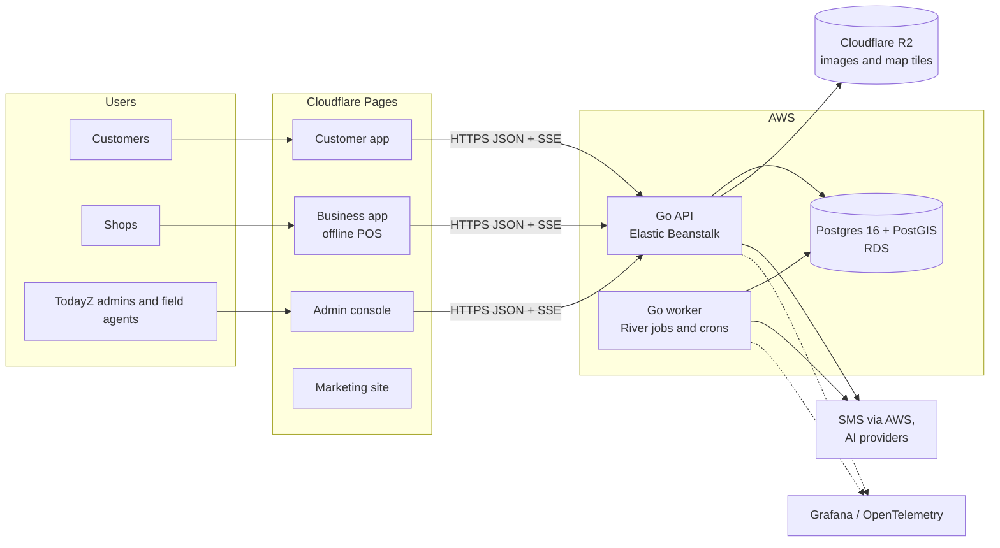

# TodayZ

TodayZ is hyperlocal retail for India. Neighbourhood shops put their stock online. Customers search what is in stock near them, book it, and either pick it up or have it delivered. Shops run their counter (POS, which works offline), stock, offers, cashback credits and customers from one business app.

> As built on main at d641cbe6 (27 Oct 2026). Update this file when an app, command, feature area or deploy step changes.

## The apps

| App | Who uses it | Prod | Local | Folder |
|---|---|---|---|---|
| Customer app (PWA) | Shoppers: search nearby, book, pick up or get delivery, orders, ask nearby shops | [app.todayz.in](https://app.todayz.in) | https://app.todayz.localhost | [customer/](customer/README.md) |
| Business app (PWA, offline POS) | Shop owners and staff: orders, POS, stock, offers, cashback, customers, statements, insights | [business.todayz.in](https://business.todayz.in) | https://business.todayz.localhost | [business/](business/README.md) |
| Admin console | The TodayZ team and field agents: stores, the daily shop check, risk, payouts, support, settings | [admin.todayz.in](https://admin.todayz.in) | https://admin.todayz.localhost | [admin/](admin/README.md) |
| Marketing site | Everyone, in English, Hindi, Kannada, Telugu and Tamil | [todayz.in](https://todayz.in) | https://todayz.localhost | [site/](site/README.md) |
| API and worker | All apps; the worker runs jobs, timers and crons | api.todayz.in | https://api.todayz.localhost | [backend/](backend/README.md) |

## How it fits together



The API contract is OpenAPI in [backend/api/](backend/api/README.md). `make gen` turns it into the Go server and the typed TypeScript client every app uses. More detail: [architecture](docs/guide/architecture.md) and [flows](docs/guide/flows.md).

## Stack

| Layer | Tech |
|---|---|
| Backend | Go: chi router, pgx and sqlc, River jobs, Server-Sent Events for realtime |
| Database | Postgres 16 with PostGIS for geo; Postgres full-text search |
| Frontends | React 19, Vite, TanStack Router, PWA with an offline store for the POS; Astro for the site |
| Shared | `@todayz/tokens`, `ui`, `api-client`, `auth`, `config`, `i18n`, `realtime` and `telemetry` in [shared/](shared/README.md) |
| Maps | Protomaps PMTiles with MapLibre |
| Infra | AWS (Beanstalk, RDS, Secrets Manager, End User Messaging SMS) and Cloudflare (Pages, DNS, R2 for images and map tiles), managed with Terraform in [infra/](infra/README.md) |
| Observability | OpenTelemetry to Grafana (Prometheus, Loki, Tempo), alerts with [runbooks](docs/runbooks/README.md) |
| Tests | Go unit and integration, vitest, Playwright journeys, contract, axe a11y, visual, Lighthouse, k6 load, ZAP/Trivy/checkov security: see [testing](docs/guide/testing.md) |

## Quick start (Mac)

```bash
make setup
```

```bash
make dev
```

```bash
make reset
```

- `make setup` installs the toolchains and dependencies. It also writes any missing local app keys to `.env.local`, printing names only.
- `make dev` starts Postgres/PostGIS, MinIO, Grafana, the mocks server, Caddy HTTPS and the apps.
- `make reset` recreates the database, runs migrations and loads the seed data.

Then open https://app.todayz.localhost. Local SMS goes to the mocks server, so no real messages are sent. Full setup, ports, seed users and fixes are in [local-dev.md](docs/guide/local-dev.md).

| Command | What it does |
|---|---|
| `make gen` | Bundle OpenAPI and generate the Go server, the TS client and sqlc. The output is never committed |
| `make check` | Everything that must pass before a merge: gen, lint, types, unit and integration tests, contract, builds, security static, terraform validate, AI evals, docs check |
| `make e2e` | Playwright journeys, full contract, visual, a11y and Lighthouse |
| `make load` / `make security` | k6 load tests / ZAP, Trivy, checkov and the abuse suite |
| `make stop` / `make logs` / `make env-check` | Stop the stack / tail its logs / list env vars as set or missing (never their values) |
| `make release-candidate` | All of the above on a clean reset, written to `docs/qa/rc-<date>/` |

## Repo map

| Folder | What |
|---|---|
| [backend/](backend/README.md) | Go API and worker, OpenAPI contract, migrations, SQL queries |
| [customer/](customer/README.md), [business/](business/README.md), [admin/](admin/README.md) | The three React PWAs |
| [site/](site/README.md) | Astro marketing site |
| [shared/](shared/README.md) | Packages every app uses |
| [infra/](infra/README.md) | Terraform for AWS and Cloudflare, Grafana dashboards and alerts, local stack config |
| [e2e/](e2e/README.md) | Cross-app Playwright journeys, contract, a11y, visual, load, security, mocks |
| [design/](design/README.md) | Copy of the design system and its generators |
| [docs/](docs/README.md) | Guides, features, plan, decisions, runbooks, ops, QA evidence |
| `mk/`, `scripts/` | Make steps (one file per area) and CI, deploy, hook and test scripts |

Each app folder builds and tests on its own, so each can become its own repo later. Folders depend only on `shared/` and `design/`. Every folder has a `README.md` (what it is, how to run it) and a `CLAUDE.md` (rules for changing it).

## Features

[docs/features/](docs/features/README.md) has one doc per area: what users can do, the rules, the code, the tests, and the status. Every product rule and number lives in [01-product-rules.md](docs/plan/01-product-rules.md). Configurable numbers come from the `platform_settings` table, never from code.

## Deploying

There is one environment, prod (D-210). **A push to `main` deploys it.** GitHub Actions publishes the four apps to Cloudflare Pages and the API and worker to Elastic Beanstalk. Only the lead pushes. Today the four apps are live on Cloudflare Pages; the AWS backend is ready but not yet applied. Details: [deployment.md](docs/guide/deployment.md).

## Contributing (people and AI agents)

Read [CLAUDE.md](CLAUDE.md) for the rules ([AGENTS.md](AGENTS.md) points other AI tools to the same rules). Then read [working-on-todayz.md](docs/guide/working-on-todayz.md). **Every change updates the docs it affects, in the same commit.** `make check` and the commit-msg hook enforce part of this.

Never print or commit secret values, OTPs, phone numbers or tokens. Refer to env vars by name and use `make env-check`.
