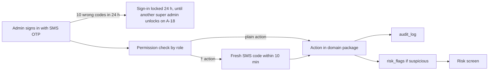

# Admin console

What TodayZ staff can see and do: pulse, reviews of shops, risk, settings, support tickets, jobs and system health.

> As built on main at d641cbe6 (27 Oct 2026). Update this file in the same change as the code it describes.

The console is at admin.todayz.in. It is English only (the console i18n is partial, see [languages-and-design](languages-and-design.md)).

## What users can do

Each screen is a route in [admin/src](../../admin/src/). Screens are gated by role (D-64): field_agent, support, catalogue, analyst, finance, admin, super_admin.

| Screen | Folder | What |
|---|---|---|
| Pulse (home) | [pulse](../../admin/src/pulse/) | Daily platform numbers |
| Shop checks (A-24) | [shop-checks](../../admin/src/shop-checks/) | The daily queue of live, unchecked shops, newest first: mark checked or reject with a reason (field_agent, admin, super_admin; D-274, [stores-and-onboarding](stores-and-onboarding.md)) |
| Businesses, stores | [businesses](../../admin/src/businesses/), [stores](../../admin/src/stores/) | Suspend, reinstate, force-close; the check pill on A-03; the pre-D-274 verify and store review stay for old rows ([stores-and-onboarding](stores-and-onboarding.md)) |
| Field agents, leads | [field](../../admin/src/field/) | Onboard shops for owners |
| Orders | [orders](../../admin/src/orders/) | Search and cancel ([orders-pickup-delivery](orders-pickup-delivery.md)) |
| Customers | [customers](../../admin/src/customers/) | Block, reset strikes, adjust credits |
| Risk | [risk](../../admin/src/risk/) | Open flags, take actions (D-225) |
| Credits, payouts | [credits](../../admin/src/credits/), [payouts](../../admin/src/payouts/) | See [credits-and-wallet](credits-and-wallet.md), [payouts-and-money](payouts-and-money.md) |
| Reviews, banners, referrals | [reviews](../../admin/src/reviews/), [banners](../../admin/src/banners/), [referrals](../../admin/src/referrals/) | Moderation |
| Catalogue | [catalogue](../../admin/src/catalogue/) | Pending products, categories, synonyms, images |
| Demand | [demand](../../admin/src/demand/) | Demand gaps, site marquee |
| Notifications | [notifications](../../admin/src/notifications/) | Read-only templates, test send |
| Support | [support](../../admin/src/support/) | Tickets with an SLA clock (D-226) |
| Settings | [settings](../../admin/src/settings/) | Edit `platform_settings` with history |
| Admin users, audit | [admin-users](../../admin/src/admin-users/), [audit](../../admin/src/audit/) | Staff accounts and roles, "Unlock sign-in" for a locked admin (D-264), audit trail |
| Jobs (A-21) | [jobs](../../admin/src/jobs/) | Run state of every background job (D-95) |
| System (A-22) | [system](../../admin/src/system/) | Health and AWS service readouts (D-97, D-227) |

Customers and shops reach support from their own apps: [customer/src/help](../../customer/src/help/) and [business/src/help](../../business/src/help/).

## Rules

Source: [01-product-rules.md](../plan/01-product-rules.md) sections 13 and 14.

- Every sensitive change writes an audit row, and KYC reveal is audited (D-41).
- Shop check (D-274): shops go live on submit with nobody approving first. field_agent, admin and super_admin work A-24 and mark a shop `checked` (audited `business.check`) or reject it with a reason (`business.check_reject`). A reject hides the shop at once and cancels its open online orders with `shop_rejected`: no customer strike, held credits back, each customer told. Until checked, the monthly close holds the shop's payout as `shop_unchecked` (A-11 shows the cause). The A-24 list and actions work at phone width for agents in the field.
- Support SLA keys: `support_sla_<priority>_min`, `support_open_tickets_max`, `support_tickets_per_hour`, `support_uploads_per_hour`, `support_upload_ttl_hours`.
- Risk rules and thresholds: D-225. Store strikes do not auto-pause (D-67). Keys include `store_strike_risk_threshold`.
- The permission matrix is D-38. Admin AI drafts apply by the screen's own permissions (D-233).
- Admins sign in with the phone OTP alone. A † action (payouts, credit adjustments and approvals, settings edits, admin users and roles, `money` jobs) needs a fresh SMS step-up within 10 minutes; the dialog is `admin/src/app/StepUpDialog.tsx` (D-264). Step-up codes have their own 10 an hour per admin (`admin_step_up_sends_per_hour`).
- Admin sign-in lock (D-264): 10 wrong sign-in codes for one number in 24 hours, across its codes, lock its admin sign-in for 24 hours (`admin_signin_max_failures`, `admin_signin_failure_window_hours`, `admin_signin_lock_hours`, in the A-17 "Access" group). The sign-in screen shows "Sign-in is locked for now". On A-18 a locked admin shows a "Locked until …" row and an "Unlock sign-in" button (super_admin, step-up, reason, audited `admin_user.unlock_sign_in`); nobody unlocks their own. A disabled admin can be unlocked (the list filtered to disabled shows the lock too); sign-in still refuses them. The "Access" group is super_admin only, like the money units: a plain admin sees it read-only with "Super admin only" (`superAdminOnly` on each setting). The break-glass CLI for when every super admin is locked out is in the deploy RUNBOOK §8.

## How it works

Every domain keeps its own admin handlers; `backend/internal/admin` holds the shared admin pieces (businesses, stores, users, settings, audit, catalogue, banners, leads, notifications, AI assist). `backend/internal/risk` raises flags (`risk_scan` job). `backend/internal/support` runs tickets with presigned uploads and a retention sweep.

## Code

| Part | Where |
|---|---|
| Backend | `backend/internal/admin` ([folder](../../backend/internal/admin/)), `backend/internal/risk` ([folder](../../backend/internal/risk/)), `backend/internal/support` ([folder](../../backend/internal/support/)); also `backend/internal/ops` (the System screen's cloud readouts) and `backend/internal/platform` (jobs framework, settings, authz) |
| API paths | `admin-*.yaml` in [backend/api/paths](../../backend/api/paths/), plus [support.yaml](../../backend/api/paths/support.yaml), [biz-support.yaml](../../backend/api/paths/biz-support.yaml) |
| Tables | `platform_settings`, `audit_log`, `risk_flags`, `admin_users`, `support_tickets`, `support_messages`, `support_attachments`, `job_runs`, `job_stats_hourly`, `job_controls` |
| Jobs | `risk_scan`, `support_uploads_sweep`, `jobs_watchdog`, `job_runs_retention`, `platform_heartbeat`, `platform_maintenance` |

## Tests

Package tests (`backend/cmd/todayz/shop_check_http_test.go`, `admin/src/shop-checks/shopChecks.test.tsx`); journeys `16-e2e-08-field-onboarding` (the agent checks the shop), `13-e2e-20-suspended`, `12-e2e-19-blocked`, `05-e2e-10-review-hide`. Reports: [W3-02](../qa/W3-02/REPORT.md), [W3-08](../qa/W3-08/REPORT.md), [W3-15](../qa/W3-15/REPORT.md), [W3-16](../qa/W3-16/REPORT.md), [admin-i18n](../qa/admin-i18n/). Runbooks: [risk-store-strikes](../runbooks/risk-store-strikes.md), [jobs-job-failing](../runbooks/jobs-job-failing.md).

## Status and known gaps

Live in code. Admin and its legal text are English only (B6). A sessions page for staff is not built.

## Decisions

D-38, D-41, D-47, D-64, D-95, D-97, D-106, D-224, D-225, D-226, D-227, D-233, D-240, D-244 (superseded by D-264), D-264, D-274.
