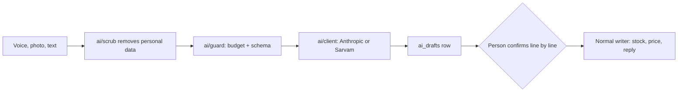

# AI features

Every place a language model is used, and the rule that keeps it safe: AI output is a draft a person confirms.

> As built on main at 2c2f23d6 (27 Oct 2026). Update this file in the same change as the code it describes.

## What users can do

| App | What |
|---|---|
| Customer app | Turn a pasted shopping list into items (list parse), search by voice, plain-language search help, substitutes. Folders: [list-parse](../../customer/src/list-parse/), [voice-search](../../customer/src/voice-search/), [search-assist](../../customer/src/search-assist/), [ai](../../customer/src/ai/). |
| Shop app | Voice stock update ("sold 2, restock 10"), supplier bill scan, shelf photo scan, review-reply draft, banner copy, retail assistant. Each gives drafts the shop confirms line by line (D-230). Folders: [ai-drafts](../../business/src/ai-drafts/), [voice](../../business/src/voice/), [restock-scan](../../business/src/restock-scan/). |
| Admin console | Catalogue cleanup, support ticket triage, risk summary, each applied per line through the screen's own writers and permissions (D-233). Folder: [admin/src/ai-assist](../../admin/src/ai-assist/). |
| Backend jobs | `coach_*` wording and `insight_texts` run on a separate AI budget (D-228); `voice_transcript_retention`. |

## Rules

Source: [01-product-rules.md](../plan/01-product-rules.md) sections 11.1, 12; [11-ai-features.md](../plan/11-ai-features.md).

- Nothing changes stock, money or orders from model output directly. Drafts live in `ai_drafts` (D-46) until confirmed.
- Cost cap per day per user and a global budget (D-70). Customer limit: `ai_daily_calls_customer`.
- Switches: `ai_querynorm_enabled`, `ai_voicesearch_enabled`, `refine_ai_min_words`. Per-feature enable flags come back from `me/ai/features`.
- Scans are checked and capped, and grounding knows units (D-230). Voice line kinds: sale, restock, count, set_price (D-65).
- Provider calls go through `*_API_URL` names, never SDK default URLs. Keys are never logged. In `make check` the provider keys are unset and calls are refused.
- Voice audio is not kept: the package stores the transcript only, with `voice_transcript_retention`.

## How it works

Model clients are in `ai/client` (anthropic, sarvam, metered, price). Prompts are versioned in `ai/prompts`. Evals live in `ai/eval` and `voice/voiceeval`. `make check` runs recorded evals only; `make ai-eval` uses live keys and is opt-in.

## Code

| Part | Where |
|---|---|
| Backend | `backend/internal/ai` ([folder](../../backend/internal/ai/)): subpackages `assist`, `bannercopy`, `billscan`, `catalogue`, `client`, `drafts`, `eval`, `guard`, `imagecheck`, `insighttext`, `listparse`, `prompts`, `querynorm`, `replydraft`, `retail`, `riskexplain`, `schema`, `scrub`, `shelfscan`, `triage`, `voicesearch`. `backend/internal/voice` ([folder](../../backend/internal/voice/)) handles the stock voice line. Also `backend/internal/imageimport`. |
| API paths | [ai.yaml](../../backend/api/paths/ai.yaml), [voice.yaml](../../backend/api/paths/voice.yaml) |
| Tables | `ai_drafts`, `ai_usage_daily`, `ai_text_misses`, `insight_texts`, `substitutes` |

## Tests

Recorded evals in `make check`, package tests, journeys `17-e2e-11-voice-update`, `18-e2e-13-list-parse`, `19-e2e-14-bill-scan`, `e2e/scenarios/AI.md`. Reports: [W3-04](../qa/W3-04/REPORT.md), [W3-11](../qa/W3-11/REPORT.md), [W3-12](../qa/W3-12/REPORT.md), [W3-13](../qa/W3-13/REPORT.md). Runbook: [ai-cost](../runbooks/ai-cost.md).

## Status and known gaps

Live in code, tested with recorded and mocked providers. Quality against live models and real Indic speech has not been verified on main.

## Decisions

D-46, D-65, D-70, D-82, D-101, D-228, D-229 (voice has no nav entry), D-230, D-231, D-233, D-234, D-235, D-238.
