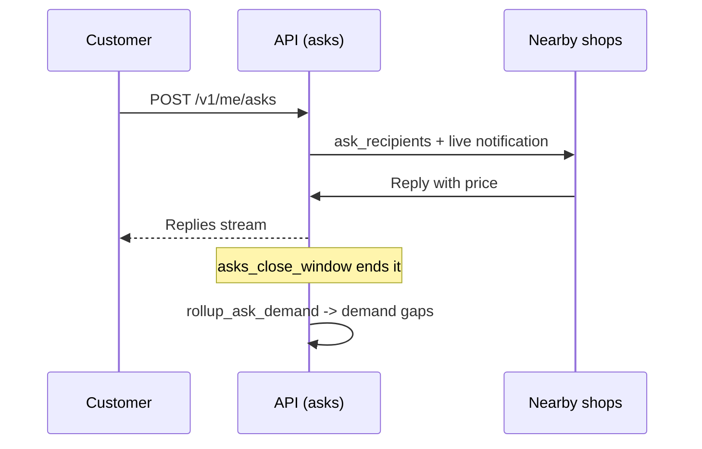

# Asks

How a customer asks nearby shops "do you have this?", how shops reply with a price, and how unmet asks become demand signals and share cards.

> As built on main at 2c2f23d6 (27 Oct 2026). Update this file in the same change as the code it describes.

## What users can do

| App | What |
|---|---|
| Customer app | Send an ask for an item to shops nearby, watch replies arrive, close the ask, share a card of a shop or find. Folders: [asks](../../customer/src/asks/), [share](../../customer/src/share/). Route `x/$code` opens a share card. |
| Shop app | See incoming asks, reply with price and stock, report abuse. Folder: [asks](../../business/src/asks/). |
| Admin console | See demand gaps (asks no shop could meet) and curate the site marquee. Folder: [demand](../../admin/src/demand/). |
| Site | The home page marquee shows popular unmet searches. See [marketing-site](marketing-site.md). |
| Backend jobs | `asks_close_window`, `asks_retention`, `rollup_ask_demand`, `site_marquee_build`, `share_card_render`. |

## Rules

Source: [01-product-rules.md](../plan/01-product-rules.md) sections 11.1 to 11.3.

- Limits: `ask_daily_limit_customer`, `ask_radius_m`, `ask_max_stores`, `ask_daily_limit_store`.
- Reply window `ask_reply_window_min`; a quoted price is valid for `ask_price_valid_min`. A shop may quote above MRP (D-245).
- A gap needs `ask_gap_min_customers` in `ask_gap_window_days`. Low-yield blocks use `ask_low_yield_*`. Ask data is kept for `ask_retention_days`.
- Marquee: `site_marquee_min_searchers`, `site_marquee_window_days`, `site_marquee_max_items`. Counts follow the k-anonymity floor (k at least 10, D-71).
- Share cards: `share_card_create_per_hour`.

## How it works

`asks_close_window` closes an ask when the reply window ends. Runbook: [asks-timers](../runbooks/asks-timers.md). Share cards render as images by `share_card_render` and are stored in object storage; public pages need no sign-in.

## Code

| Part | Where |
|---|---|
| Backend | `backend/internal/asks` ([folder](../../backend/internal/asks/)), `backend/internal/share` ([folder](../../backend/internal/share/)): `cards.go`, `render.go`, `marquee.go`, `gaps.go`, `preview.go` |
| API paths | [asks.yaml](../../backend/api/paths/asks.yaml), [share.yaml](../../backend/api/paths/share.yaml), [admin-demand.yaml](../../backend/api/paths/admin-demand.yaml) |
| Tables | `asks`, `ask_recipients`, `ask_store_blocks`, `share_cards`, `site_demand_marquee`, `rollup_daily_ask_demand`, `share_card_creates`, `share_card_opens` |

## Tests

Package tests, journey `22-e2e-21-asks`, `e2e/scenarios/ASK.md`. Reports: [W3-05](../qa/W3-05/REPORT.md), [W3-10](../qa/W3-10/REPORT.md).

## Status and known gaps

Live in code. Share card images in Indic scripts show the price without the name (no text shaper). The "ready soonest" badge is not shown on search results.

## Decisions

D-71, D-101, D-245.
