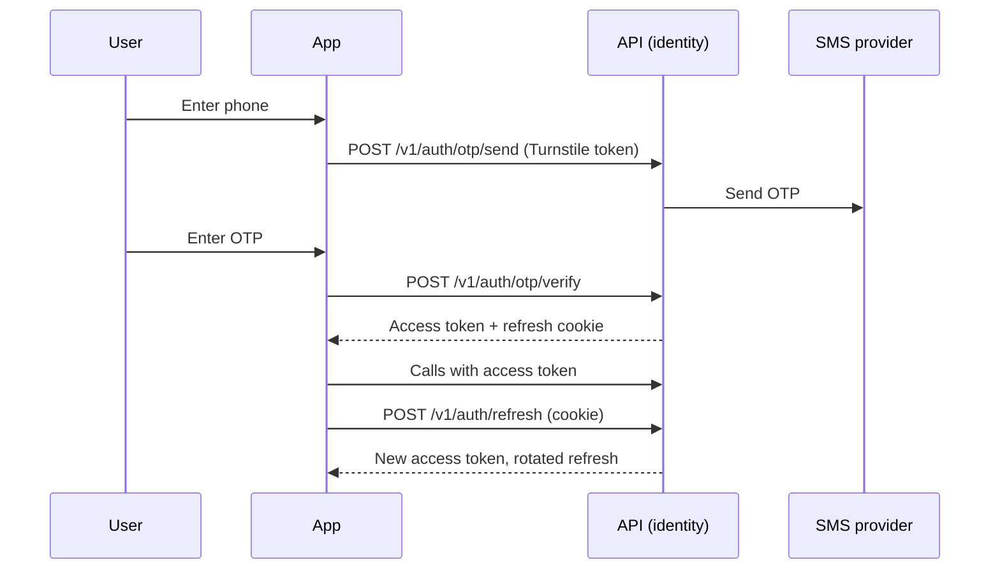

# Auth and accounts

How people sign in to TodayZ, what a session is, and what an account can do (profile, photo, addresses, deletion).

> As built on main at d8857496 (28 Oct 2026). Update this file in the same change as the code it describes.

## What users can do

| App | What |
|---|---|
| Customer app | Sign in with a phone number and a one-time password (OTP, a code sent by SMS). Who sends and checks the code is a deploy setting (D-275): TodayZ through AWS SMS, or Firebase Authentication in the page, with Google's invisible reCAPTCHA; the person sees the same screens. Pick a language. Edit the name and a profile photo. Save delivery addresses. Delete the account. Routes: [customer/src/app](../../customer/src/app/), [account](../../customer/src/account/), [address](../../customer/src/address/). |
| Shop app (business) | Same phone OTP sign-in (either provider). Choose which shop to work in after sign-in. Accept a staff invite. Routes: [business/src/app](../../business/src/app/), [shell](../../business/src/shell/). |
| Admin console | Phone OTP alone, like the other apps (D-264), through either provider; the step-up code always goes through AWS SMS. A † action (money, settings, admin users and roles, `money` jobs) asks for a step-up: "Send code" texts a fresh code to the admin's own number, and the right code counts for 10 minutes of that sign-in. After 10 wrong sign-in codes in 24 hours a number's admin sign-in is locked for 24 hours; another super admin can "Unlock sign-in" on A-18. Routes: [admin/src/admin-users](../../admin/src/admin-users/), [shell](../../admin/src/shell/). |
| Site | None. |
| Backend jobs | `identity_purge` removes expired OTP, session and deleted-account rows, used Firebase sign-ins past their expiry, admin sign-in failures older than 7 days and sign-in locks that have run out. |

## Rules

Source: [01-product-rules.md](../plan/01-product-rules.md) section 2 (accounts) and section 16 (privacy).

- OTP sign-in is guarded by Cloudflare Turnstile (a bot check), which fails closed (D-105), and by OTP send and verify limits kept in `platform_settings`.
- Who sends the sign-in code (D-275): `OTP_PROVIDER` is `sms` (the default: TodayZ's code through AWS SMS, as above) or `firebase`. With `firebase`, the page signs in to Firebase by phone (Firebase's reCAPTCHA instead of Turnstile, Firebase's own limits, Google's SMS text, no WebOTP) and swaps the Firebase ID token at `POST /v1/auth/firebase/verify`. The API checks the token against Google's keys (RS256, `aud` and `iss` for `FIREBASE_PROJECT_ID`, `exp`, `iat`, `sign_in_provider: phone`) and takes it only while the phone sign-in (`auth_time`) is at most 5 minutes old (`identity.FirebaseMaxAuthAge`, founder), once (`firebase_sign_ins` keeps an HMAC of the Firebase user and `auth_time`; a second swap is `401 otp_expired`). The session that follows is the normal TodayZ one. Switching provider: a half-done sign-in on the other path gets `409 sign_in_method_changed` and the screen starts again. `GET /v1/auth/config` tells the apps which path to use. Admin step-up stays on SMS. Setup and switching: [firebase-phone-auth runbook](../runbooks/firebase-phone-auth.md).
- With `firebase`, wrong codes go from the browser to Google, so the admin sign-in lock below counts none of them (an existing lock still refuses the swap). The founder accepted that (D-275).
- A session is a short-lived access token plus a rotating refresh token in an httpOnly cookie (D-14). A lost refresh response is replayed, not refused (D-239). Writes use `If-Match` (D-105, D-109).
- Admins sign in with the OTP alone; there is no authenticator and no recovery codes (D-264). A † admin action needs an SMS step-up younger than 10 minutes (`authn.StepUpWindow`, a fixed constant, D-92). Step-up codes have their own send limits: 30 s between step-up codes and `admin_step_up_sends_per_hour` (10) per admin an hour, apart from the sign-in caps, so a step-up straight after sign-in is never refused. The fifth wrong one ends the admin's admin-app sessions (`otp_locked`).
- Admin sign-in lock (D-264, founder: "Lock after 10 wrong"): wrong admin-app sign-in codes are counted per number across requests. The one that makes `admin_signin_max_failures` (10) inside `admin_signin_failure_window_hours` (24) locks that number's admin sign-in for `admin_signin_lock_hours` (24): sending and checking admin sign-in codes answer `429 signin_locked` with `Retry-After`, and the sign-in screen says so without a countdown. A right code clears the count. The count is kept for every number tried in the admin app, admin or not, so the lock reveals nothing about who is an admin; a customer or business sign-in never counts. Another super admin lifts it on A-18 ("Unlock sign-in", step-up, reason, audited `admin_user.unlock_sign_in`); a disabled admin can be unlocked too, which lets nobody in. If every super admin is locked out, the operator runs `todayz admin unlock-sign-in --phone-file FILE|--phone-env NAME --reason TEXT` on the ops task (deploy RUNBOOK §8): the number never goes on the command line or into a log, and the audit row has the system actor and `via: break_glass`. Only a super admin edits the four limits. If the limits cannot be read when a wrong code arrives, the code is still counted and its try spent, and the answer is 503. Anyone who knows an admin's number can lock them out for a day; the founder accepted that. SMS step-up does not protect against a SIM swap; the founder accepted that (D-264).
- Reserved test phone numbers and fixed OTPs work in local and test only (D-15). They never work in prod.
- Profile photo (D-259): the server re-encodes to a small JPEG with no EXIF, stores it privately, and shows it through a short-lived link. Limit key: `profile_photo_uploads_per_hour`.
- Saved addresses are capped by `customer_max_saved_addresses` (D-222).
- Account deletion is a soft delete with a purge later (D-31, D-106).

## How it works

Customer, shop and admin sign-in share one flow. The API issues the tokens. The browser keeps the access token in memory and the refresh token in the cookie. [shared/auth](../../shared/auth/) wraps this for all three apps.



Admins sign in the same way, with the sign-in lock above on top of the per-code limit. A † action that answers `403 step_up_required` opens the step-up dialog:

```mermaid
sequenceDiagram
    participant U as Admin
    participant A as Admin console
    participant API as API (identity)
    participant SMS as SMS provider
    A->>API: † action (e.g. mark payout paid)
    API-->>A: 403 step_up_required
    U->>A: Send code
    A->>API: POST /v1/auth/step-up/send (bearer, no body)
    API->>SMS: Code to the admin's own number
    API-->>A: requestId, resendAfter
    U->>A: Enter code
    A->>API: POST /v1/auth/step-up/verify {requestId, code}
    API-->>A: validUntil (sessions.step_up_at stamped; token unchanged)
    A->>API: Same † action again
```

With `OTP_PROVIDER=firebase` the sign-in part changes; everything from the TodayZ tokens on is the same:

```mermaid
sequenceDiagram
    participant U as User
    participant A as App
    participant FB as Firebase Auth (Google)
    participant API as API (identity)
    A->>API: GET /v1/auth/config
    API-->>A: otpProvider firebase + public web config
    U->>A: Enter phone
    A->>FB: signInWithPhoneNumber (invisible reCAPTCHA; SDK chunk loaded now)
    FB-->>U: SMS code (Google's sender)
    U->>A: Enter code
    A->>FB: confirm(code)
    FB-->>A: Firebase ID token
    A->>API: POST /v1/auth/firebase/verify {idToken, app, deviceId}
    API->>API: Check token (Google keys, project, phone, auth_time ≤ 5 min, used once)
    API-->>A: Access token + refresh cookie
```

The code always goes to the number on the admin's account. `POST /v1/auth/otp/send` refuses `purpose: step_up` with `app: admin` (422 `validation_failed`); the contract itself excludes the pair (D-264).

## Code

| Part | Where |
|---|---|
| Backend | `backend/internal/identity` ([folder](../../backend/internal/identity/)): `otp.go`, `firebase.go` (the Firebase ID-token swap, D-275), `session.go`, `stepup.go` (admin SMS step-up), `signin_limits.go` (admin sign-in lock, step-up quota, unlock), `photo.go`, `addresses.go`, `purge.go`. Authn and authz middleware sit in `backend/internal/platform` (`authn`, `authz`, `awssms`, `firebaseauth`: the ID-token verifier with Google's cached keys). |
| API paths | [auth.yaml](../../backend/api/paths/auth.yaml), [me.yaml](../../backend/api/paths/me.yaml), [admin-users.yaml](../../backend/api/paths/admin-users.yaml) |
| Tables | `users`, `phone_identities`, `otp_requests`, `firebase_sign_ins`, `admin_signin_failures`, `admin_signin_locks`, `devices`, `sessions`, `admin_users`, `customer_profiles`, `addresses`, `user_photo_uploads` ([migrations](../../backend/db/migrations/)) |
| Jobs | `identity_purge` ([backend/internal/jobs](../../backend/internal/jobs/)) |
| Frontend | [shared/auth](../../shared/auth/) (`phone-otp.tsx`; `firebase.ts` and the lazily loaded `firebase-sdk.ts` for D-275), [customer/src/account](../../customer/src/account/), [business/src/shell](../../business/src/shell/), [admin/src/admin-users](../../admin/src/admin-users/) |

## Tests

Go tests sit beside the code (`identity_test.go`, `refresh_replay_test.go`, `account_race_test.go`, `stepup_test.go`, `signin_limits_test.go`, `firebase_test.go`, `platform/firebaseauth/firebaseauth_test.go`). Frontend: `shared/auth/src/phone-otp.test.tsx` and `firebase.test.ts`. The Firebase stand-in in the mocks server has `e2e/mocks/internal/server/firebase_test.go`. HTTP-level tests live in `backend/cmd/todayz/*_http_test.go` (`admin_signin_lock_http_test.go` for the lock, the unlock and the cookie-free step-up routes; `identity_firebase_http_test.go` for the config route and the swap; `identity_firebase_live_test.go`, opt-in, for a real Firebase test project, [runbook](../runbooks/firebase-phone-auth.md) section 8). Journeys: `e2e/journeys/specs/` has `10-e2e-17-owner`, `11-e2e-18-cashier`, `12-e2e-19-blocked`, `13-e2e-20-suspended`. Reports: [W1-02](../qa/W1-02/REPORT.md), [firebase-otp](../qa/firebase-otp/REPORT.md), [auth-refresh-and-a09](../qa/auth-refresh-and-a09/), [D-259](../qa/D-259/).

## Status and known gaps

- Live in code: OTP sign-in (AWS SMS, or Firebase with `OTP_PROVIDER=firebase`), refresh rotation, admin SMS step-up, the admin sign-in lock and unlock, the step-up quota, photo, addresses, deletion.
- Firebase in prod: the `todayz-prod` project is set up (28 Oct 2026). It still needs the founder's Blaze billing and the lead's AWS apply ([runbook](../runbooks/firebase-phone-auth.md) sections 1 and 5). Until then prod stays on SMS. The verifier and the swap were checked against a real test project, `todayz-dev`, on 28 Oct 2026 ([report](../qa/firebase-otp/REPORT.md)).
- Left for a later release (D-264): dropping the unused admin `totp_*` columns, `sessions.totp_verified_at` and `admin_recovery_codes` (49501 already scrubbed them).
- Not built: a sessions page ("where am I signed in") and a "new sign-in" notice. Both are after launch ([go-live gaps](../qa/go-live-gaps/LIST.md)).
- Open: a signed device id for referral-farming defence, and key rotation, are listed in the same gap file.

## Decisions

- D-14 refresh cookies. D-15 OTP in local and test only.
- D-105 Turnstile fails closed, refresh grace, If-Match, session purge.
- D-106 account deletion and session locking (its admin two-step part is superseded by D-264).
- D-239 a lost refresh response is replayed.
- D-264 the admin authenticator is gone; † actions use an SMS step-up (supersedes D-244). Review answers: "Lock after 10 wrong" (the admin sign-in lock) and "Own quota of 10/hour" (step-up sends).
- D-222 saved address cap. D-259 profile photo.
- D-275 Firebase Authentication may send and check the sign-in code (`OTP_PROVIDER`); TodayZ keeps sessions, roles and users; 5-minute, single-use swap; admin step-up stays on SMS.
