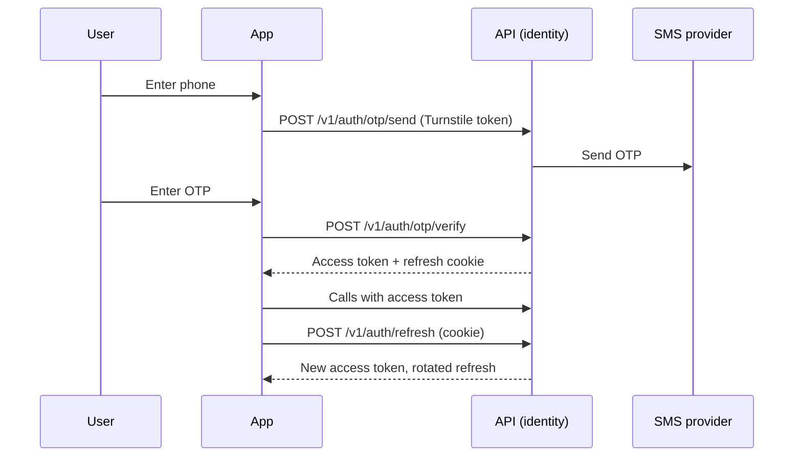

# Auth and accounts

How people sign in to TodayZ, what a session is, and what an account can do (profile, photo, addresses, deletion).

> As built on main at 2c2f23d6 (27 Oct 2026). Update this file in the same change as the code it describes.

## What users can do

| App | What |
|---|---|
| Customer app | Sign in with a phone number and a one-time password (OTP, a code sent by SMS). Pick a language. Edit the name and a profile photo. Save delivery addresses. Delete the account. Routes: [customer/src/app](../../customer/src/app/), [account](../../customer/src/account/), [address](../../customer/src/address/). |
| Shop app (business) | Same phone OTP sign-in. Choose which shop to work in after sign-in. Accept a staff invite. Routes: [business/src/app](../../business/src/app/), [shell](../../business/src/shell/). |
| Admin console | Phone OTP, then a second step with an authenticator app code (TOTP) or a recovery code. A local-only switch turns the second step off (D-244). Routes: [admin/src/admin-users](../../admin/src/admin-users/), [shell](../../admin/src/shell/). |
| Site | None. |
| Backend jobs | `identity_purge` removes expired OTP, session and deleted-account rows. |

## Rules

Source: [01-product-rules.md](../plan/01-product-rules.md) section 2 (accounts) and section 16 (privacy).

- OTP sign-in is guarded by Cloudflare Turnstile (a bot check), which fails closed (D-105), and by OTP send and verify limits kept in `platform_settings`.
- A session is a short-lived access token plus a rotating refresh token in an httpOnly cookie (D-14). A lost refresh response is replayed, not refused (D-239). Writes use `If-Match` (D-105, D-109).
- Admins also need a TOTP step and get recovery codes (D-106).
- Reserved test phone numbers and fixed OTPs work in local and test only (D-15). They never work in prod.
- Profile photo (D-259): the server re-encodes to a small JPEG with no EXIF, stores it privately, and shows it through a short-lived link. Limit key: `profile_photo_uploads_per_hour`.
- Saved addresses are capped by `customer_max_saved_addresses` (D-222).
- Account deletion is a soft delete with a purge later (D-31, D-106).

## How it works

Customer, shop and admin sign-in share one flow. The API issues the tokens. The browser keeps the access token in memory and the refresh token in the cookie. [shared/auth](../../shared/auth/) wraps this for all three apps.

Admins add `POST /v1/auth/totp/verify` (or `totp/recover`) before the session counts as admin.

## Code

| Part | Where |
|---|---|
| Backend | `backend/internal/identity` ([folder](../../backend/internal/identity/)): `otp.go`, `session.go`, `totp.go`, `photo.go`, `addresses.go`, `purge.go`. Authn and authz middleware sit in `backend/internal/platform` (`authn`, `authz`, `awssms`). |
| API paths | [auth.yaml](../../backend/api/paths/auth.yaml), [me.yaml](../../backend/api/paths/me.yaml), [admin-users.yaml](../../backend/api/paths/admin-users.yaml) |
| Tables | `users`, `phone_identities`, `otp_requests`, `devices`, `sessions`, `admin_users`, `admin_recovery_codes`, `customer_profiles`, `addresses`, `user_photo_uploads` ([migrations](../../backend/db/migrations/)) |
| Jobs | `identity_purge` ([backend/internal/jobs](../../backend/internal/jobs/)) |
| Frontend | [shared/auth](../../shared/auth/), [customer/src/account](../../customer/src/account/), [business/src/shell](../../business/src/shell/), [admin/src/admin-users](../../admin/src/admin-users/) |

## Tests

Go tests sit beside the code (`identity_test.go`, `refresh_replay_test.go`, `account_race_test.go`, `totp_test.go`). HTTP-level tests live in `backend/cmd/todayz/*_http_test.go`. Journeys: `e2e/journeys/specs/` has `10-e2e-17-owner`, `11-e2e-18-cashier`, `12-e2e-19-blocked`, `13-e2e-20-suspended`. Reports: [W1-02](../qa/W1-02/REPORT.md), [auth-refresh-and-a09](../qa/auth-refresh-and-a09/), [D-259](../qa/D-259/).

## Status and known gaps

- Live in code: OTP sign-in, refresh rotation, admin TOTP, photo, addresses, deletion.
- Not built: a sessions page ("where am I signed in") and a "new sign-in" notice. Both are after launch ([go-live gaps](../qa/go-live-gaps/LIST.md)).
- Open: a signed device id for referral-farming defence, and key rotation, are listed in the same gap file.

## Decisions

- D-14 refresh cookies. D-15 OTP in local and test only.
- D-105 Turnstile fails closed, refresh grace, If-Match, session purge.
- D-106 admin two-step, account deletion, session locking.
- D-239 a lost refresh response is replayed.
- D-244 local-only switch for the admin authenticator step.
- D-222 saved address cap. D-259 profile photo.
