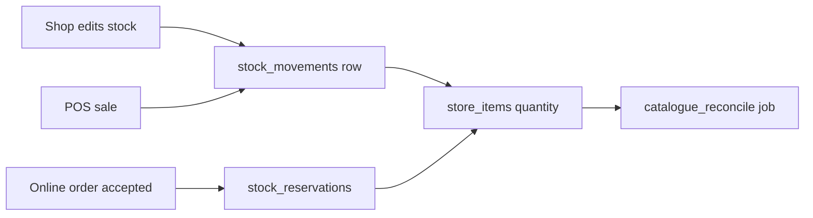

# Catalogue and stock

How products, shop prices and stock quantities are stored, changed and photographed.

> As built on main at a0402006 (27 Oct 2026). Update this file in the same change as the code it describes.

## What users can do

| App | What |
|---|---|
| Shop app | Add items from the master catalogue or create new ones, set price and stock, add stock with a reason, see movement history, scan a supplier bill or shelf photo (AI drafts), count stock, set batches with expiry. Folders: [stock](../../business/src/stock/), [restock-scan](../../business/src/restock-scan/), [onboarding](../../business/src/onboarding/) (shelf scan). |
| Admin console | Approve pending products, edit categories and synonyms, upload product images and type photos. Folder: [admin/src/catalogue](../../admin/src/catalogue/). |
| Customer app | See products and photos on shop pages. Folders: [product](../../customer/src/product/), [category](../../customer/src/category/). |
| Backend jobs | `catalogue_reconcile` rechecks stock totals. |

## Rules

Source: [01-product-rules.md](../plan/01-product-rules.md) section 4.

- Master catalogue (shared products) plus a store catalogue (the shop's own price and stock).
- Every stock change is a movement with a source: opening, restock, supplier_bill, import, count_correction, damage, expired, sale_pos, sale_online, pos_reversal (D-33).
- Batches carry expiry (D-99). Stale and low stock use `stock_stale_after_hours` and `low_stock_default`.
- A shop may sell at any price, above the MRP too (D-245).
- Online stock is reserved at accept, not at placing (D-01).

## How it works

Each movement writes in the same transaction as the quantity change. Allocation across batches is in `alloc.go`. Product photos have three sources in order: the shop's photo, an admin upload, a stock photo of that kind of item (D-252, D-253). An admin picks each kind's photo from Commons candidates in A-08 (`todayz images types` finds them). The founder's picks are saved in `backend/internal/imageimport/data/approved-type-photos.csv`; `todayz images types --picks builtin` applies them to a new or reset database, with the same steps as A-08 and the system as the audited actor. It leaves alone a kind that already has a photo and a file that was turned down (D-265).

## Code

| Part | Where |
|---|---|
| Backend | `backend/internal/catalogue` ([folder](../../backend/internal/catalogue/)): `items.go`, `movements.go`, `batches.go`, `alloc.go`, `price.go`, `photos.go`, `field.go`. Image import: `backend/internal/imageimport` ([folder](../../backend/internal/imageimport/)). |
| API paths | [catalogue.yaml](../../backend/api/paths/catalogue.yaml), [admin-catalogue.yaml](../../backend/api/paths/admin-catalogue.yaml), [discover.yaml](../../backend/api/paths/discover.yaml) (substitutes) |
| Tables | `categories`, `brands`, `products`, `store_items`, `stock_batches`, `stock_movements`, `stock_movement_batches`, `catalogue_changes`, `product_images`, `type_photos`, `substitutes` |
| Frontend | folders above |

## Tests

Package tests plus `backend/cmd/todayz/*_http_test.go`. Reports: [W1-03](../qa/W1-03/REPORT.md), [W1-05](../qa/W1-05/REPORT.md), [product-images](../qa/product-images/).

## Status and known gaps

Live in code. The AI scan flows are drafts only (see [ai-features](ai-features.md)). Stock photos for Indic names depend on the kind mapping. 20 of the founder's 176 picks could not be saved (the files left the search results) and wait in A-08.

## Decisions

D-01 stock math. D-33 stock sources. D-99 batches. D-245 any price. D-252, D-253 and D-265 product images. D-35 and D-79 foreign-key ordering.
