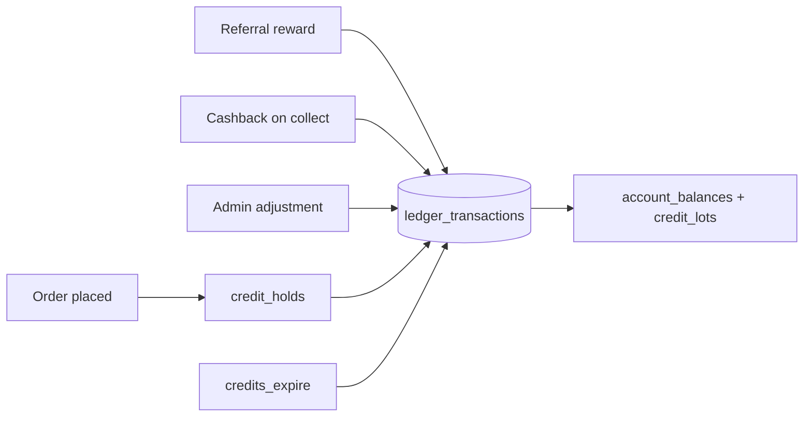

# Credits and wallet

How TodayZ credits work: a double-entry ledger of customer credits, cashback, caps, expiry and admin adjustments.

> As built on main at 2c2f23d6 (27 Oct 2026). Update this file in the same change as the code it describes.

Credits are loyalty value in a customer's wallet: 1 credit = ₹1, spent only on orders and never withdrawn. Customers earn them as store cashback, referral rewards or admin adjustments. Credits a customer spends go to the shop's credit account, which is paid out with the monthly statement ([payouts](payouts-and-money.md)). This is not udhaar (a shop letting a customer pay later): a "khata" POS payment method is listed as later in [01-product-rules.md](../plan/01-product-rules.md) §12.

## What users can do

| App | What |
|---|---|
| Customer app | Spend credits at checkout with `CreditsControl` in the cart ([cart](../../customer/src/cart/)). The wallet tab in the bottom nav is a placeholder card (SoonCard); no wallet screen is built. |
| Shop app | See the shop's credit account for its own stores (D-125). Folder: [credits](../../business/src/credits/). |
| Admin console | Look up a customer ledger, preview expiry, request and approve adjustments (two people above a threshold). Folder: [admin/src/credits](../../admin/src/credits/), [customers](../../admin/src/customers/). |
| Backend jobs | `credits_expire`, `credits_expiry_reminder`, `ledger_reconcile`. |

## Rules

Source: [01-product-rules.md](../plan/01-product-rules.md) section 7.

- Settings: `credit_max_per_order`, `credit_min_order_value_paise`, `credit_expiry_days`, `credit_expiry_reminder_days`, `credit_orders_per_month`, `store_credit_redemptions_per_day`, `pos_reversal_window_hours`.
- Adjustments above `admin_adjust_dual_approval_above_paise` need a second admin; the day total alerts above `admin_adjust_daily_total_alert_above_paise` (D-73, D-237).
- Cashback is a per-store `cashback_bp` and an order keeps the rate it was placed at (D-124).
- Credits are lots with expiry (D-27). An order's end always releases its credits (D-127).
- There are no earn caps (D-62). Over-cap credits are refused at placing (D-216).

## How it works

All money moves are ledger transactions with legs that balance to zero. Balances and lots change only through triggers (D-123). A hold locks credits for an open order and releases at the end (D-120, D-127).

The `ledger_reconcile` job checks balances against entries. Runbooks: [credits-ledger](../runbooks/credits-ledger.md), [ledger-invariant](../runbooks/ledger-invariant.md).

## Code

| Part | Where |
|---|---|
| Backend | `backend/internal/credits` ([folder](../../backend/internal/credits/)): `adjustments*.go`, `jobs.go`, `reads.go`, `reverse.go` |
| API paths | [wallet.yaml](../../backend/api/paths/wallet.yaml), [business-credits.yaml](../../backend/api/paths/business-credits.yaml), [admin-credits.yaml](../../backend/api/paths/admin-credits.yaml) |
| Tables | `ledger_accounts`, `ledger_transactions`, `account_balances`, `ledger_entries`, `credit_holds`, `credit_lots`, `credit_lot_consumptions`, `admin_adjustment_requests` |

## Tests

Package tests, journey `15-cr-15-adjustments`, `06-e2e-12-credit-cap`, `01-e2e-02-referral-credits`. Reports: [W2-01](../qa/W2-01/REPORT.md), [W2-13](../qa/W2-13/REPORT.md), [backend-risk-fixes](../qa/backend-risk-fixes/).

## Status and known gaps

- Live in the backend and admin. The customer wallet screen is not built; the API exists (`me/wallet`, transactions).
- A customer with no wallet yet can still be adjusted (D-240).

## Decisions

D-02, D-27, D-29, D-30, D-62, D-73, D-120 to D-127, D-216, D-237, D-240.
