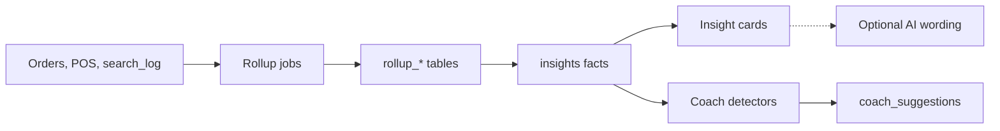

# Customers, CRM and insights

What a shop learns about its customers and sales: the overview, demand insights, analytics, and the daily coach.

> As built on main at 1488dbce (28 Oct 2026). Update this file in the same change as the code it describes.

CRM means customer relationship management, here a simple list of a shop's own customers and how they buy.

## What users can do

| App | What |
|---|---|
| Shop app | Overview of today, insight cards (selling fast, sitting on shelf and more), analytics, customer list, coach cards to mark done or dismiss. Until setup is done, a shop setup card (sidebar foot on desktop, under the KPIs on a phone) lists all five steps (KYC, 50 products, staff, QR standee, opening hours) with a tick or a link to where each is done; its × hides it for that store on that device (D-277). Folders: [overview](../../business/src/overview/), [insights](../../business/src/insights/), [analytics](../../business/src/analytics/), [customers](../../business/src/customers/), [coach](../../business/src/coach/). |
| Admin console | Platform pulse (daily numbers), demand view, customer list with block and strike reset. Folders: [pulse](../../admin/src/pulse/), [demand](../../admin/src/demand/), [customers](../../admin/src/customers/). |
| Backend jobs | `rollup_today`, `rollup_day`, `rollup_demand`, `rollup_cohorts`, `rollup_item_pairs`, `rollup_banners`, `coach_daily`, `coach_weekly`, `coach_realtime_rules`. |

## Rules

Source: [01-product-rules.md](../plan/01-product-rules.md) sections 12, 16.

- Insight kinds: selling_fast, sitting_on_shelf, going_to_waste, wanted_nearby, missed_sales, expired_on_shelf, selling_below_cost, stock_check_due, bought_together, regulars_slipping, priced_above_nearby. Tuning keys are `insight_*` and `insight_period_days` (D-99).
- Anything about other shops or areas needs at least k=10 sources and uses H3 cells (D-71, D-81).
- The coach never changes stock, money or orders. It suggests and a person acts (D-43, D-71).
- Insight wording can come from AI under its own budget and a negative cache (D-228); the numbers always come from rollups.

## How it works

Rollups pre-aggregate by day, store and cohort so the screens read small tables. Detectors in `coach/detectors` are plain rules. Runbook: [coach](../runbooks/coach.md).

## Code

| Part | Where |
|---|---|
| Backend | `backend/internal/insights` ([folder](../../backend/internal/insights/)): `analytics.go`, `customers.go`, `facts`. `backend/internal/coach` ([folder](../../backend/internal/coach/)): `detectors`, `feed.go`, `runs.go`. `backend/internal/rollups` ([folder](../../backend/internal/rollups/)). |
| API paths | [insights.yaml](../../backend/api/paths/insights.yaml), [coach.yaml](../../backend/api/paths/coach.yaml), [admin-pulse.yaml](../../backend/api/paths/admin-pulse.yaml), [admin-customers.yaml](../../backend/api/paths/admin-customers.yaml) |
| Tables | `rollup_daily_platform`, `rollup_daily_store`, `rollup_cohort_weekly`, `rollup_daily_search_demand`, `rollup_item_pairs`, `insight_feedback`, `insight_geo_cells`, `coach_suggestions`, `coach_weights`, `insight_texts`, `coach_checkpoints` |

## Tests

Package tests including `coach/coacheval` and detector scenarios. Reports: [W3-01](../qa/W3-01/REPORT.md), [W3-03](../qa/W3-03/REPORT.md), [W3-11](../qa/W3-11/REPORT.md).

## Status and known gaps

Live in code. Demand cards need enough local data to pass the k floor, so new areas show fewer insights.

## Decisions

D-43, D-45, D-48, D-59, D-71, D-81, D-99, D-228.
