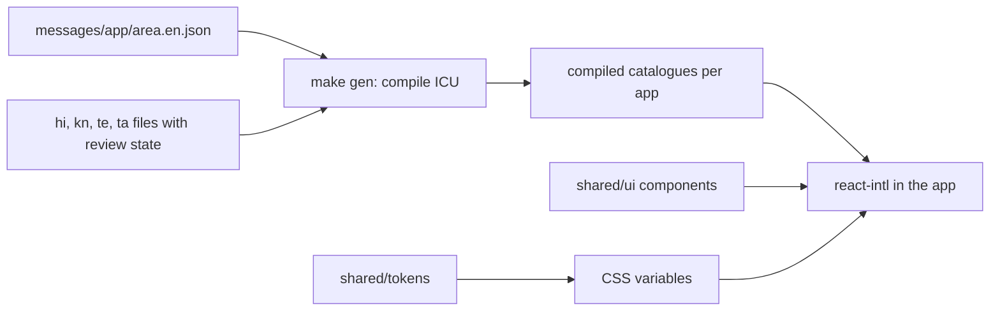

# Languages and design

The five languages, the shared design tokens and components, and the "bright" skin used by the customer and shop apps.

> As built on main at d641cbe6 (27 Oct 2026). Update this file in the same change as the code it describes.

## What users can do

| App | What |
|---|---|
| Customer app | Pick a language (route `language`), the choice is remembered. Folder: [shared/i18n](../../shared/i18n/), [customer/src/shell](../../customer/src/shell/). |
| Shop app | Same picker; screens translated ([business-i18n report](../qa/business-i18n/)). |
| Admin console | English with partial catalogue ([admin-i18n report](../qa/admin-i18n/)). |
| Site | Home and for-retailers in all five languages; other pages English only. See [marketing-site](marketing-site.md). |

## Rules

Source: [01-product-rules.md](../plan/01-product-rules.md); design source is the artifact named in the root [CLAUDE.md](../../CLAUDE.md).

- Languages: English (default and fallback), Hindi, Kannada, Telugu, Tamil. A pseudo-locale `en-XA` is for testing only.
- Messages are ICU MessageFormat, sentence case, no exclamation marks. Numbers use Latin digits in every language. Amounts and dates arrive pre-formatted.
- Machine drafts and stale translations never ship to prod. Only reviewed translations compile into the prod catalogue ([translation workflow](../../shared/i18n/docs/translation-workflow.md)).
- Light theme only: white page, mint wash, pastel tints, Lucide icons, Anek and Figtree fonts.
- The bright, Zomato-style look moved from a trial into the customer app as a skin (D-249) and into the shop app (D-261). The site follows the same look (D-262).
- Customer discovery screens use quick-commerce patterns on TodayZ tokens (D-269): pastel photo tiles, product tiles with a square photo on a tint, the price first and ADD on the photo's corner (it becomes the − n + stepper), sideways rails and a floating cart bar. Patterns only: no other app's images, icons or words. Photos are CC0 or public domain, each in a `SOURCES.md`.

## How it works

`shared/tokens` generates CSS variables, fonts and icons. `shared/ui` holds the components (StoreCard, ProductCard, BottomNav, PosCart, StatusPill and more). Design source and generators live in [design](../../design/).

## Code

| Part | Where |
|---|---|
| Shared | [shared/i18n](../../shared/i18n/), [shared/tokens](../../shared/tokens/), [shared/ui](../../shared/ui/) |
| Design | [design/source](../../design/source/), [design/generators](../../design/generators/), [design/trials](../../design/trials/) |
| Backend | None. Language is stored in the profile; templates are code-owned. |

## Tests

Pseudo-locale checks, the `check-i18n-messages` lint, visual baselines in [e2e/visual](../../e2e/visual/), accessibility checks in [e2e/a11y](../../e2e/a11y/). Journey `08-e2e-15-language`. Reports: [W4-04](../qa/W4-04/REPORT.md), [W4-05](../qa/W4-05/REPORT.md), [W4-05-hindi-customer](../qa/W4-05-hindi-customer/), [D-261](../qa/D-261/), [customer-redesign](../qa/customer-redesign/REPORT.md).

## Status and known gaps

- Hindi, Kannada, Telugu, Tamil copy awaits review by native speakers before it counts as reviewed.
- Admin and most site pages are English only.

## Decisions

D-58, D-87, D-103, D-247, D-248, D-249, D-250, D-260, D-261, D-262, D-269.

## Liquid Silver customer design (30 Oct 2026)

As built on base commit 7e831f7d; Liquid Silver change in this commit. The customer app now uses a light silver page, graphite actions and text, white product cards, and translucent search and floating navigation. The customer theme maps shared semantic tokens to opt-in `silver-*` palette tokens; other applications retain their palettes. Home has silver category wells, more section spacing and staggered entrance animation; product cards lift and images gently scale on hover. Buttons respond to presses and the cart bar animates into view. Motion is enabled only with `prefers-reduced-motion: no-preference`; navigation transitions are disabled for reduced motion. Glass surfaces have an opaque-enough fallback background when backdrop blur is unavailable. Product photography, translations and shopping flows use the existing implementation.

Palette values live in `design/source/tokens.json`; presentation lives in `customer/src/app/theme.css` and the Home, shell and product tile CSS modules. The token generator output stays untracked. The floating nav retains safe-area padding and the cart bar remains above it.
