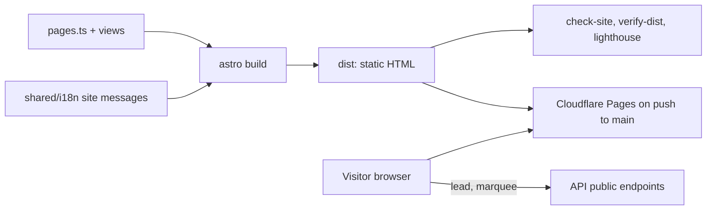

# Marketing site

The public site at todayz.in: pages, languages, lead form, the demand marquee and the performance gates.

> As built on main at 2c2f23d6 (27 Oct 2026). Update this file in the same change as the code it describes.

## What users can do

| App | What |
|---|---|
| Site visitor | Read the landing page, how it works, pricing, about, contact, legal pages. Switch language on the home and for-retailers pages. Send a lead (a shop asking to join). |
| Backend | The public lead form posts to `public/leads` ([admin-leads](../../backend/api/paths/admin-leads.yaml) lists them). The marquee reads `public/site-marquee` ([share.yaml](../../backend/api/paths/share.yaml)). |

## Pages

| Path | Page id | Languages |
|---|---|---|
| `/` | home | all five |
| `/for-retailers/` | retailers | all five |
| `/how-it-works/`, `/pricing/`, `/about/`, `/contact/` | how, pricing, about, contact | English |
| `/legal/privacy/`, `/legal/terms-for-shoppers/`, `/legal/terms-for-shops/`, `/legal/refunds-and-credits/` | privacy, terms-shoppers, terms-shops, refunds | English |

The page registry is [site/src/lib/pages.ts](../../site/src/lib/pages.ts). Views are in [site/src/views](../../site/src/views/) (Home, Retailers, Info, Legal, NotFound); components in [site/src/components](../../site/src/components/); styles in `site/src/styles/bright.css`. Pages render from `src/pages/[...slug].astro`, plus `robots.txt` and `sitemap.xml` endpoints.

## Rules

- Astro builds static pages. Draft locales are dropped from the prod build (`drop-draft-locales`, D-102).
- The landing follows the founder's bright trial on every page (D-262). Shop types have round photos (D-260).
- Lighthouse gates are in `lighthouserc.json` (D-102). The `/kn/` pages have a recorded exception (D-262, see commit history).
- The marquee shows searches from at least k=10 people in a window (`site_marquee_min_searchers`, `site_marquee_window_days`, `site_marquee_max_items`).

## How it works

## Code

| Part | Where |
|---|---|
| Frontend | [site](../../site/) with scripts in [site/scripts](../../site/scripts/) (check-site, verify-dist, lighthouse, og, headers) |
| Backend | `backend/internal/share` ([folder](../../backend/internal/share/)) builds the marquee (`site_marquee_build`); `backend/internal/business` stores leads |
| Deploy | Cloudflare Pages from GitHub Actions on push to main (D-214); see the lead's deploy docs |

## Tests

Unit tests in `site/src/lib/*.test.ts`, Playwright in [site/e2e](../../site/e2e/), the check-site and Lighthouse scripts. Reports: [landing-v2](../qa/landing-v2/), [W4-04](../qa/W4-04/REPORT.md).

## Status and known gaps

Live in code. Legal pages are English only (B6). The Kannada phone Lighthouse score was merged as is on the founder's word.

## Decisions

D-102, D-103, D-214, D-247, D-248, D-260, D-262.
