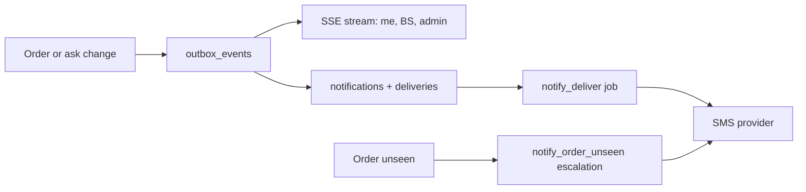

# Notifications

How the platform tells people things: the outbox, the inbox API, live streams and SMS.

> As built on main at 2c2f23d6 (27 Oct 2026). Update this file in the same change as the code it describes.

## What users can do

| App | What |
|---|---|
| Customer app | Gets order updates live through a stream (SSE, a one-way push over HTTP) and by SMS when set. No inbox screen is built. |
| Shop app | Gets new-order alerts live. If an order sits unseen, an SMS follows after `order_unseen_sms_after_min`. No inbox screen (B-16) is built; web push was deferred. |
| Admin console | Read the templates (A-16 is read-only, D-224), send a test message, and see integration status. Folder: [admin/src/notifications](../../admin/src/notifications/). |
| Backend jobs | `notify_deliver`, `notify_order_unseen`, `credits_expiry_reminder`, `realtime_outbox_cleanup`. |

## Rules

Source: [01-product-rules.md](../plan/01-product-rules.md) section 15.

- Channels in the plan: inbox, push, SMS, WhatsApp. Each has a switch `notify_<channel>_enabled`.
- Reminder timing keys: `order_unseen_sms_after_min`, `pickup_hold_reminder_min`.
- SMS goes through AWS End User Messaging with India's DLT registration (D-212, D-213). DLT is the telecom regulator's template registry. Templates are code-owned until re-registration has a process (D-224).
- User preferences are stored in `notification_prefs`.

## How it works

State changes write an `outbox_events` row in the same transaction. A realtime fan-out streams it to open apps. The `notify` package builds a notification and `notify_deliver` sends it on enabled channels.

Runbooks: [realtime-sse-down](../runbooks/realtime-sse-down.md), [realtime-order-alerts-slow](../runbooks/realtime-order-alerts-slow.md), [auth-sms-failures](../runbooks/auth-sms-failures.md).

## Code

| Part | Where |
|---|---|
| Backend | `backend/internal/notify` ([folder](../../backend/internal/notify/)): `catalogue.go`, `templates.go`, `deliver.go`, `escalate.go`, `provider.go`, `status.go`. Streams: `backend/internal/platform/realtime`; SMS: `backend/internal/platform/awssms`. Client side: [shared/realtime](../../shared/realtime/). |
| API paths | [notifications.yaml](../../backend/api/paths/notifications.yaml), [admin-notifications.yaml](../../backend/api/paths/admin-notifications.yaml), [realtime.yaml](../../backend/api/paths/realtime.yaml) |
| Tables | `outbox_events`, `outbox_watermark`, `notifications`, `notification_deliveries`, `notification_prefs`, `notify_order_escalations` |

## Tests

Package tests (`catalogue_test.go` and others), `cmd/todayz/*_http_test.go`. Reports: [W2-05](../qa/W2-05/REPORT.md), [W2-12](../qa/W2-12/REPORT.md).

## Status and known gaps

- Built: inbox API rows, SSE streams, SMS.
- Not built: web push (VAPID keys), WhatsApp sending (needs a sender number from the founder), and the customer and shop inbox screens.
- Waiting on the founder: DLT ids and registered templates ([go-live gaps](../qa/go-live-gaps/LIST.md)).

## Decisions

D-212, D-213, D-224, D-167 (referral notices), D-218 (return reminders).
