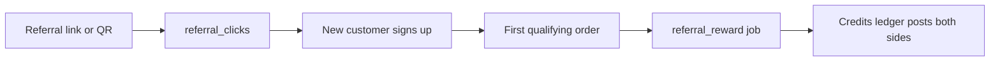

# Offers, banners and referrals

How shops promote themselves (offers, banners) and how new customers and shops are rewarded (referrals).

> As built on main at 2c2f23d6 (27 Oct 2026). Update this file in the same change as the code it describes.

## What users can do

| App | What |
|---|---|
| Shop app | Create offers with a preview of the price effect. Upload banners. Claim a referral for the shop (owner only). Folders: [offers](../../business/src/offers/). |
| Customer app | See nearby offers, tap banners. Referral and share links land on `/s/{slug}`. No referral screen is built in the customer app. Folders: [home](../../customer/src/home/), [store](../../customer/src/store/). |
| Admin console | Approve or take down banners, list or reject referrals. Folders: [banners](../../admin/src/banners/), [referrals](../../admin/src/referrals/). |
| Backend jobs | `offers_tidy`, `banners_tidy`, `rollup_banners`, `referral_reward`, `referral_sweep`. |

## Rules

Source: [01-product-rules.md](../plan/01-product-rules.md) sections 8 and 12.

- Offer kinds, rounding, caps and what is immutable: D-150. Redemption is counted inside the order transaction (D-151).
- Banners are held until approved. The cap is `store_banners_max` (D-152). Taps are attributed (D-77).
- Referral kinds: retailer_customer, customer_customer, any_shop. Keys: `ref_<kind>_referrer_credits`, `ref_<kind>_referee_credits`, `ref_qualifying_min_order_paise`, `ref_shop_qualifying_orders`, `ref_attribution_window_days`.
- A new shop qualifies on distinct customers (D-168). Same-device referrals do not count (D-13). Self-likes are held before the reward (D-237).
- Rewards post to the credits ledger, per side and idempotently (D-161, D-169).

## How it works

Offers apply in checkout quote and are recorded in `offer_redemptions`. Banners show on the customer home and count taps in `banner_taps` and `banner_daily`.

## Code

| Part | Where |
|---|---|
| Backend | `backend/internal/offers` ([folder](../../backend/internal/offers/)), `backend/internal/banners` ([folder](../../backend/internal/banners/)), `backend/internal/referrals` ([folder](../../backend/internal/referrals/)) |
| API paths | [offers.yaml](../../backend/api/paths/offers.yaml), [banners.yaml](../../backend/api/paths/banners.yaml), [admin-banners.yaml](../../backend/api/paths/admin-banners.yaml), [referrals.yaml](../../backend/api/paths/referrals.yaml), [admin-referrals.yaml](../../backend/api/paths/admin-referrals.yaml) |
| Tables | `offers`, `offer_redemptions`, `store_banners`, `banner_daily`, `banner_taps`, `referral_clicks`, `referrals`, `referral_shop_sales` |

## Tests

Package tests, journey `01-e2e-02-referral-credits`. Reports: [W2-03](../qa/W2-03/REPORT.md), [W2-07](../qa/W2-07/REPORT.md).

## Status and known gaps

Live in the backend. The customer app has no refer screen. A signed device id against referral farming is still open ([go-live gaps](../qa/go-live-gaps/LIST.md)).

## Decisions

D-13, D-26, D-32, D-77, D-150 to D-155, D-160 to D-169, D-72, D-237.
