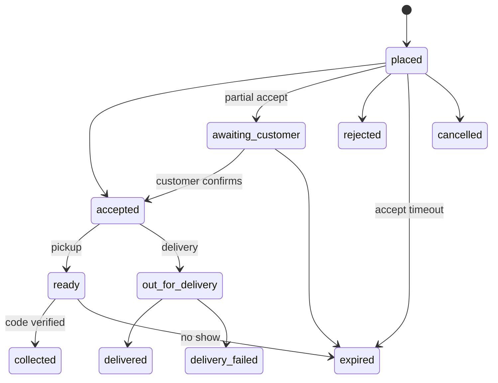

# Orders, pickup and delivery

How a customer books items, how the shop accepts and hands over, and what the timers do.

> As built on main at 3d54bd71 (28 Oct 2026). Update this file in the same change as the code it describes.

## What users can do

| App | What |
|---|---|
| Customer app | Build a cart (each line shows the item's photo, or its initials when there is none; D-272), see a quote (items, credits, delivery), place an order for pickup or delivery, confirm or reject a partial accept, extend the hold, get a new pickup code, cancel, track status live. Folders: [cart](../../customer/src/cart/), [checkout](../../customer/src/checkout/), [orders](../../customer/src/orders/). |
| Shop app | See incoming orders (sound and live stream), accept (fully or partly), reject, mark ready, verify the pickup code, dispatch delivery, mark delivery failed, confirm a return. The Counter sales tab next to Online orders lists the shop's POS sales ([pos-and-offline](pos-and-offline.md#counter-sales-d-268), D-268). Folder: [orders](../../business/src/orders/). |
| Admin console | Search orders, cancel with a reason. Folder: [admin/src/orders](../../admin/src/orders/). |
| Backend jobs | Order timers (below). |

## Rules

Source: [01-product-rules.md](../plan/01-product-rules.md) sections 5 and 6.

- Timers are settings: `order_accept_timeout_min`, `pickup_hold_min`, `pickup_extension_min`, `partial_confirm_timeout_min`, `delivery_dispatch_timeout_min`.
- Stock reserves at accept (D-01); on hand drops only at hand-over. Every hold and release records a catalogue change per item, so the shop's counter shows the blocked units (D-280). A partial accept waits for the customer (D-28, D-68).
- No-show applies to pickup only (D-21). Strikes use `noshow_strikes`, `noshow_window_days`, `noshow_limit_days`; stores use `store_strike_risk_threshold` (D-67).
- Delivery has a kill switch, `feature_delivery_enabled`. Thresholds are inclusive (D-94). Quote and place share one hours check (D-219).
- A failed delivery sends reminders (`delivery_return_first_reminder_hours`, `delivery_return_second_reminder_hours`, D-218). After a fixed 72 hours the return is auto-confirmed.
- The pickup code is 4 digits with 5 tries. It is stored sealed (D-04).
- A customer with an active order sees the shop phone (D-220).
- Credits are refused at placing if over the cap with `409 credit_max_exceeded`; the quote only informs (D-216).

## How it works

Every transition is a function in `machine.go` and writes an `order_events` row. Each timer is a job that re-checks the state when it fires (so a late job is harmless), and `order_timer_reconcile` repairs missing timers. Runbook: [orders-timers](../runbooks/orders-timers.md).

Timer jobs: `order_accept_timeout`, `order_pickup_no_show`, `order_partial_timeout`, `order_dispatch_timeout`, `order_delivery_return`, `order_timer_reconcile`, `customer_strikes_recount`.

## Code

| Part | Where |
|---|---|
| Backend | `backend/internal/orders` ([folder](../../backend/internal/orders/)): `create.go`, `quote.go`, `machine.go`, `partial.go`, `delivery.go`, `code.go`, `admin.go`, `crossdomain.go`. Risk strikes: `backend/internal/risk` ([folder](../../backend/internal/risk/)). |
| API paths | [orders.yaml](../../backend/api/paths/orders.yaml), [admin-orders.yaml](../../backend/api/paths/admin-orders.yaml), [realtime.yaml](../../backend/api/paths/realtime.yaml) |
| Tables | `orders`, `order_items`, `order_events`, `stock_reservations`, `strikes`, `order_code_lockouts`, `outbox_events` |
| Frontend | folders above |

## Tests

Package tests, `cmd/todayz/*_http_test.go`, journeys `02-e2e-03-partial`, `14-e2e-05-delivery`, `20-e2e-04-no-show`, `06-e2e-12-credit-cap`. Reports: [W2-02](../qa/W2-02/REPORT.md), [W2-02-delivery](../qa/W2-02-delivery/), [W2-15-customer-delivery](../qa/W2-15-customer-delivery/), [W2-13](../qa/W2-13/REPORT.md).

## Status and known gaps

Live in code. No courier integration exists in the code; the shop dispatches and marks delivery itself.

## Decisions

D-01, D-04, D-21, D-22, D-28, D-67, D-68, D-69, D-94, D-108 (cancel races, deadlines), D-216, D-218, D-219, D-220, D-222, D-268 (the Counter sales tab), D-272 (line photos in cart, checkout and order; full-width Pickup / Delivery switch), D-280 (held stock reaches the counter).
