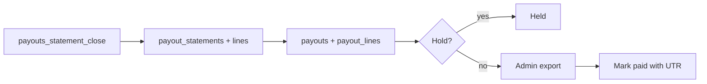

# Payouts and money

How shops are paid: monthly statements, payout holds, exports, and what "mark paid" means.

> As built on main at 2c2f23d6 (27 Oct 2026). Update this file in the same change as the code it describes.

## What users can do

| App | What |
|---|---|
| Shop app | See statements and payout status. Folder: [statements](../../business/src/statements/). |
| Admin console | List statements and payouts, hold or unhold a payout, export payout files, mark a payout paid by recording a bank reference (UTR). Folder: [admin/src/payouts](../../admin/src/payouts/). |
| Backend jobs | `payouts_statement_close` closes statements. |

## Rules

Source: [01-product-rules.md](../plan/01-product-rules.md) section 9.

- A statement closes on the 1st at 00:30 IST.
- Payout holds: kyc_incomplete, risk_flag, business_suspended (D-225).
- Payout amount is defined in D-09. The export format is D-85.
- "Mark paid" only records a UTR. TodayZ makes no bank call; a person pays outside the system.

## How it works

Runbook: [payouts](../runbooks/payouts.md).

## Code

| Part | Where |
|---|---|
| Backend | `backend/internal/payouts` ([folder](../../backend/internal/payouts/)) |
| API paths | [admin-payouts.yaml](../../backend/api/paths/admin-payouts.yaml) (statements, payouts, exports, shop `B/statements`) |
| Tables | `payouts`, `payout_lines`, `payout_statements`, `payout_statement_lines` |

## Tests

Package tests, journey `30-e2e-09-statement-payout`. Reports: [W3-07](../qa/W3-07/REPORT.md).

## Status and known gaps

Live in code. No bank or payment-gateway integration.

## Decisions

D-09, D-85, D-93, D-225.
