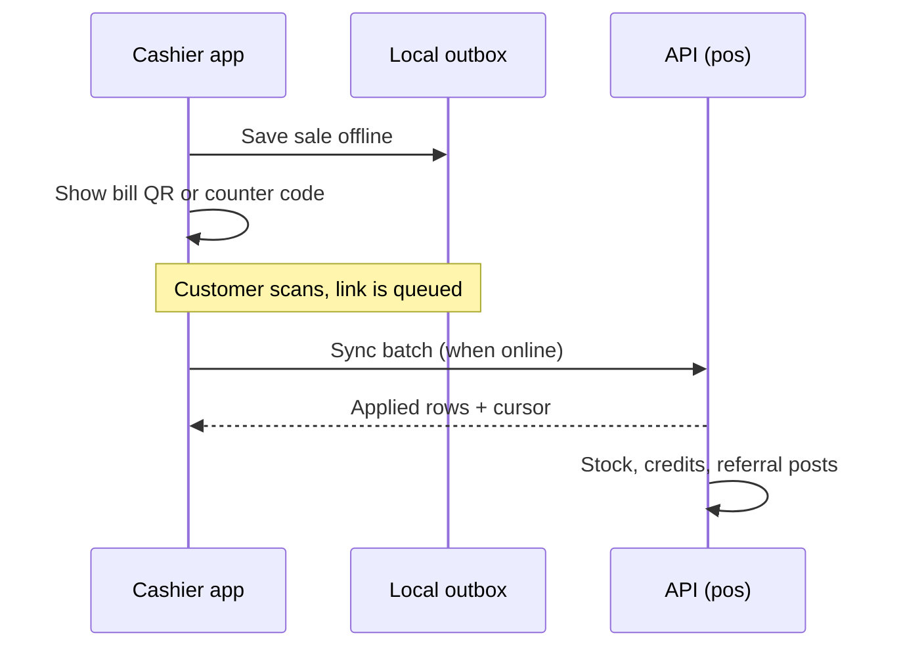

# POS and offline

How a shop runs its counter: sells in the shop app, keeps working without internet, and links a sale to a customer by QR or code.

> As built on main at d641cbe6 (27 Oct 2026). Update this file in the same change as the code it describes.

POS means point of sale, the counter screen where a cashier rings up a sale.

## What users can do

| App | What |
|---|---|
| Shop app | Scan or search items, ring up a sale (cash, UPI, credits), print or share a receipt, reverse a sale, work offline. Orders → Counter sales lists every device's sales with stats, filters, a bill panel (why an offline link failed, the reversal) and a CSV export (D-268). A bill never holds more of an item than is available: asking for more opens Update stock, a quick count from the counter (D-270). Folders: [pos](../../business/src/pos/), [sync](../../business/src/sync/), [scanner](../../business/src/scanner/), [receipt](../../business/src/receipt/). |
| Customer app | Scan the bill QR to link a purchase, show a counter code, open a receipt, see purchases. Folders: [scan](../../customer/src/scan/), [receipt](../../customer/src/receipt/). |
| Backend jobs | `pos_bill_claim_expiry`. |

## Rules

Source: [01-product-rules.md](../plan/01-product-rules.md) sections 6 and 12.

- Bill QR lasts 120 seconds and is signed (HMAC). The counter code is a TOTP (time-based code) that works offline and changes every 60 seconds (D-12).
- Offline links last up to `pos_offline_link_max_hours`; many per day raise a risk flag (`pos_offline_links_risk_per_day`). Code lockouts: `risk_code_lockouts_store_per_day`.
- A reversal is allowed for `pos_reversal_window_hours` and claws back credits (D-74).
- A sale with an odd `sold_at` is kept and flagged, never refused (D-243).
- No item goes below zero at the counter (D-270): a line stops at available (on hand − units blocked for accepted online orders); an online sale above it is `409 insufficient_stock`; damage and expiry stop at on hand. Only an offline race between devices can still take on hand below 0, and then the item reads 0 with "Count needed".
- Cashiers have limited powers (D-06, D-176). POS sales use the real credits ledger and referrals (D-132).
- Receipts live at `/r/{token}` and need no sign-in.

## How it works

The shop app keeps an outbox in IndexedDB (browser storage; D-170). Each sale gets a client id. On reconnect it sends batches to `/v1/biz/stores/{id}/sync`. The server applies them in order, returns a cursor, and is idempotent (D-36, D-171).

Money units on the counter are paise (D-172). Settings are never assumed on the client (D-174).

### Stock at the counter (D-270)

- **The cap.** `cart.ts` never raises a line past the item's available; lowering always works. Adding past it, typing a larger quantity, the + button or the keyboard opens `UpdateStockDialog` for that item instead, and the bill stays as it was until the count is saved. Before charging, `firstShortLine` checks the bill against the live catalogue (a sync or an online order may have lowered it) and asks the same way.
- **Update stock.** On hand, blocked for online orders and available; "Counted now"; the box "This count includes the N units set aside for online orders" only when N > 0 (unticked: on hand = count + blocked; ticked: on hand = count); a preview of the result. Save records a `count_correction` in the outbox (any role, offline too) and fits the line to the new available. Cancel writes nothing.
- **Device stock.** Each sale and count is applied to the stored catalogue at once (`engine.recordSale`, `recordMovement`), so offline bills see it; a refused sale gives its units back; the change feed overwrites with the server's numbers when nothing is pending.
- **Online refusal.** `createPosSale` above available answers `409 insufficient_stock` with `storeItemId` and `available` and writes nothing. The money was already taken, so the device keeps that sale pending for sync (which never refuses for stock), adopts the server's number less its own pending sales, and opens Update stock ("This sale went through…"). A bill QR sale, which needs the server, is refused.
- **The race.** Two devices that sold the last unit offline both keep their sale; on hand ends below 0 on the server, and every read (items, sync changes) shows 0 with `countNeeded`. The tile says "Count needed" until a count.
- **Tiles and search results** show "N blocked for online orders" when N > 0.

### Counter sales (D-268)

Orders has two tabs, Online orders and Counter sales (`/orders?view=sales`). The Sell screen's "View sales" link opens Counter sales; the device's own outbox stays in the Sell screen's sales sheet and shows on Counter sales as "Not synced yet".

- **Range and filters.** Today, Yesterday, Last 7 days, Last 30 days or two IST dates; payment, status, link, rung up offline, cashier. All live in the URL, and the list, the stats and the export take the same filters (`GET {S}/pos/sales`, 20 a page on a cursor).
- **Stats** (owner and manager, `GET {S}/pos/sales-summary`): sales and bills (completed only), average bill, reversed apart, the split by payment, credits used and cashback given. A cashier sees the list only: no stats, no cashier filter, no export.
- **Bill panel** (`GET {S}/pos/sales/{saleId}`, a side panel on desktop and a sheet on phones, `?sale=` in the URL): lines, discounts, payment, credits and cashback, cashier, device, sold and received times, the offline flag, the link with why it failed, and the reversal (reason, who, when). Copy bill id. The receipt opens only on the device that holds its token; the server never returns it.
- **Reverse:** owner or manager, inside `pos_reversal_window_hours` from when the sale reached the server, with a reason. It calls `POST {S}/pos/sales/{saleId}/reverse` with the fixed key `reverse-<saleId>`, so a retry is the same reversal.
- **Export CSV** (`GET {S}/pos/sales-export`, owner and manager): every matching sale, IST times, formula-safe cells (D-93), no phone, code or receipt token.

## Code

| Part | Where |
|---|---|
| Backend | `backend/internal/pos` ([folder](../../backend/internal/pos/)): `sale.go`, `sync.go`, `claims.go`, `totp.go`, `receipts.go`, `history.go`, `seams.go` |
| API paths | [pos.yaml](../../backend/api/paths/pos.yaml) (sales list, summary, export, one sale, reverse), [sync.yaml](../../backend/api/paths/sync.yaml), [receipts.yaml](../../backend/api/paths/receipts.yaml) |
| Tables | `pos_sales`, `pos_sale_lines`, `bill_claims`, `counter_code_checks`, `counter_code_failures`, `counter_code_uses`, `receipt_tokens`, `sync_cursors`, `sync_entries` |
| Frontend | folders above; offline store is raw IndexedDB behind a `PosStorage` interface. Stock cap: `business/src/pos/cart.ts`, `catalogue.ts` (`sellableUnits`, `blockedUnits`, `countedOnHand`), `UpdateStockDialog.tsx`, `Counter.tsx`, `business/src/sync/engine.ts`. Counter sales: `business/src/orders/CounterSales.tsx`, `SaleDetail.tsx`, `salesQueries.ts` |

## Tests

Package tests, journeys `03-e2e-06-bill-qr`, `09-e2e-16-offline`, `21-e2e-07-offline-code`, `11-e2e-18-cashier`. Reports: [W2-04](../qa/W2-04/REPORT.md), [W2-11](../qa/W2-11/REPORT.md), [W2-16](../qa/W2-16-pos-sales-list/), [D-268 Counter sales](../qa/D-268-counter-sales/REPORT.md), [D-270 stock cap](../qa/D-270-pos-stock-cap/REPORT.md). Stock cap: `cmd/todayz/pos_stock_cap_http_test.go` (online 409, offline race reads 0, damage capped), `business/src/pos/cart.test.ts`, `Counter.test.tsx`, `business/src/sync/engine.test.ts`, `e2e/sell.spec.ts`. Counter sales: `backend/internal/pos` history tests, `cmd/todayz/pos_counter_sales_http_test.go`, `business/src/orders/counterSales.test.tsx`, `business/e2e/sell.spec.ts`. Runbooks: [pos-bill-claims](../runbooks/pos-bill-claims.md), [pos-sync-lag](../runbooks/pos-sync-lag.md).

## Status and known gaps

Live in code.

## Decisions

D-06, D-07, D-08, D-12, D-36, D-74, D-130, D-131, D-132, D-170 to D-179, D-221, D-243, D-268, D-270.
