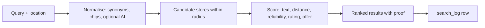

# Search and discovery

How a customer finds nearby shops and items: search, ranking, saved baskets, ratings and reviews, and the plain-language helpers.

> As built on main at 2c2f23d6 (27 Oct 2026). Update this file in the same change as the code it describes.

## What users can do

| App | What |
|---|---|
| Customer app | Set a location. Search items. Filter with refine chips. Search by voice or plain sentence. Open a shop or item page. See proof on results (badges, ratings). Save baskets (lists) and find the shop that has the whole list or the best two-shop split. Write a review after pickup. Folders: [search](../../customer/src/search/), [search-assist](../../customer/src/search-assist/), [voice-search](../../customer/src/voice-search/), [basket](../../customer/src/basket/), [store](../../customer/src/store/), [home](../../customer/src/home/), [map](../../customer/src/map/), [substitutes](../../customer/src/substitutes/), [list-parse](../../customer/src/list-parse/). |
| Shop app | Reply to reviews. Folder: [reviews](../../business/src/reviews/). |
| Admin console | Hide or restore reviews and replies, handle reports. Folder: [reviews](../../admin/src/reviews/). |
| Backend jobs | `store_rating` (Bayesian rating writer), `store_reliability`, `rollup_ask_demand`. |

## Rules

Source: [01-product-rules.md](../plan/01-product-rules.md) sections 10, 11, 11.1, 11.4.

- Score weights are settings: `search_w_text`, `search_w_distance`, `search_w_reliability`, `search_w_rating`, `search_w_offer`. There is no freshness term (D-63).
- Rating is Bayesian (a small prior pulls shops with few reviews toward the middle, D-92). Edit window: `review_edit_window_days`.
- Refine chips parse the query deterministically. The AI refine step needs `refine_ai_min_words` and `ai_querynorm_enabled`.
- Voice search needs `ai_voicesearch_enabled`. Daily AI use per customer is `ai_daily_calls_customer`.
- Baskets: `basket_max_saved`, `basket_max_items`, `basket_results_max`, `basket_split_max_shops` (D-110, D-111).
- Search logs keep location only as H3 cells (a hex grid) at coarse resolution (D-81, D-59).
- Only live shops of verified businesses appear (D-40).

## How it works

Basket search checks which shops have every line, and if none does, finds the best pair of shops (D-110). Substitutes are rule-based with a pack-size tolerance setting (D-235).

## Code

| Part | Where |
|---|---|
| Backend | `backend/internal/search` ([folder](../../backend/internal/search/)): `discover.go`, `expand.go`, `refine.go`, `basket.go`, `basket_rank.go`, `credit.go`, `cursor.go`, `logging.go`. `backend/internal/baskets` ([folder](../../backend/internal/baskets/)) stores saved baskets. `backend/internal/reviews` ([folder](../../backend/internal/reviews/)) holds reviews and rating. Query normaliser: `backend/internal/ai/querynorm`. |
| API paths | [discover.yaml](../../backend/api/paths/discover.yaml), [baskets.yaml](../../backend/api/paths/baskets.yaml), [reviews.yaml](../../backend/api/paths/reviews.yaml), [admin-reviews.yaml](../../backend/api/paths/admin-reviews.yaml) |
| Tables | `places`, `product_synonyms`, `search_log`, `baskets`, `basket_lines`, `reviews`, `review_replies`, `review_reports` |
| Frontend | folders above |

## Tests

Package tests; contract tests in `e2e/contract`; journey `07-e2e-13-baskets`; `e2e/scenarios/BSK.md`. Reports: [W1-06](../qa/W1-06/REPORT.md), [W2-06](../qa/W2-06/REPORT.md), [W2-14](../qa/W2-14/REPORT.md), [W3-12](../qa/W3-12/REPORT.md), [refine-synonym-miss](../qa/refine-synonym-miss/).

## Status and known gaps

- Live in code. The refine-chip parser is built; a stale package comment in `search/search.go` still says it is not.
- The "ready soonest" ask badge is not shown on search results ([go-live gaps](../qa/go-live-gaps/LIST.md)).
- The home map is a "tap to see the map" card (D-251 B1).

## Decisions

D-40, D-42, D-63 ranking. D-59 and D-81 location. D-92 rating. D-101 proof, voice, plain-language search. D-110 and D-111 baskets. D-140 reviews. D-231 and D-238 refine chips and hint. D-235 substitutes. D-250 baskets tab.
