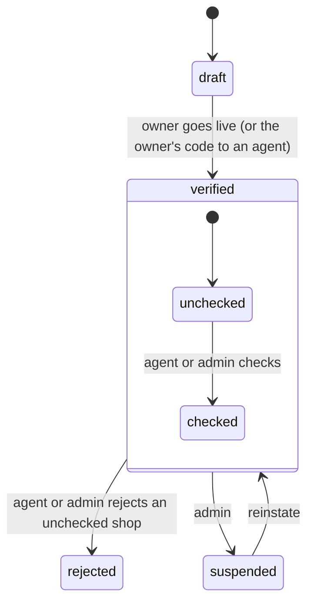

# Stores and onboarding

How a shop owner signs up and goes live at once with their stores (D-274), how the field team checks new shops afterwards, and the shop's staff, standee (the printed QR stand) and field-agent help.

> As built on main at d641cbe6 (27 Oct 2026). Update this file in the same change as the code it describes.

## What users can do

| App | What |
|---|---|
| Shop app | Sign up and set up the shop in a step flow with a dark green step rail (B-02, `/onboarding`, D-274): business, store and map pin, hours, category, shop photos, payout details (optional), then **Go live**, which puts the business and every complete store live at once. No one approves anything first. Upload KYC documents (accepted at once), add stores (live at once), invite staff (manager, cashier), print QR standees, claim a referral. Folders: [onboarding](../../business/src/onboarding/), [stores](../../business/src/stores/), [settings](../../business/src/settings/), [standee](../../business/src/standee/). |
| Admin console | Work the daily shop check queue (A-24, `/shop-checks`; field agents, admins, super admins): mark a new shop checked, or reject it with a reason. Suspend and reinstate businesses, and still verify or ask for info on rows submitted before D-274, reveal KYC details with an audit entry, force-close and reopen stores (review only for stores waiting from before D-274), manage field agents and leads. Folders: [businesses](../../admin/src/businesses/), [stores](../../admin/src/stores/), [field](../../admin/src/field/). |
| Field agent (admin console) | Onboard a shop on the owner's behalf using a one-time owner code; check or reject new shops from the queue on a phone (A-24, [admin/src/shop-checks](../../admin/src/shop-checks/)). Folder: [admin/src/field](../../admin/src/field/). |
| Customer app | See a live shop page and its storefront photo (D-246). Scan a standee QR to land on the shop. Folder: [store](../../customer/src/store/), [scan](../../customer/src/scan/). |
| Backend jobs | `business_field_photos_sweep`, `store_photos_publish`, `banners_tidy` (see [offers-banners-referrals](offers-banners-referrals.md)). |

## Rules

Source: [01-product-rules.md](../plan/01-product-rules.md) sections 3 and 14.

- Business states: draft, verified (live), rejected, suspended; submitted and needs_info only on rows from before D-274. Store states: draft, live, paused, suspended; pending_review only on old rows.
- Submit puts the business `verified` and every complete store (address, pin, phone, hours) `live` in one go; a store added or edited later stays live or goes live at once (D-274). Only live stores of verified businesses show to customers (D-40).
- Shop check (D-274): `check_status` unchecked → checked | rejected, by `field_agent`, `admin` or `super_admin`, audited. Until checked, the business's payouts are held `shop_unchecked` ([payouts-and-money](payouts-and-money.md)). A reject hides the shop at once and cancels its open online orders with `shop_rejected`: no strikes, held credits back, each customer told in their language.
- Shop photos and KYC documents are accepted when the upload is confirmed; nobody reviews them first.
- Roles are owner, manager, cashier (D-65, D-66). The app has no business delete (D-66).
- The standee URL is `app.todayz.in/s/{slug}` with referral and standee parameters.
- Field agents edit only items they added, within `field_agent_edit_window_days` (D-232). The owner code is limited by `field_owner_codes_per_agent_hour` (D-241).

## How it works

The inner states are `check_status`. A store goes `draft` to `live` when its business is live and nothing is missing, and the owner can pause it. Reads happen before writes with `If-Match` (D-202). KYC documents upload straight to storage through presigned links (D-203). Standee rows keep counts and reorder (D-205, D-223).

Field onboarding: the agent asks the owner for a code, enters the shop details, and the owner's code puts the business and the agent's complete stores live (D-241, D-274).

The B-02 page (`business/src/onboarding/`) sits outside the app shell (the gate renders it bare). `steps.ts` holds the step order and which step to open; each step saves on its own, so the owner can leave and come back. On a phone the rail is a dark header with the steps as a scrolling row of chips; from 1024px it is a column on the left. The rail's "Go to dashboard" link shows only once the shop is live: a new signup has no shop to go to. Colours are the `rail` tokens (D-274).

The check queue (`GET /v1/admin/shop-checks`, `shop_checks.go`) reads live unchecked businesses newest first, then each page's stores and photos in two queries; photo previews are presigned links to the private bucket. Check and reject lock the business row, refuse anything not unchecked, and write the audit row in the same transaction; reject also calls `orders.CancelShopOrders` there.

## Code

| Part | Where |
|---|---|
| Backend | `backend/internal/business` ([folder](../../backend/internal/business/)): `businesses.go`, `stores.go`, `kyc.go`, `documents.go`, `staff.go`, `hours.go`, `leads.go`, `agent*.go`, `store_photo.go`. Admin side: `backend/internal/admin` (`shop_checks.go`); the reject cascade is `backend/internal/orders/shop_reject.go`. Standees: `backend/internal/business/standee`. |
| API paths | [business.yaml](../../backend/api/paths/business.yaml), [standee.yaml](../../backend/api/paths/standee.yaml), [admin-businesses.yaml](../../backend/api/paths/admin-businesses.yaml) (with `/admin/shop-checks`, `/check`, `/check-reject`), [admin-stores.yaml](../../backend/api/paths/admin-stores.yaml), [admin-field.yaml](../../backend/api/paths/admin-field.yaml), [admin-leads.yaml](../../backend/api/paths/admin-leads.yaml), [public.yaml](../../backend/api/paths/public.yaml) (public leads) |
| Tables | `businesses`, `business_kyc`, `stores`, `business_documents`, `staff`, `leads`, `qr_standees`, `field_owner_codes`, `field_item_adds` |
| Frontend | folders above |

## Tests

`owner_test.go`, `agent_sweep_test.go`, `store_photo_test.go` in the package; `business_http_test.go`, `field_http_test.go` and `shop_check_http_test.go` in `backend/cmd/todayz` (go live on submit, the queue, check, reject and its cascade, the role checks). Frontend: `business/src/onboarding/onboarding.test.tsx`, `business/src/shell/sidebar.test.ts`, `admin/src/shop-checks/shopChecks.test.tsx`. Journeys: `04-e2e-01-standee`, `16-e2e-08-field-onboarding`, `10-e2e-17-owner`. Scenario docs: `e2e/scenarios/OB.md`, `FA.md`. Reports: [seller auto-onboarding](../qa/seller-auto-onboarding/REPORT.md), [W1-04](../qa/W1-04/REPORT.md), [W2-10](../qa/W2-10/REPORT.md), [W3-06](../qa/W3-06/REPORT.md), [W3-09](../qa/W3-09/REPORT.md).

## Status and known gaps

Live in code. The customer shop page is a card, not a full map (D-251 B1). An address or pin edit after the check does not put the shop back in the queue. The business app has no label for `shop_rejected` orders yet. The owner is not shown the reject reason.

## Decisions

D-39 field agents. D-40 verification (its admin gate replaced by D-274). D-66 staff. D-107 businesses, stores and staff. D-200 to D-206 onboarding screens. D-223 standee rows. D-232 and D-241 field agents. D-246 storefront photo. D-274 live on signup, the shop check and the green rail.
