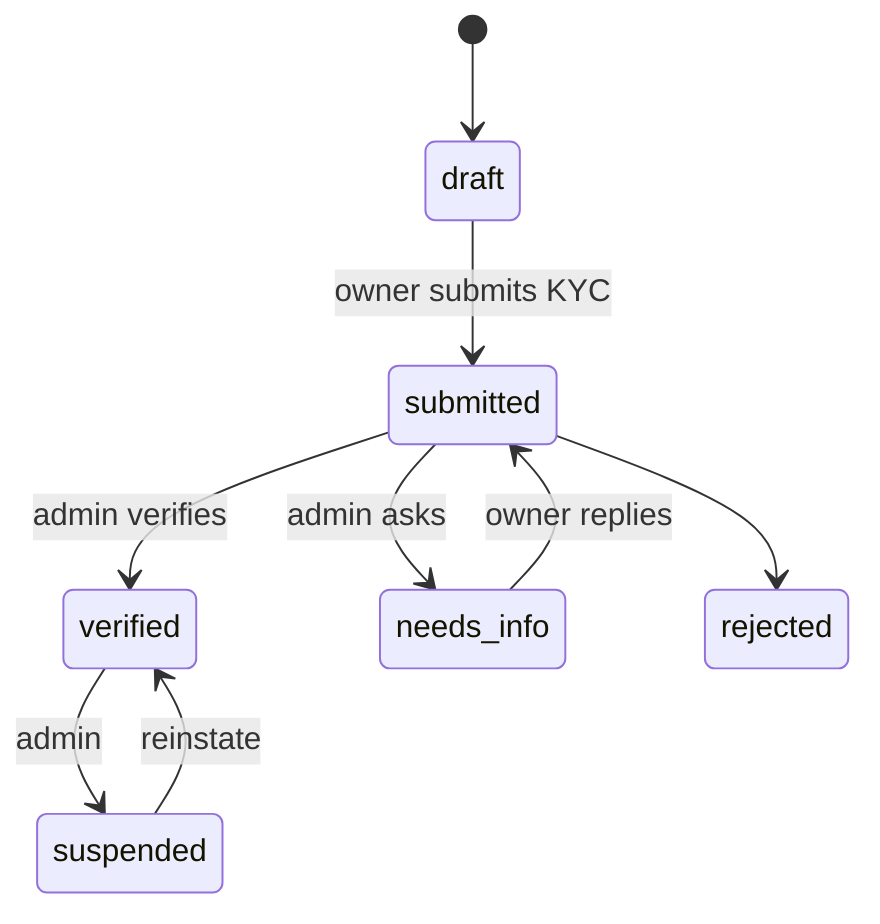

# Stores and onboarding

How a shop owner becomes a verified business with live stores, staff, a standee (the printed QR stand), and field-agent help.

> As built on main at 2c2f23d6 (27 Oct 2026). Update this file in the same change as the code it describes.

## What users can do

| App | What |
|---|---|
| Shop app | Create a business, upload KYC documents (identity checks), submit for review, add stores with hours and a storefront photo, invite staff (manager, cashier), print QR standees, claim a referral. Folders: [onboarding](../../business/src/onboarding/), [stores](../../business/src/stores/), [settings](../../business/src/settings/), [standee](../../business/src/standee/). |
| Admin console | Review businesses (verify, ask for info, reject, suspend, reinstate), reveal KYC details with an audit entry, review stores (approve, force-close, reopen), manage field agents and leads. Folders: [businesses](../../admin/src/businesses/), [stores](../../admin/src/stores/), [field](../../admin/src/field/). |
| Field agent (admin console) | Onboard a shop on the owner's behalf using a one-time owner code. Folder: [admin/src/field](../../admin/src/field/). |
| Customer app | See a live shop page and its storefront photo (D-246). Scan a standee QR to land on the shop. Folder: [store](../../customer/src/store/), [scan](../../customer/src/scan/). |
| Backend jobs | `business_field_photos_sweep`, `store_photos_publish`, `banners_tidy` (see [offers-banners-referrals](offers-banners-referrals.md)). |

## Rules

Source: [01-product-rules.md](../plan/01-product-rules.md) sections 3 and 14.

- Business KYC states: draft, submitted, verified, needs_info, rejected, suspended. Store states: draft, pending_review, live, paused, suspended.
- Only live stores of verified businesses show to customers (D-40).
- Roles are owner, manager, cashier (D-65, D-66). The app has no business delete (D-66).
- The standee URL is `app.todayz.in/s/{slug}` with referral and standee parameters.
- Field agents edit only items they added, within `field_agent_edit_window_days` (D-232). The owner code is limited by `field_owner_codes_per_agent_hour` (D-241).

## How it works

A store has its own states. A store goes `draft` to `pending_review` to `live`, and the owner can pause it. Reads happen before writes with `If-Match` (D-202). KYC documents upload straight to storage through presigned links (D-203). Standee rows keep counts and reorder (D-205, D-223).

Field onboarding: the agent asks the owner for a code, enters the shop details, and the owner's code also sends the agent's complete stores for review (D-241).

## Code

| Part | Where |
|---|---|
| Backend | `backend/internal/business` ([folder](../../backend/internal/business/)): `businesses.go`, `stores.go`, `kyc.go`, `documents.go`, `staff.go`, `hours.go`, `leads.go`, `agent*.go`, `store_photo.go`. Standees: `backend/internal/business/standee`. Admin side: `backend/internal/admin`. |
| API paths | [business.yaml](../../backend/api/paths/business.yaml), [standee.yaml](../../backend/api/paths/standee.yaml), [admin-businesses.yaml](../../backend/api/paths/admin-businesses.yaml), [admin-stores.yaml](../../backend/api/paths/admin-stores.yaml), [admin-field.yaml](../../backend/api/paths/admin-field.yaml), [admin-leads.yaml](../../backend/api/paths/admin-leads.yaml), [public.yaml](../../backend/api/paths/public.yaml) (public leads) |
| Tables | `businesses`, `business_kyc`, `stores`, `business_documents`, `staff`, `leads`, `qr_standees`, `field_owner_codes`, `field_item_adds` |
| Frontend | folders above |

## Tests

`owner_test.go`, `agent_sweep_test.go`, `store_photo_test.go` in the package. Journeys: `04-e2e-01-standee`, `16-e2e-08-field-onboarding`, `10-e2e-17-owner`. Scenario docs: `e2e/scenarios/OB.md`, `FA.md`. Reports: [W1-04](../qa/W1-04/REPORT.md), [W2-10](../qa/W2-10/REPORT.md), [W3-06](../qa/W3-06/REPORT.md), [W3-09](../qa/W3-09/REPORT.md).

## Status and known gaps

Live in code. The customer shop page is a card, not a full map (D-251 B1).

## Decisions

D-39 field agents. D-40 verification. D-66 staff. D-107 businesses, stores and staff. D-200 to D-206 onboarding screens. D-223 standee rows. D-232 and D-241 field agents. D-246 storefront photo.
