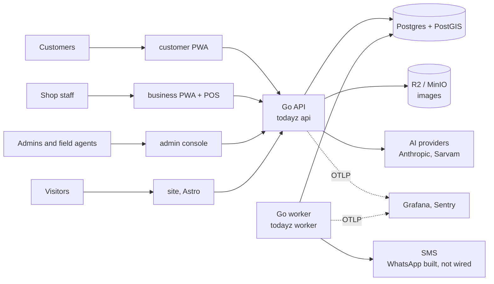
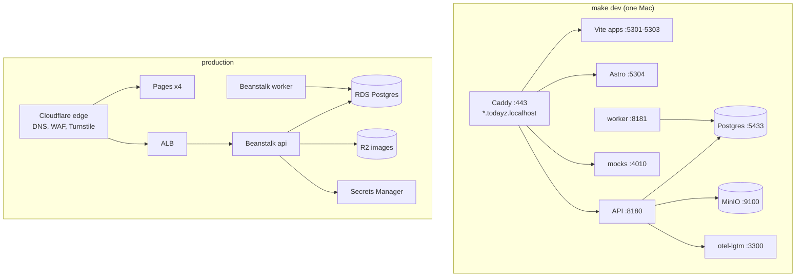
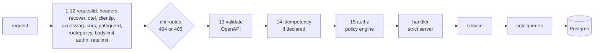
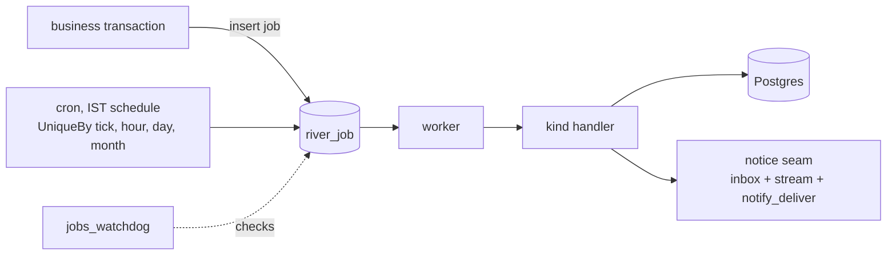
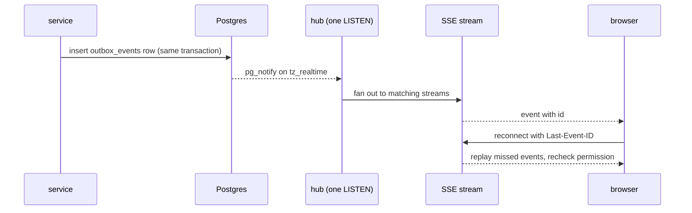
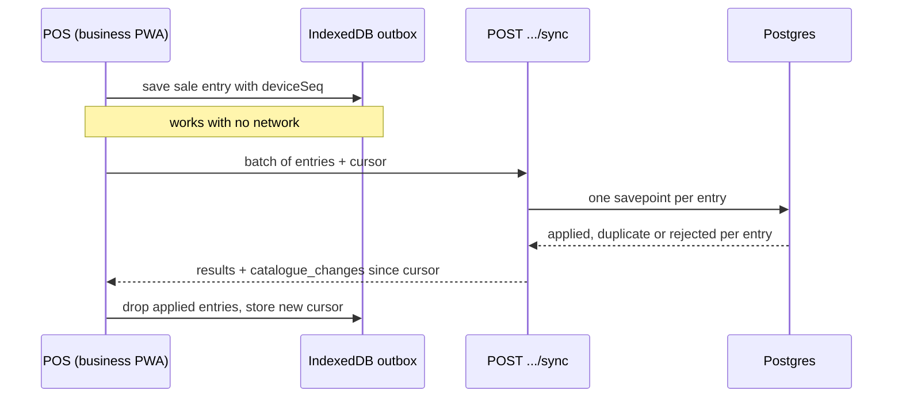
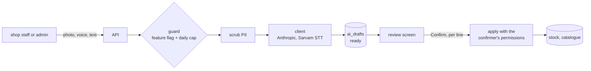
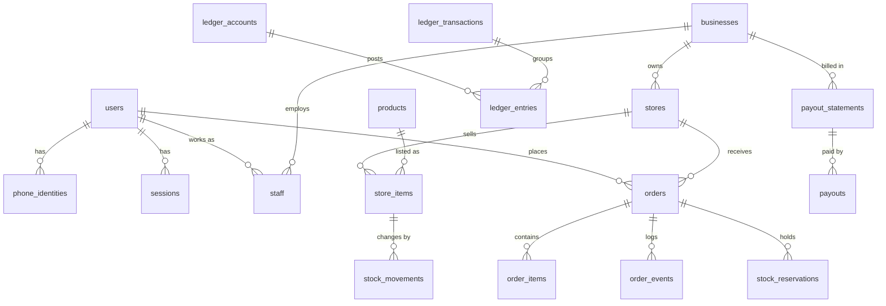

# Architecture

How TodayZ is put together: the parts, how they talk, and why.

> As built on main at 2c2f23d6 (27 Oct 2026). Update this file in the same change as the code it describes.

The plan lives in [docs/plan/02-architecture.md](../plan/02-architecture.md). This page describes what the code does today. When the two differ, the code wins and the plan file is fixed. Product numbers (timers, fees, limits) are never repeated here: they live in `platform_settings` and are listed in [01-product-rules.md](../plan/01-product-rules.md).

Related: [flows.md](flows.md) (step by step journeys), [code-structure.md](code-structure.md) (where things are), [deployment.md](deployment.md), [local-dev.md](local-dev.md), [testing.md](testing.md).

## 1. System context

Four web apps talk to one Go API. A second process, the worker, runs background jobs from the same binary. Everything durable is in Postgres.

| Part | What it is | Where |
|---|---|---|
| customer, business, admin | React 19 + Vite PWAs, TanStack Router and Query | `customer/`, `business/`, `admin/` |
| site | Astro static marketing site, no login | `site/` |
| API | one Go binary, chi router, strict server generated from OpenAPI | `backend/cmd/todayz`, `backend/internal` |
| worker | the same binary run as `todayz worker`; River jobs and crons | `backend/internal/jobs` |
| database | Postgres 16 with PostGIS; the only store of record | `backend/db/migrations` |
| shared | tokens, UI kit, API client, auth, config, i18n, realtime, telemetry | `shared/` |

Hosting: the four frontends are Cloudflare Pages projects. The API and worker are Elastic Beanstalk environments behind an ALB, with RDS Postgres, Secrets Manager and ECR, all described in Terraform under `infra/`. There is one environment, production (D-210): a merge to `main` deploys. See [deployment.md](deployment.md). Terraform has not been applied yet, so "prod" here means the design the pipeline targets.

## 2. Local and production topology

The local stack mirrors production's shape with Docker and host processes. Fixed ports are in the root [CLAUDE.md](../../CLAUDE.md).

| Concern | Local | Production |
|---|---|---|
| TLS and routing | Caddy on the host | Cloudflare, then ALB |
| Postgres | Docker, PostGIS 3.4 | RDS |
| Images | MinIO | R2 behind Cloudflare |
| SMS, WhatsApp, AI | `e2e/mocks` via `*_API_URL` variables | the real providers |
| Telemetry | otel-lgtm (Grafana) | Grafana Cloud and Sentry |
| Start | `infra/local/proc.sh` | Beanstalk platform hooks |

Provider base URLs use `*_API_URL` names (for example `LLM_API_URL`, `STT_API_URL`), so the same code runs against mocks locally. Config is read from the environment only, in `backend/internal/platform/config`. Names are checked with `make env-check`, which never prints values.

## 3. One API request

Every request passes the same pipeline, defined in `backend/internal/platform/httpx` and `backend/internal/platform/httpx/mw` (one file per slot, plan 02 §2.4).

Rules worth knowing:

- **One router decides.** Slots 1 to 12 wrap the mux before chi picks the route. Slots 13 to 15 run inline after chi has picked it, so the validator reads chi's own route (D-100). A path that two routers could read differently gets a 400 in `pathguard`.
- **Per-route policy comes from the contract.** The OpenAPI extensions `x-idempotency`, `x-upload`, `x-money` and `x-problems` become a `route.Policy` in the request context (`backend/internal/platform/httpx/route`).
- **Idempotency is opt-in per route.** A route that declares it needs an `Idempotency-Key`. The stored response is sealed with `PII_ENC_KEY`, and a claim holds a short lease so a duplicate waits or replays (`backend/internal/platform/idempotency`). It runs after validation, so a refused request is never stored.
- **Authentication** turns a Bearer JWT (EdDSA access token) into a principal (`backend/internal/platform/authn`). The URL namespace must match the principal: `/v1/discover` public, `/v1/me` customer, `/v1/biz/businesses/{bid}[/stores/{sid}]` staff, `/v1/admin` admin, `/v1/auth` and `/v1/public` no login, plus `/v1/rum` and `/v1/events` for telemetry.
- **Authorization** fails closed. Each operation has a policy in `backend/internal/platform/authz/policy/<domain>.go`, tested against golden tables. Staff scope (which business and store) is resolved from the `staff` table. Admin actions need TOTP step-up (D-14).
- **Errors** are RFC 9457 problem documents. Codes are declared per route in `backend/api/problems/` and generated into `backend/gen/problems`.
- **Telemetry** is added at slots 4 and 6: a trace per request, RED metrics, and a request log with a server-made request id. See [05-observability.md](../plan/05-observability.md).
- **Money** is integer paise everywhere (D-03). `backend/internal/platform/money` has no floats.

Handlers are thin. They decode the generated request type, call a service method, and map the result. The service opens a transaction through `platform/db`, calls the generated sqlc queries (`backend/gen/sqlc/<domain>db`), writes any audit, outbox and job rows in the same transaction, and returns.

## 4. Background jobs

Jobs are River jobs stored in Postgres (ADR 0003, D-95). They are inserted in the same transaction as the business change, so a rolled-back change never leaves a stray job. The wrapper `backend/internal/platform/jobs` forces every kind to declare an owner, a class, a description, a timeout and attempt limit. The registry of kinds is `backend/internal/jobs`.

| Class | What runs there | Examples (kind) |
|---|---|---|
| timer | order and hold expiries; never paused or retried by hand | `order_accept_timeout`, `order_pickup_no_show`, `order_partial_timeout` |
| money | ledger, payouts, credit expiry | `payouts_statement_close`, `credits_expire`, `ledger_reconcile` |
| notify | SMS and WhatsApp delivery, reminders | `notify_deliver`, `credits_expiry_reminder` |
| marketing | offers and banner housekeeping | `offers_tidy`, `banners_tidy` |
| ai | coach runs and AI-backed sweeps | the coach daily, weekly and realtime kinds |
| rollup | analytics rollups | `rollup_today`, `rollup_day`, `rollup_demand` |
| maintenance | heartbeat, retention, watchdog | `platform_heartbeat`, `jobs_watchdog`, `job_runs_retention` |

- **Two trigger styles.** Event-triggered timers are enqueued inside the transaction that starts the clock (for example accepting an order). Crons are standard five-field schedules in IST, made unique per tick, hour, day or month so a slow run never doubles up.
- **Catch-up.** Cron jobs such as `order_reconcile` (every minute) recompute from the database, so a missed tick is repaired on the next one.
- **Visibility.** Every run writes `job_runs`; `jobs_watchdog` raises an alert when a cron is missed. Runbooks are in [docs/runbooks](../runbooks/README.md) (`jobs-cron-missed.md`, `job-queue-backlog.md`).
- **Shutdown.** The worker drains on SIGTERM and then cancels what is left. The API drains through `SHUTDOWN_PRESTOP` and `SHUTDOWN_DRAIN` (D-98, `backend/internal/platform/lifecycle`).

## 5. Realtime (SSE)

Live updates use Server-Sent Events from Postgres (ADR 0004). There is no separate message broker.

- A domain publishes by writing an `outbox_events` row inside its transaction (`backend/internal/platform/realtime`). A trigger sends `pg_notify` on channel `tz_realtime`. The hub holds one listening connection per instance (`backend/internal/platform/pgnotify`) and fans out.
- Streams: `/v1/me/stream` (customer) and `/v1/biz/businesses/{bid}/stores/{sid}/stream` (shop). Each sends a heartbeat comment so Cloudflare does not close it, and rechecks permission on resume.
- A client that reconnects with `Last-Event-ID` gets every event it missed from the outbox, on any instance. Old rows are removed by a cleanup job.
- The browser side is `@todayz/realtime` (`shared/realtime`): the stream client, backoff, a polling fallback, and a hook that invalidates TanStack Query keys. Events are hints, never the source of truth: the app refetches.

## 6. Offline POS sync

The business app records counter sales with no network. They are stored on the device and sent later (D-69, ADR 0008).

- The client engine is `business/src/sync` (`engine.ts`, `idb.ts`). Each entry carries a `deviceSeq`, so replays are harmless.
- The server (`backend/internal/pos`, `sync.go`) applies each entry in its own savepoint, so one bad entry does not fail the batch. A batch has an entry cap and the server limits how far back a device's changes may reach; both are in `01-product-rules.md` and `platform_settings`.
- The reply carries `catalogue_changes`, the shop's price and stock changes since the device's cursor, so a second counter device catches up.
- Customer-linked bills use a bill QR (an HMAC-signed token with a short life) that the customer scans; the offline counter code is a TOTP that the shop can check without a network (`/v1/biz/.../counter-code/verify`).

## 7. AI calls

AI output is always a draft that a person confirms ([11-ai-features.md](../plan/11-ai-features.md), D-06, D-46). Nothing changes stock, money or orders straight from a model.

- The platform is `backend/internal/ai/*`: `client` (provider calls through `LLM_API_URL` and `STT_API_URL`), `guard` (feature flags and daily caps from `platform_settings`), `scrub` (removes personal data before a prompt), `drafts` (the `ai_drafts` table and its states), `prompts`, `schema` and `eval`.
- The draft lifecycle is Create, MarkReady, Confirm. Confirm applies line by line and checks the confirmer's own permissions, not the model's.
- Features sit in their own packages under `backend/internal/ai` (for example `shelfscan`, `billscan`, `listparse`, `replydraft`, `triage`). Search never calls a model (01 §11.1).
- Evals run on recorded replies in `make check` and need no key. Live evals (`make ai-eval`) use the user's own key. See [08-testing.md](../plan/08-testing.md) and [11-ai-features.md](../plan/11-ai-features.md).

## 8. Core data model

Only the central tables are drawn. The rest are listed in the [migrations folder](../../backend/db/migrations) and described in [03-data-model.md](../plan/03-data-model.md). Ids are ULIDs stored as `uuid`. Money columns are integer paise.

| Area | Core tables | Notes |
|---|---|---|
| Identity | `users`, `phone_identities`, `sessions`, `staff`, `admin_users` | Phones are sealed and hashed (`platform/pii`). Sessions hold refresh families. |
| Shops | `businesses`, `stores`, `business_kyc`, `business_documents` | A store has a slug and a PostGIS location. Only live stores of verified businesses are searchable (D-40). |
| Catalogue and stock | `products`, `product_images`, `store_items`, `stock_batches`, `stock_movements`, `stock_reservations` | `backend/internal/catalogue` is the single writer of `stock_movements` (D-99). |
| Orders | `orders`, `order_items`, `order_events`, `strikes` | A DB trigger, `trg_orders_guard`, mirrors the status table in Go. |
| Credits | `ledger_accounts`, `ledger_transactions`, `ledger_entries`, `credit_lots`, `credit_holds` | A double-entry loyalty wallet with FIFO lots and expiry, not shop credit (see [flows.md](flows.md)). |
| Payouts | `payout_statements`, `payout_statement_lines`, `payouts`, `payout_lines` | Monthly statements, then payouts. |
| Platform | `platform_settings`, `idempotency_keys`, `outbox_events`, `audit_log`, `job_runs`, `events` | Large append-only tables are partitioned (`partition_policies`). |

Migrations: goose, embedded in the binary, out-of-order allowed. Database changes are only ever new files ([backend/db/migrations/README.md](../../backend/db/migrations/README.md)).

## 9. Auth in one paragraph

Sign-in is by phone and OTP (`/v1/auth/otp/send`, `/v1/auth/otp/verify`). The API returns a short-lived EdDSA access token in the body and a refresh token in an opaque, hashed, rotating cookie, one per app (`__Secure-tz_rt_c`, `_b`, `_a` for customer, business, admin) so the three apps never share a session. A refresh rotates the token inside a session family. If the same old token is replayed after a short grace window the whole family is revoked (reuse detection). Inside the grace window a repeat caller gets the same successor token again, derived from `sessions.successor_salt` (D-239), so two tabs or a lost response do not log the user out. Admins add TOTP step-up for sensitive actions.

## 10. Key design choices

| Choice | Why | Link |
|---|---|---|
| One Go monolith, one binary, `api` and `worker` modes | One deploy unit, simple to run on a small team | [ADR 0001](../adr/0001-go-backend.md) |
| pgx and sqlc, no ORM | SQL is visible and checked at generate time | [ADR 0002](../adr/0002-pgx-sqlc.md) |
| River jobs in Postgres | A job commits or rolls back with the business change | [ADR 0003](../adr/0003-river-jobs.md), D-95 |
| SSE from an outbox, not a broker | Replay by `Last-Event-ID`, no extra service | [ADR 0004](../adr/0004-sse-realtime.md) |
| Search is Postgres (PostGIS and full text) | Filter first, then score from `platform_settings`; no model in the path | [ADR 0005](../adr/0005-postgres-search.md), D-40 |
| Protomaps tiles we host | No per-view map bill | [ADR 0006](../adr/0006-protomaps.md) |
| Own analytics events and rollups | One event catalogue, no third-party tracker | [ADR 0007](../adr/0007-own-analytics.md) |
| Local first: the stack runs on one laptop | Same code against mocks, fast tests | [ADR 0008](../adr/0008-local-first.md) |
| Spec first API: OpenAPI, then generated Go and TS | One contract for server, client and mocks | [backend/api/README.md](../../backend/api/README.md) |
| One router decides | The validator reads chi's own route | D-100 |
| Stock reserved when the shop accepts, written off at hand-over | An order the shop has not agreed to cannot lock stock | D-01 |
| Single writer for stock | Every stock change leaves a `stock_movements` row | D-99 |
| Per-app refresh cookies, grace replay | Three apps, no shared session; safe retries | D-14, D-239 |
| Money in integer paise | No rounding drift; settings keys end in `_paise` or `_bp` | D-03 |
| Prod only, deploy on merge | One founder, one environment | D-210 |
| H3 cells for search logging | Demand maps without storing exact positions | D-59 |

The full list, with reasons, is in [12-decision-log.md](../plan/12-decision-log.md).
