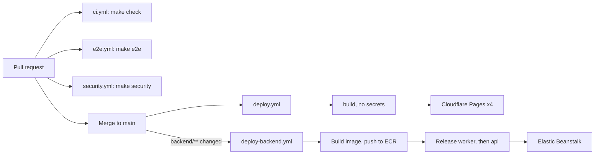

# Deployment

How TodayZ is built, released and rolled back, and what is live today.

> As built on main at a0402006 (27 Oct 2026). Update this file in the same change as the code it describes.

## Environments

There are two: **local** ([local-dev.md](local-dev.md)) and **prod**. There is no staging (D-210, founder 24 Oct): a merge or push to `main` deploys straight to prod. Only the lead pushes, creates cloud resources or applies Terraform. Worker sessions stay local: no push, no cloud calls. The first prod Terraform apply waits for the founder's yes on the plan summary. The `envs/staging` folder in Terraform is unused since D-210.

## What deploys where

| What | Where | How | Status |
|---|---|---|---|
| Marketing site | Cloudflare Pages project `todayz-site`: todayz.in, www.todayz.in | `deploy.yml` | live |
| Customer app | Pages `todayz-customer`: app.todayz.in | `deploy.yml` | live |
| Business app | Pages `todayz-business`: business.todayz.in | `deploy.yml` | live |
| Admin console | Pages `todayz-admin`: admin.todayz.in | `deploy.yml` | live |
| API and worker | AWS Elastic Beanstalk (one arm64 image, `todayz`), api.todayz.in | `deploy-backend.yml` | **not applied yet** |
| Database | AWS RDS Postgres + PostGIS, private | Terraform `envs/prod` | **not applied yet** |
| DNS, WAF, rate limits, R2, Turnstile, cache rules | Cloudflare | Terraform `infra/cloudflare` | partly (Pages and DNS imported; API record waits) |

The four Pages projects were created on 24 Oct (D-214). The AWS backend has not been planned or applied: `deploy-backend.yml` is switched off by the repo variable `BACKEND_DEPLOY_ENABLED`, and [the runbook](../qa/deploy-prep/RUNBOOK.md) says nothing has been applied. Until it is, the live apps have no production API behind them.

## Pipeline

## Workflows

All in [.github/workflows](../../.github/workflows/). Every action is pinned by commit SHA; the `setup-toolchain` and `upload-reports` composite actions are in [.github/actions](../../.github/actions/). `make wflint` enforces these rules in CI, and [dependabot.yml](../../.github/dependabot.yml) bumps weekly with a 14-day cooldown.

| File | Runs on | Jobs |
|---|---|---|
| [ci.yml](../../.github/workflows/ci.yml) | pull request, push to main, manual | `check`: `make setup` then `make check`, 45 min limit |
| [deploy.yml](../../.github/workflows/deploy.yml) | push to main, manual | `build` (no secrets: `pages.sh prepare` and `build`, uploads an artifact) then `deploy` (`pages.sh deploy`, the only job with Cloudflare secrets) |
| [deploy-backend.yml](../../.github/workflows/deploy-backend.yml) | push to main touching `backend/**`, `scripts/deploy/beanstalk.sh` or the workflow itself; manual | `build` (image) then `deploy` (`beanstalk.sh ci-deploy`, `environment: production`, `id-token: write`). Both jobs run only when `vars.BACKEND_DEPLOY_ENABLED == 'true'` |
| [e2e.yml](../../.github/workflows/e2e.yml) | pull request, push to main, manual | `e2e`: browser deps, `make reset`, `make e2e`, `make stop`, upload reports, 90 min limit |
| [security.yml](../../.github/workflows/security.yml) | pull request, push to main, weekly (Mondays 03:00 IST), manual | `static`: `make security` with full history; `dynamic` (weekly and manual only): `make dev`, `make security`, `make stop`. The weekly run adds a report-only Trivy pass including unfixed findings |

## Scripts

[scripts/deploy](../../scripts/deploy/) holds the deploy tooling. Every script prints names, never secret values.

| Script | Commands | Notes |
|---|---|---|
| `pages.sh` | `prepare`, `build`, `deploy` | Output goes to `.cache/pages/<app>`. Public build settings are in [infra/cloudflare/pages.env](../../infra/cloudflare/pages.env). The Vite apps get security headers (CSP in report-only for now). Deploys with `wrangler pages deploy --project-name todayz-<app> --branch main`; needs `CLOUDFLARE_API_TOKEN` and `CLOUDFLARE_ACCOUNT_ID` in the environment |
| `beanstalk.sh` | `build`, `push`, `db-bootstrap`, `migrate`, `images-picks`, `release`, `deploy`, `ci-deploy` | One image runs `api`, `worker` and the migrate and images ops tasks (`images-picks` applies the saved item-photo picks, D-265). Images go to ECR with immutable tags. A release is two application versions, `<tag>-api` and `<tag>-worker`; deploy order is worker, then api. `ci-deploy` uses an OIDC role (`todayz-prod-github-deploy`, trusted only for the `production` environment), so no AWS key is stored in GitHub |
| `secrets.sh` | `status`, `app-keys`, `database`, `put NAME`, `share-preview-to-pages` | Fills Secrets Manager containers at `todayz/prod/<NAME>`. Never replaces an existing value |
| `state-bucket.sh` | (one run) | Creates the Terraform state bucket, versioned, with a native lock file (no DynamoDB, D-255) |

Production builds need real public values: `VITE_API_URL` and `VITE_TURNSTILE_SITE_KEY` for the apps, `PUBLIC_API_URL` and `PUBLIC_TURNSTILE_SITE_KEY` for the site.

## Terraform

[infra/terraform](../../infra/terraform/README.md) and [infra/cloudflare](../../infra/cloudflare/README.md).

- `infra/terraform/envs/account` (account-level: ECR, OIDC), `envs/prod` (the stack), and `envs/staging` (unused since D-210). State keys: `account/`, `prod/` and `cloudflare/terraform.tfstate` in the state bucket.
- Modules: `stack`, `network`, `database`, `secrets`, `ecr`, `edge`, `beanstalk_env`. A policy check ([infra/terraform/checks/check.py](../../infra/terraform/checks/check.py)) enforces the allow-list (SC-OPS-05) and timings (SC-GS-10).
- `infra/cloudflare` covers DNS, WAF, rate limits, R2, Turnstile, cache rules and Pages.
- **Wave-5 gate.** Before Wave 5, Terraform runs only `fmt -check`, `validate`, tflint and checkov (in `make check`). `scripts/ci/terraform.sh` refuses `plan`, `apply` and `output` unless `TODAYZ_WAVE5=1`, which only the lead sets. Cloud admin credentials live in `.env.cloud.local`, read by the lead's shell. Never put them in a worker session.

## First go-live order

From [the runbook](../qa/deploy-prep/RUNBOOK.md), all by the lead:

1. State bucket
2. Account root apply
3. First image build and push
4. Prod apply 1 (`app_environments_enabled=false`)
5. Cloudflare apply 1 (imports)
6. Secrets filled
7. Database bootstrap
8. Migrate
9. First release
10. Prod apply 2
11. Cloudflare apply 2 (the API record)
12. Smoke test
13. Turn on CI deploy (`BACKEND_DEPLOY_ENABLED=true`)

## Secrets

Names only, never values, in logs, chat and docs. `make env-check` prints set or missing. Local secrets are in `.env.local`; cloud admin credentials in `.env.cloud.local`; prod secrets in AWS Secrets Manager at `todayz/prod/<NAME>` (filled by `secrets.sh`); the Pages build token is a GitHub secret on the `deploy` job only. Rotation steps: [docs/ops/secret-rotation.md](../ops/secret-rotation.md). Access: [docs/runbooks/cloud-access.md](../runbooks/cloud-access.md).

## Migrations at deploy

Database changes are new migration files only. They run as a Fargate ops task (`beanstalk.sh migrate`) as the owner role, before the new API is released, and only move forward (expand, then contract in a later release). The app role cannot change schema. `db-bootstrap` creates the roles once.

## Release candidate

`make release-candidate` runs reset, check, e2e, load and security on a clean database and writes `docs/qa/rc-<date>/` with `summary.md` and one log per step, then scans the folder for leaked secrets. The latest is [rc-2026-10-26](../qa/rc-2026-10-26/summary.md). The release checklist is [docs/ops/release-checklist.md](../ops/release-checklist.md).

## Rollback

| What | How |
|---|---|
| API and worker | `scripts/deploy/beanstalk.sh deploy <older tag>`. Images are immutable, so the old tag is still there |
| Pages apps | In the Cloudflare dashboard, roll back to an earlier deployment, or redeploy an older commit |
| A feature | Turn off its `platform_settings` flag |
| Database | No down migrations. Fix forward; restore from backup only for data loss ([backup-restore](../ops/backup-restore.md)) |

Never destroy prod. RDS has deletion protection and Terraform state is versioned.

## Observability

- [infra/grafana/dashboards](../../infra/grafana/dashboards/): 16 dashboards, from `00-what-to-fix-today` to `15-jobs`.
- [infra/grafana/alerts](../../infra/grafana/alerts/): 15 files (ai, api, auth, client, database, jobs, ledger, marketplace, orders, pos-sync, pos, queue, realtime, risk, search). Every alert links a runbook in [docs/runbooks](../runbooks/README.md); `make check-runbooks` fails if one is missing.
- Datasource ids are `prometheus`, `loki`, `tempo` and `todayz-postgres`. Locally it is all in one Grafana at https://grafana.todayz.localhost.
- On-call, severity and incident pages: [docs/ops](../ops/README.md).

## Next

[local-dev.md](local-dev.md), [testing.md](testing.md), [docs/plan/09-infra-release.md](../plan/09-infra-release.md).
