# Flows

The main journeys through TodayZ, step by step, with the endpoints and packages each step touches.

> As built on main at a0402006 (27 Oct 2026). Update this file in the same change as the code it describes.

How to read this page: each flow has a diagram and a short walk-through. Endpoints are written as in the OpenAPI files under [backend/api/paths](../../backend/api/paths). Packages are under `backend/internal`. Timer lengths, fees and limits are never written here: each is a `platform_settings` key listed in [01-product-rules.md](../plan/01-product-rules.md). For the bigger picture see [architecture.md](architecture.md).

| # | Flow | Main package |
|---|---|---|
| 1 | [Customer sign-in and token refresh](#1-customer-otp-sign-in-and-token-refresh) | `backend/internal/identity` |
| 2 | [Search nearby, open a product, book for pickup](#2-search-nearby-and-book-for-pickup) | `backend/internal/search`, `backend/internal/orders` |
| 3 | [Delivery order](#3-delivery-order) | `backend/internal/orders` |
| 4 | [Shop accepts, prepares, hands over](#4-shop-accepts-prepares-and-hands-over) | `backend/internal/orders` |
| 5 | [Order states](#5-order-states) | `backend/internal/orders` |
| 6 | [Order timers and auto-cancel](#6-order-timers-and-auto-cancel) | `backend/internal/orders`, `backend/internal/jobs` |
| 7 | [POS sale offline, then sync](#7-pos-sale-offline-then-sync) | `backend/internal/pos` |
| 8 | [Stock update](#8-stock-update) | `backend/internal/catalogue` |
| 9 | [Credits ledger](#9-credits-ledger) | `backend/internal/credits` |
| 10 | [Payouts](#10-payouts) | `backend/internal/payouts` |
| 11 | [Ask shops nearby](#11-ask-shops-nearby) | `backend/internal/asks` |
| 12 | [Admin approves a new store](#12-admin-store-onboarding-and-approval) | `backend/internal/business`, `backend/internal/admin` |
| 13 | [Product photo: draft, then admin approval](#13-product-photo-draft-then-admin-approval) | `backend/internal/catalogue`, `backend/internal/admin` |

## 1. Customer OTP sign-in and token refresh

A customer signs in with a phone number and a one-time code. The API returns an access token and sets a refresh cookie for the customer app only.

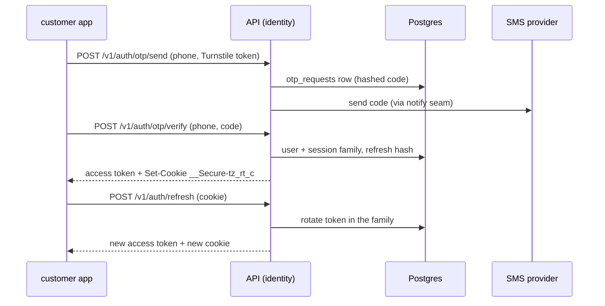

- `/v1/auth/otp/send` is rate limited per phone and per IP, and checked by Turnstile. Locally the OTP is read from the mocks server (`/_mock/sms/latest-otp`), never from logs. Phones are sealed and hashed (`backend/internal/platform/pii`).
- `/v1/auth/otp/verify` creates the user on first sign-in, then a session. The refresh token is opaque, only its hash is stored, and the cookie is named per app: `__Secure-tz_rt_c` for customer (`_b` business, `_a` admin).
- `/v1/auth/refresh` rotates the token. Each rotation links the new token to the old one inside a session family.
- **Reuse detection.** Presenting a token that was already rotated, outside the grace window, revokes the whole family and writes an audit row (`backend/internal/identity/session.go`).
- **Refresh grace (D-239).** If the same old token arrives again within `RotationGrace` (a code constant in `session.go`), the caller is not logged out. The server derives the same successor token again from `sessions.successor_salt` with an HMAC, so a lost response or a second tab racing the first gets a working token. The salt is never sent to a client. A token older than the window is reuse.
- `/v1/auth/logout` ends one session. `/v1/auth/logout-all` ends every session of the user.
- The browser side is `@todayz/auth` (`shared/auth`): `session.ts` holds the token in memory, retries once after a 401, and `phone-otp.tsx` is the sign-in form.

## 2. Search nearby and book for pickup

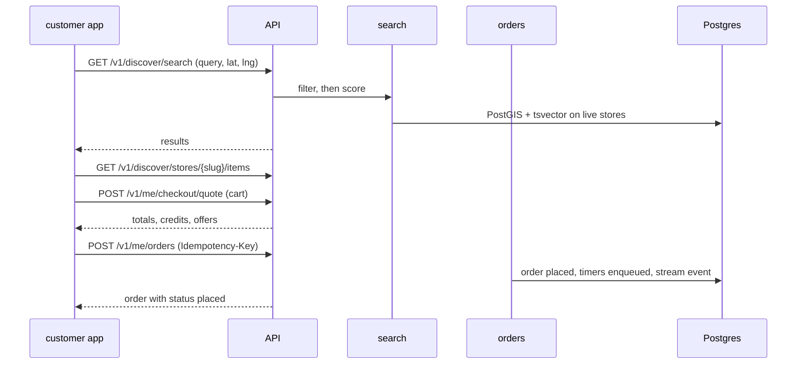

- **Search** (`backend/internal/search`) filters first, then scores with weights read from `platform_settings`. Only `live` stores of `verified` businesses are shown (D-40). No model is called (01 §11.1). The search is logged by H3 res-8 cell, not exact position (D-59). Related endpoints: `/v1/discover/stores`, `/v1/discover/search/suggest`, `/v1/discover/basket-search`, `/v1/discover/places/search`.
- **Quote.** `POST /v1/me/checkout/quote` prices the cart: offers, credits the customer may use, delivery fee if any, and the minimum order rules. The quote is advice. The order recomputes the total and refuses if it moved (`create(ctx, cart, expectedTotal)` in `backend/internal/orders/create.go`).
- **Place.** `POST /v1/me/orders` carries an `Idempotency-Key`, so a retry never books twice. Nothing is reserved at placing (D-01). The order starts as `placed`, an accept timer is enqueued in the same transaction (`order_accept_timeout`), credits are held if used, and the shop gets a stream event and a notification through the notice seam.
- A store may auto-accept; `autoAccept` then does the accept step straight away.
- The customer follows the order on `/v1/me/orders/{orderId}` and the `/v1/me/stream` event stream.

## 3. Delivery order

A delivery order uses the same path with a different end.

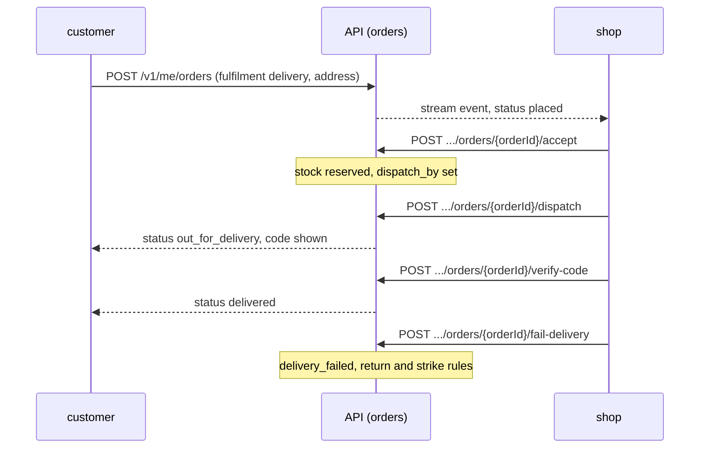

- Delivery is a shop service: the shop's own people deliver. The order carries an address snapshot and a delivery fee quoted at checkout.
- A delivery order has `dispatch_by` where a pickup order has `hold_until`. If the shop does not dispatch by then, the order is expired by the timer jobs (`backend/internal/orders/timers.go`).
- `dispatch` moves `accepted` to `out_for_delivery`. The customer's code is shown while the order is out for delivery. Verifying it completes the order as `delivered`.
- `fail-delivery` moves it to `delivery_failed` (D-22). The shop then confirms what happened to the goods with `confirm-return`, which restores stock or records a loss (`backend/internal/orders/returns.go`). Unconfirmed returns are chased by a runbook alert ([risk-unconfirmed-returns.md](../runbooks/risk-unconfirmed-returns.md)).
- Strikes against a store are counted by `backend/internal/orders/strikes.go`; a store's reliability is recomputed hourly (`backend/internal/orders/reliability.go`).

## 4. Shop accepts, prepares and hands over

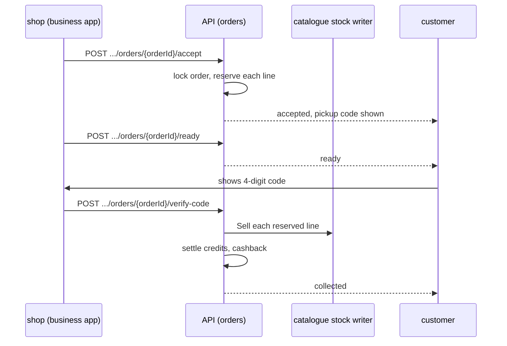

All shop endpoints are under `/v1/biz/businesses/{bid}/stores/{sid}/orders/{orderId}/`.

- **Accept** (`accept`, `holdAndStart` in `backend/internal/orders/transitions.go`). The order row is locked, every line is checked against available stock (on hand minus reserved), and `stock_reservations` rows are written. A partial accept (some lines short) goes to `awaiting_customer` and the customer confirms the new totals with `/v1/me/orders/{orderId}/confirm-partial` (D-28). A reject sends `reject`.
- **Ready** (pickup only). `ready` tells the customer the goods are set aside.
- **Code.** The pickup code is four digits, sealed at rest with `ORDER_CODE_ENC_KEY` so the customer can be shown it again, and matched by HMAC with `ORDER_CODE_HMAC_KEY` when the shop types it (`backend/internal/orders/code.go`). Wrong guesses are counted and lock out (`order_code_lockouts`). A customer can ask for a fresh code with `/v1/me/orders/{orderId}/new-code`.
- **Hand over.** `verify-code` checks the code and calls `collect`. `collect` sells each held line through the single stock writer (`backend/internal/catalogue/writer.go`, D-99), which consumes the reservation, then settles held credits and pays cashback (`backend/internal/credits`). Pickup ends as `collected`, delivery as `delivered`.
- **Cancel.** The shop uses `cancel`, the customer uses `/v1/me/orders/{orderId}/cancel`. Reservations and credit holds are released.
- **Extend.** `/v1/me/orders/{orderId}/extend` lets a customer ask for a longer hold, within the limits in `platform_settings`.

## 5. Order states

These are the statuses and moves in `backend/internal/orders/machine.go`. A database trigger, `trg_orders_guard`, enforces the same table, and a test (`TestMachineMatchesTheGuard`) checks the two agree.

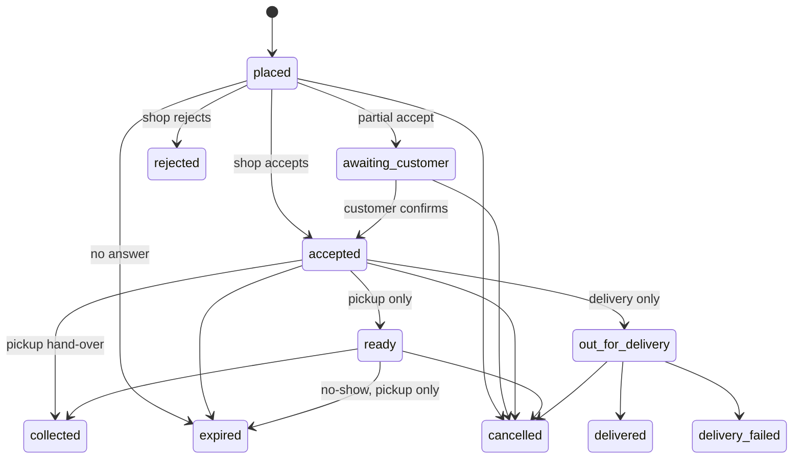

- Past (final) statuses: `collected`, `delivered`, `rejected`, `expired`, `cancelled`, `delivery_failed`.
- `ready` and `collected` are pickup only. `out_for_delivery` and `delivered` are delivery only. Expiry from `ready` is a pickup no-show (D-21).
- Each move writes an `order_events` row and a stream event in the same transaction.

## 6. Order timers and auto-cancel

Timers are jobs in the `timer` class. They are enqueued inside the transaction that starts the clock, so a rolled-back accept never leaves a timer.

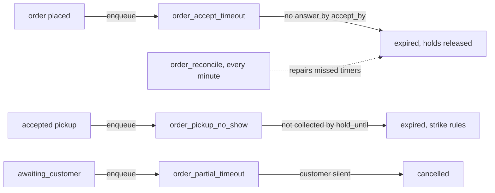

- Kinds: `order_accept_timeout`, `order_pickup_no_show`, `order_partial_timeout` (`backend/internal/orders/timers.go`). Each handler re-reads the order and does nothing if it already moved on.
- `order_reconcile` runs every minute and expires any order whose deadline has passed, so a lost job is repaired within a minute (`backend/internal/orders/reconcile.go`). Strikes are recounted nightly and store reliability hourly.
- Every length (how long a shop has to answer, the pickup hold, the partial wait, the no-show rule) is a `platform_settings` key. See 01 §5 and §6 in [01-product-rules.md](../plan/01-product-rules.md). The tests use the test clock (`/v1/test/clock`, D-80), never real waiting.
- Runbooks: [orders-timers.md](../runbooks/orders-timers.md), [queue-order-timers-late.md](../runbooks/queue-order-timers-late.md).

## 7. POS sale offline, then sync

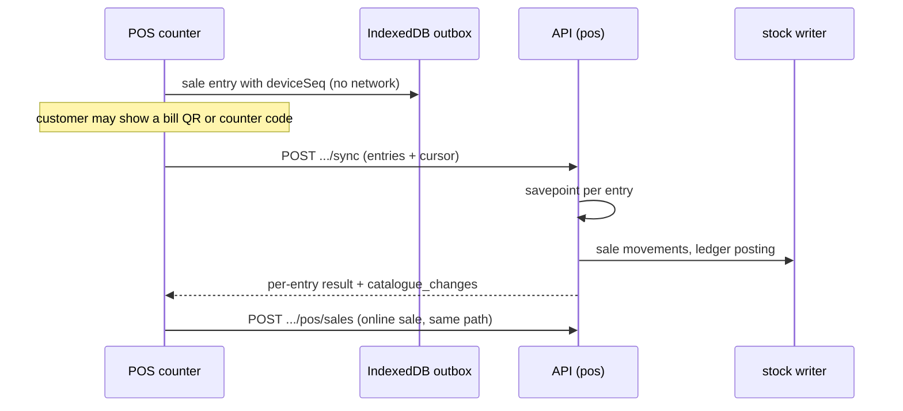

- **Offline.** The sale is saved with a `deviceSeq` in IndexedDB (`business/src/sync`, `business/src/pos`). Prices and stock come from the cached catalogue.
- **Sync.** `POST /v1/biz/businesses/{bid}/stores/{sid}/sync` sends a batch. Each entry runs in its own savepoint, so one bad entry is reported and the rest are applied. A repeated `deviceSeq` is answered as a duplicate. The batch size and how old an entry may be are settings (see 01 §6 to §8).
- **Online sale.** `POST .../pos/sales` records a sale straight away. `POST .../pos/sales/{saleId}/reverse` reverses one within the reversal window (D-08), which also reverses any credits and cashback.
- **Linking a customer.** The customer either scans a bill QR (an HMAC-signed token with a short life, claimed through `/v1/me/bill-claims/{token}/preview` and `/confirm`) or reads a counter code that is a TOTP seeded from `/v1/me/counter-code-seed` and checked at `/v1/biz/.../counter-code/verify`, even offline (D-12). A linked sale earns cashback through the credits ledger.
- **Catch-up.** The reply carries `catalogue_changes` since the device's cursor (D-36), so a second device sees the price and stock changes made elsewhere.
- Runbooks: [pos-sync-lag.md](../runbooks/pos-sync-lag.md), [pos-bill-claims.md](../runbooks/pos-bill-claims.md).

## 8. Stock update

Stock is the sum of `stock_movements` (D-01). There is one writer: `backend/internal/catalogue/writer.go` (D-99). Every other domain calls it.

```mermaid
flowchart LR
  M[manual movement<br/>POST .../items/{itemId}/movements] --> W[stock writer]
  V[voice stock draft] -->|confirm| W
  SB[supplier bill draft] -->|confirm| W
  SH[shelf photo draft] -->|confirm| W
  OR[order collected] --> W
  POS[POS sale or sync] --> W
  W --> MV[(stock_movements<br/>+ batch allocation)]
  MV --> SI[store_items on hand, reserved]
  W --> EV[stream event + catalogue_changes]
```

- A shop changes stock by posting a movement (`/v1/biz/businesses/{bid}/stores/{sid}/items/{itemId}/movements`) with a source from the enum in D-01 (opening, restock, damage, count correction and so on). `/items/{itemId}/history` lists them.
- **AI drafts** (voice, supplier bill, shelf photo) never touch stock. They create an `ai_drafts` row; the person reviews it and calls the `.../drafts/{draftId}/confirm` endpoint, which applies each line through the writer under the confirmer's own permissions (`backend/internal/voice`, `backend/internal/ai/billscan`, `backend/internal/ai/shelfscan`).
- **Reservations** are not movements: they live in `stock_reservations`, and `store_items.reserved` is a cached counter. Available is on hand minus reserved (D-01).
- A nightly job, `catalogue_reconcile`, re-checks the cached counters against the movements.
- The writer posts `catalogue_changes` rows that POS devices read on sync.

## 9. Credits ledger

Credits are TodayZ's loyalty wallet: a customer earns them (cashback, referral rewards), may spend them on an order, and they expire. They are not shop credit or a tab. The ledger is double entry. Amounts and caps are settings (01 §7 and §9; D-02, D-27, D-29, D-30).

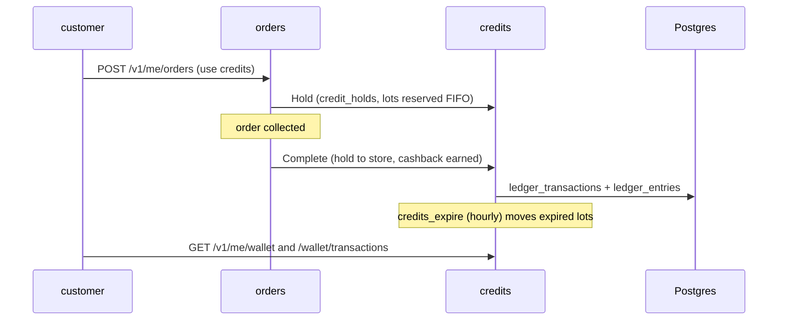

- `backend/internal/credits` keeps `ledger_accounts`, `ledger_transactions` and `ledger_entries`. Every transaction balances. `ledger_reconcile` runs nightly and an alert fires if the invariant breaks ([ledger-invariant.md](../runbooks/ledger-invariant.md)).
- **Lots.** Earned credits sit in `credit_lots` with an expiry. They are spent first-in, first-out (D-27). `credits_expire` moves lots past expiry (hourly), and `credits_expiry_reminder` warns the customer (daily).
- **Holds.** Placing an order with credits makes a `credit_holds` row. Collecting settles it; cancelling or expiry releases it.
- **Seams.** Other domains reach the ledger through small interfaces (a holder for orders, a poster for POS and referrals) so they never write ledger rows themselves.
- **Adjustments.** An admin fixes a balance by raising a request at `/v1/admin/credit-adjustments`, and a second admin must approve (D-05). See `backend/internal/credits/adjustments.go`.
- The shop sees its side at `/v1/biz/businesses/{bid}/credit-account`.
- Credits are a loyalty wallet, not udhaar (pay-later). A "khata" POS payment method is listed as later in [01-product-rules.md](../plan/01-product-rules.md).

## 10. Payouts

Each month TodayZ closes a statement per business and creates a payout for it (D-09).

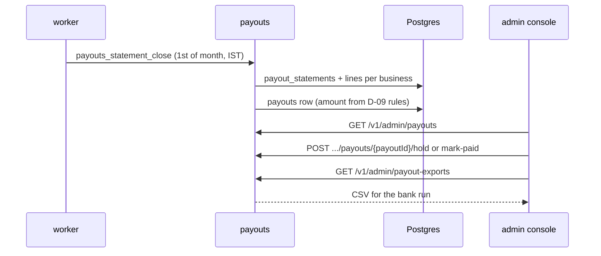

- The cron `payouts_statement_close` runs on the first of each month (`backend/internal/jobs/payouts.go`) and is idempotent per month. `CloseMonth` calls `closeBusiness` for each business and `computePayout` works out the amount (`backend/internal/payouts/close.go`).
- Shops read their statements at `/v1/biz/businesses/{bid}/statements` and `/statements/{period}` (with a CSV download).
- Admins list payouts, put one on hold or release it (`hold`, `unhold`), and mark it paid after the bank transfer. Money is moved outside TodayZ; the app records it. An export endpoint gives a CSV for the bank run.
- Runbook: [payouts.md](../runbooks/payouts.md).

## 11. Ask shops nearby

A customer who cannot find something asks the shops around them (D-101).

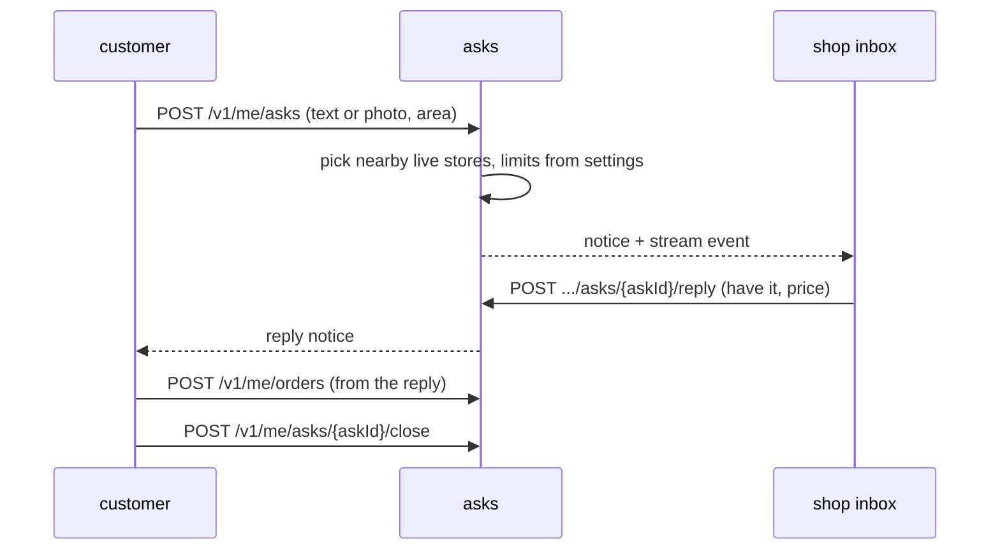

- `backend/internal/asks` creates the ask (`create.go`), chooses recipient stores by distance and eligibility, and writes `ask_recipients`. Counts, radius and window are `platform_settings` keys.
- Shops see asks in their inbox (`/v1/biz/businesses/{bid}/stores/{sid}/asks`), reply, or report abuse (`.../report`). A shop may be blocked from asks (`ask_store_blocks`).
- A cron, `asks_close_window` (every minute), closes asks whose window has ended. Retention runs daily.
- Booking from an ask goes through the normal order flow, and `tellAsk` in `backend/internal/orders/create.go` tells the ask whether it was booked.
- Runbook: [asks-timers.md](../runbooks/asks-timers.md).

## 12. Admin store onboarding and approval

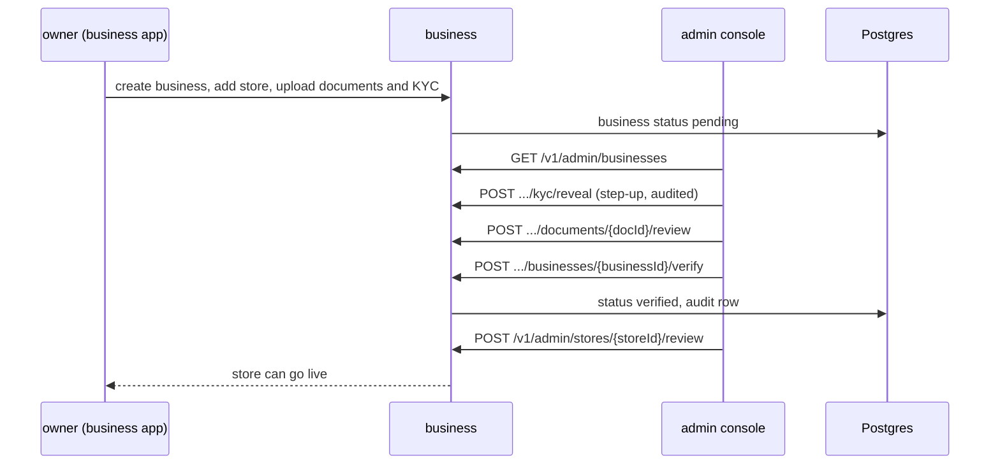

- The owner onboards in the business app (`business/src/onboarding`), served by `backend/internal/business`. Field agents can onboard shops for an owner (D-39, `backend/internal/business/agent*.go`, and the `field_*` tables).
- An admin reviews at `/v1/admin/businesses/{businessId}`: `request-info`, `reject`, `verify`, `suspend` and `reinstate`. Reading sensitive KYC values needs `kyc/reveal`, which needs TOTP step-up and writes an audit row (`backend/internal/platform/audit`).
- A store appears in search only when the store is `live` and its business is `verified` (D-40). `/v1/admin/stores/{storeId}` has `review`, `force-close`, `reopen` and `strikes/reset`.
- Every admin write is audited; the actor, reason and before and after are in `audit_log`.

## 13. Product photo: draft, then admin approval

A shop can add a photo to a product. The photo is a draft until a person approves it.

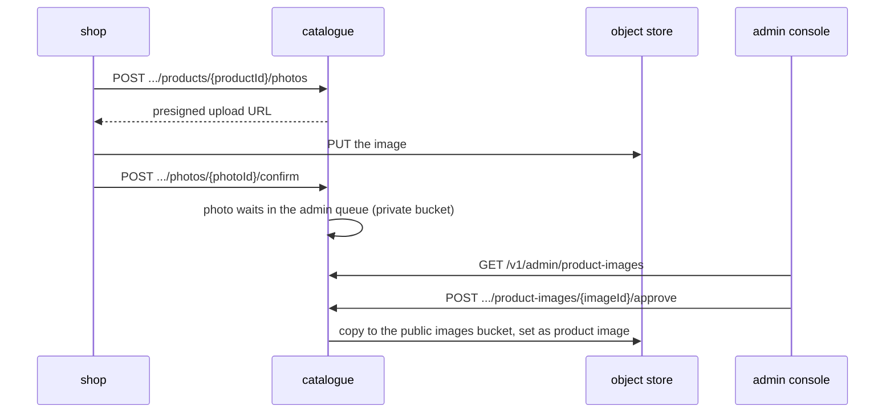

- The app resizes the photo, then `backend/internal/catalogue/photos.go` issues a presigned PUT into the private bucket (size limit in the contract) and, on confirm, queues the photo for review. Until approval the shop sees its own photo through a signed link (D-252, D-253).
- Admin approval is in `backend/internal/admin/product_images.go` (`approve`, `reject`, bulk `product-image-approvals`). Only an approval copies the image to the public images bucket and makes it the product's picture.
- Seed images from open data are drafted by `todayz images import` (`backend/internal/imageimport`, D-252) and go through the same approval.
- Item-type photos (D-253): `todayz images types` stores Commons candidates per kind, and an admin picks one in A-08. `todayz images types --picks builtin` re-applies the saved picks with the same steps, audited as the system (D-265).
- AI plays no part in photo approval. A person always decides. (`backend/internal/ai/imagecheck` exists for banner images and is not wired yet.)
