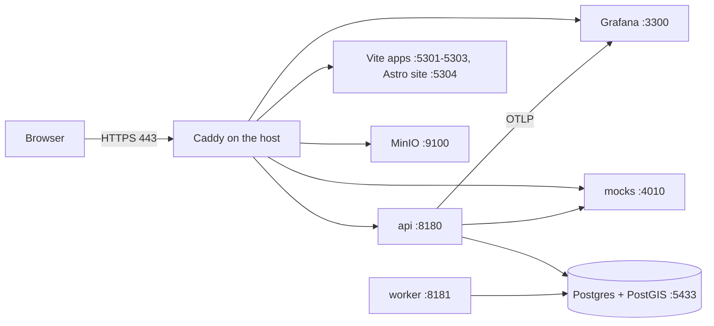

# Local development

How to set up a Mac and run the whole TodayZ stack on it, with no cloud account and no provider keys.

> As built on main at a0402006 (27 Oct 2026). Update this file in the same change as the code it describes.

Everything is driven by `make` from the repo root. The targets are fixed (D-56); each package adds its own steps in [mk/](../../mk/), nobody edits the root [Makefile](../../Makefile). The full stack config is explained in [infra/local/README.md](../../infra/local/README.md).

## What runs where



- Data services (Postgres + PostGIS, MinIO, Grafana LGTM, postgres_exporter) run in Docker, inside Colima.
- The Go API, the worker, the mocks server and the four front ends run as host processes, started and stopped by [infra/local/proc.sh](../../infra/local/proc.sh).
- Caddy runs on the host and terminates TLS for `*.todayz.localhost` with its own local certificate authority.
- The mocks server ([e2e/mocks](../../e2e/mocks/)) stands in for every outside provider: SMS, WhatsApp, web push, Turnstile, speech-to-text and the Anthropic API.

## First-time setup on a Mac

1. Install the tools `make setup` expects but does not install: Go, Node 22.12 or newer, pnpm 10, git, and Docker through Colima. Homebrew is the usual way to get them, and Caddy too. `make setup` itself installs `gitleaks`, `lefthook` and `shellcheck` with brew when they are missing ([mk/00-repo.mk](../../mk/00-repo.mk)).
2. Start Docker: `colima start` (once per boot). Give the VM enough memory for Postgres, MinIO and Grafana together; integration tests start extra containers.
3. Run `make setup`. It does, in order:
   - checks the tools, builds `.tools/bin/envtool`;
   - generates any missing app key into `.env.local` (prints names only, never values);
   - installs the pnpm workspace and the git hooks (lefthook: gitleaks and a forbidden-files check on commit, a no-push guard on push);
   - pulls the pinned Docker images and downloads the city map tiles (needs the internet; a failed tile download is a warning);
   - builds the Go tools (golangci-lint, goose, gosec, sqlc, govulncheck) into `.tools/bin`, pulls the test images and the govulncheck database;
   - installs uv, the pinned Python and the Schemathesis environment for the contract tests;
   - builds the mocks server, installs the Playwright Chromium headless shell, and prefetches Terraform providers and CI tools.
4. Run `caddy trust` once. It adds Caddy's local CA to the macOS keychain and asks for your password. Without it the browser warns about every `*.todayz.localhost` host.
5. Run `make dev`.

`make setup` needs the internet. After it has run, `make check` and `make e2e` work offline.

## Daily commands

| Command | What it does |
|---|---|
| `make dev` | Starts containers, creates buckets, uploads tiles, starts Caddy, migrates, starts the API and worker, the mocks and the four front ends, then runs the health check. Safe to run again. |
| `make stop` | Stops host processes (API and worker drain first), Caddy, then the containers. Data is kept. |
| `make logs` | Follows container logs and `.cache/dev/*.log`. |
| `make reset` | Drops and recreates the `todayz` and `todayz_test` databases, runs migrations as the owner role, then loads the `dev` seed. There is no `make seed`. |
| `make gen` | Bundles the OpenAPI contract, generates the Go and TypeScript clients, sqlc code, route trees, tokens and catalogues. Generated output is git-ignored; every check runs it first. |
| `make env-check` | Lists env var names as set or missing. Never prints values. |
| `make demo` | Live order generator for dashboards and the business app. `DEMO_FOR` and `DEMO_EVERY` tune it. |
| `infra/local/health.sh` | Prints the health table and refreshes https://todayz.localhost/_health. Green is healthy, red is down, grey is not started. |

Only one stack runs per machine, and it must run from the main checkout. `make dev` and `make reset` refuse when another checkout (a worktree) started the running stack and name it. `TODAYZ_STACK_FORCE=1` overrides.

## Hosts and ports

These are a contract: the apps, Caddy, tests and CI all assume them.

| Service | Host port | URL |
|---|---|---|
| Postgres 16 + PostGIS 3.4 | 5433 (5432 is left to your own Postgres) | local only |
| MinIO API / console | 9100 / 9101 | https://s3.todayz.localhost, https://img.todayz.localhost, https://tiles.todayz.localhost |
| Grafana (otel-lgtm) | 3300 | https://grafana.todayz.localhost |
| OTLP gRPC / HTTP | 4317 / 4318 | |
| Prometheus | 9390 | |
| postgres_exporter | 9187 | |
| Shared test Postgres (opt-in) | 5439 | Go tests only |
| API (`todayz api`) | 8180 | https://api.todayz.localhost |
| Worker health (`todayz worker`) | 8181 | loopback only: `/healthz`, `/readyz` |
| Mocks server | 4010 | https://mocks.todayz.localhost |
| Customer app (Vite) | 5301 | https://app.todayz.localhost |
| Business app (Vite) | 5302 | https://business.todayz.localhost |
| Admin console (Vite) | 5303 | https://admin.todayz.localhost |
| Site (Astro) | 5304 | https://todayz.localhost |

Caddy listens on 443 and 80 (80 only redirects). Every Caddy site refuses requests that do not come from loopback. Vite hot reload runs over wss on 443 through Caddy; set `TODAYZ_HMR=direct` to use http://127.0.0.1:5301 instead.

Non-secret local defaults live in [infra/local/local.env](../../infra/local/local.env) (committed). Secrets and your own overrides go in `.env.local` (git-ignored). `proc.sh` exports both into every process and removes every `AWS_*` variable, so the app never sees AWS credentials (D-97). Go code reads env only.

## Seed data and signing in

`make reset` runs `todayz seed dev` as the `todayz_app` role. The registry is [backend/internal/seed](../../backend/internal/seed/): one file per domain, run in dependency order (identity, business, catalogue, search, credits, orders, POS, reviews, offers, support, payouts, risk, insights, voice, admin and more) inside one transaction on a fixed clock. The seed refuses to run when `APP_ENV` is staging or prod. Profiles are `dev` (what `make reset` loads), `demo` (larger, for dashboards) and `test` (the fixed data tests rely on).

Seeded people, by role (names and ids are in [identity.go](../../backend/internal/seed/identity.go); the journeys' view of them is [e2e/fixtures/seed.ts](../../e2e/fixtures/seed.ts)):

| Role | What you can do with it |
|---|---|
| Customers (three, in English, Kannada and Hindi; one has no name yet, so it acts as a new user) | Customer app: search, book, orders, wallet |
| Owner, manager and cashier of Sri Lakshmi (the main seeded shop; the owner also owns a second shop) | Business app with each role's permissions: the cashier cannot cancel or change settings |
| Owners of Annapurna Provisions and Nandi (other shops) | Cross-shop flows such as asking nearby shops |
| Admin staff in `e2e/fixtures/admins.yaml`: field agent, support, catalogue, analyst, admin, two finance, two super admin, one who has never signed in | Admin console with each of the seven roles. The file holds reserved test phones and roles only, no secrets (D-264) |

Every seeded phone is in a reserved test block (see the comment in identity.go). To sign in locally:

- **Mock SMS.** The API sends the code to the mocks server, not to a carrier. Open https://mocks.todayz.localhost to read the SMS, or ask `GET /_mock/sms/latest-otp?to=<phone>` ([mocks README](../../e2e/mocks/README.md)). The journeys read the code this way.
- **Reserved numbers.** In local and test mode the reserved test numbers also accept a fixed development code; the seed comment names it. Staging and prod never run the seed and never accept it.
- **Admin console** signs in with the SMS code alone (D-264). A † action (payouts, credits, settings, admin users, `money` jobs) asks for a fresh SMS code: tap "Send code" in the dialog and read it from the mocks server like the sign-in code. The Playwright stack journey reads `TZ_ADMIN_PHONE` for a seeded staff number.
- **Business app** after sign-in asks you to choose a shop; a one-shop account skips that screen.

Local Turnstile is also a mock (`TURNSTILE_API_URL`), so no captcha appears.

## Shared test Postgres

Go integration tests need a real PostGIS database. By default [testkit](../../backend/internal/testkit/) starts one testcontainers container per test binary. With several checkouts testing at once that uses a lot of the Docker VM's memory. The opt-in alternative is one shared server:

```bash
make testpg-up                       # starts it on port 5439, writes .cache/testpg.url (mode 600), prints an export line
export TODAYZ_TEST_PG_URL_FILE=<main checkout>/.cache/testpg.url
go -C backend test ./internal/orders/...
make testpg-down                     # removes it; its data is tmpfs, so every leftover database goes too
```

Each test binary still migrates its own template database and every test gets a fresh copy. The URL holds a random local password and no command prints it.

## Common problems

| Symptom | Cause and fix |
|---|---|
| Browser warns about the certificate | Run `caddy trust` once. |
| `make dev` says a port is in use | Another process holds a fixed port. `proc.sh` names the owner. Stop it, or run `make stop` first. An old Caddy: `caddy stop`. |
| `make dev` says the stack was started from another checkout | Run make in that checkout, `make stop` there, or set `TODAYZ_STACK_FORCE=1` if it is gone. |
| "Docker is not running" | `colima start`, then run make again. |
| A front end or the API looks stale or will not restart | `infra/local/proc.sh status` lists processes; `proc.sh stop NAME` ends one and its child tree; `proc.sh logs NAME` or `.cache/dev/NAME.log` shows output. `make stop` then `make dev` clears everything. Pid files are in `.cache/dev/pids/`. |
| Port drift (a service answers on the wrong port) | The ports above are fixed in [docker-compose.yml](../../docker-compose.yml), [mk/](../../mk/) and [the Caddyfile](../../infra/local/Caddyfile). Do not change one alone. `infra/local/health.sh` shows which side is red. |
| Sign-in answers 429 `rate_limited` after many sign-ins | The OTP send caps (per number and per IP, see [01-product-rules.md](../plan/01-product-rules.md) section 2) count every sign-in the journeys and fuzzers make. `make reset` clears them. Start a gate run from a fresh `make reset`. |
| Data looks wrong after a branch switch | `make reset` (drops, migrates, seeds). New migrations always apply with `make dev`, which migrates first. |
| Go tests fail to find Docker (Colima) | `make` sets `DOCKER_HOST` and the Ryuk socket override for Colima. Running `go test` by hand outside make, export `DOCKER_HOST` from `docker context inspect`. |
| Stack journey cannot reach the API | The journeys need the stack up through Caddy. Run `make dev` first; `make e2e` does it for you. |

## Next

- Running and writing tests: [testing.md](testing.md).
- Shipping: [deployment.md](deployment.md).
- Working rules for contributors: [working-on-todayz.md](working-on-todayz.md).
