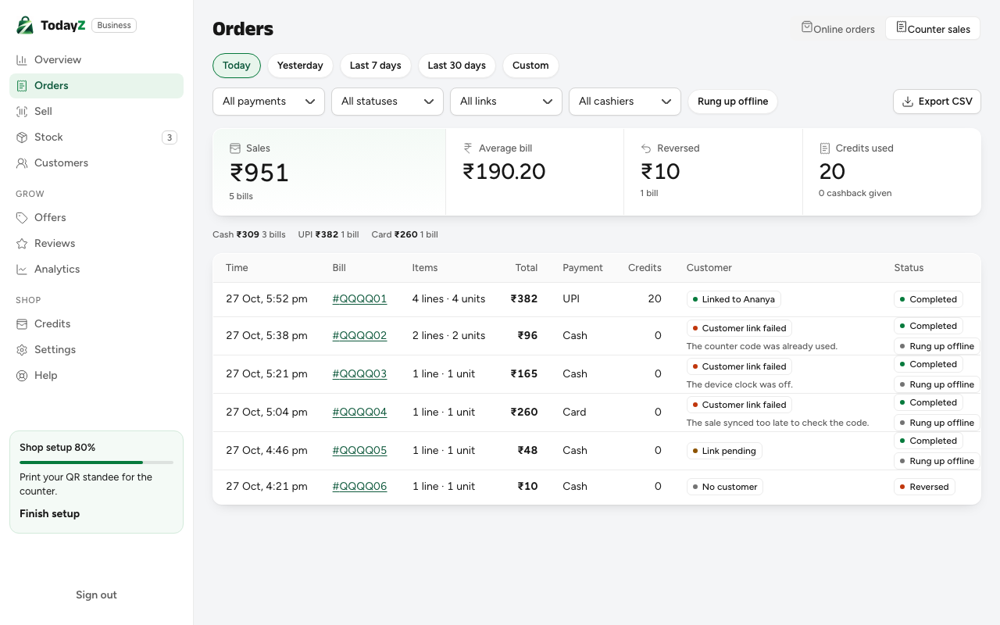
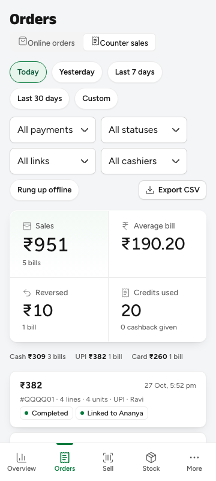
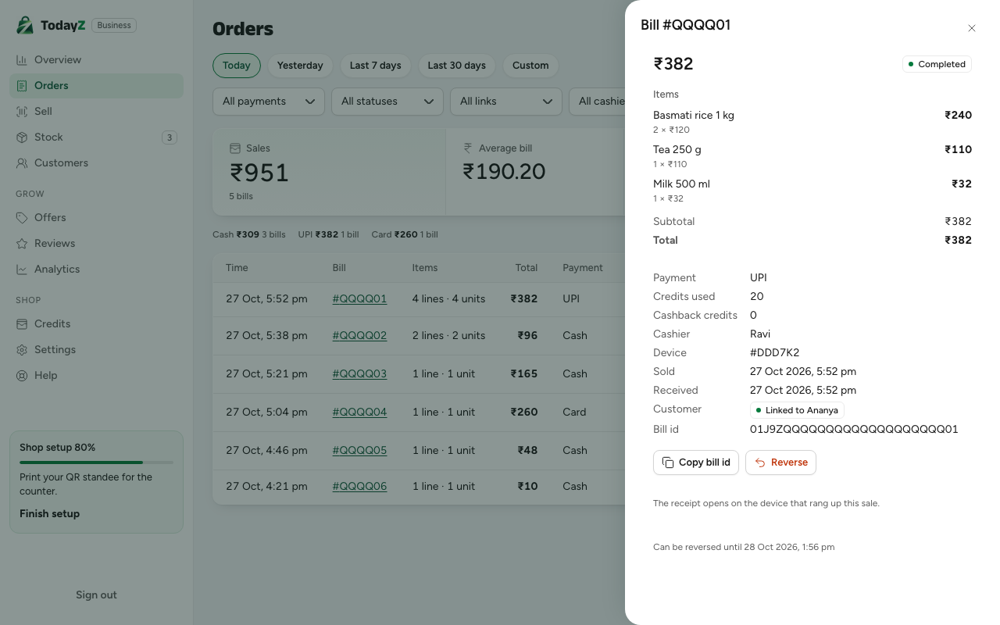
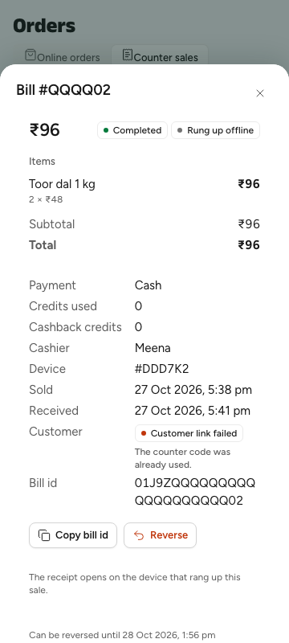

# D-268 Counter sales: report

Orders → Counter sales in the business app, next to Online orders. It replaces the Sell screen's "Store sales" sheet (W2-16).

## What was built

- **Backend** (`backend/internal/pos/history.go`, `handlers.go`, `db/queries/pos/pos.sql`, `api/paths/pos.yaml`, `api/schemas/pos.yaml`; no migration):
  - filters on `GET {S}/pos/sales`: IST `from`/`to`, payment, status, link, offline, cashier;
  - `GET {S}/pos/sales-summary` (owner and manager);
  - `GET {S}/pos/sales-export` (CSV, owner and manager, formula-safe, no phones);
  - `GET {S}/pos/sales/{saleId}`.
  - Authz: `pos.sales_summary` and `pos.sales_export` for owner and manager. The golden file is updated.
- **Business app:**
  - `src/orders/CounterSales.tsx`, `SaleDetail.tsx`, `salesQueries.ts`, `sales.module.css`;
  - the tabs in `OrdersPage`;
  - the "View sales" link on Sell;
  - `StoreSalesSheet` removed;
  - `PosProvider` always renders its context provider.
- **i18n:** `orders.view.*` and `orders.sales.*` in en, hi, kn, te and ta, reviewed with current hashes. `pos.viewSales` is added; the unused `pos.storeSales.*` sheet keys are removed.

## Checks

| Check | Result |
|---|---|
| `pnpm --filter @todayz/business typecheck`, `lint` | pass |
| `pnpm --filter @todayz/business test` | 55 files, 552 tests pass (`counterSales.test.tsx`: 10) |
| `pnpm --filter @todayz/i18n lint:messages` | 0 errors; hi/kn/te/ta fully reviewed |
| `build:e2e` + `pnpm size` | initial JS 179.52 kB gzip (limit 250), CSS 12.29 kB (limit 20) |
| `business/e2e/sell.spec.ts` (preview) | 5 of 5 pass, including the phone 360 and desktop Counter sales journeys |
| pos Go tests and `cmd/todayz/pos_counter_sales_http_test.go` | pass |

The journey `e2e/journeys/specs/21-e2e-07-offline-code.spec.ts` now reads the failure reasons from Counter sales. It needs `make dev` and was not run here, because the founder is using the stack.

## Screenshots

| Desktop | Phone 360 |
|---|---|
|  |  |
|  |  |

## Known gaps

- The online-order chime does not play while Counter sales is open, because the alert hook lives in the Online orders view.
- The receipt link shows only on the device that holds the sale's receipt token. The server never returns the token.
