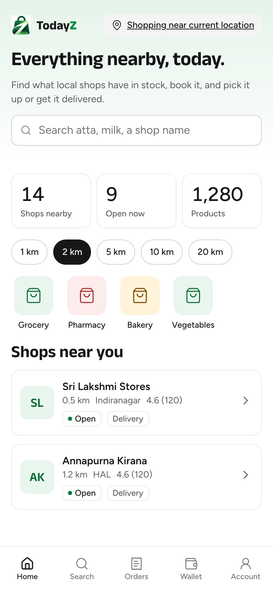
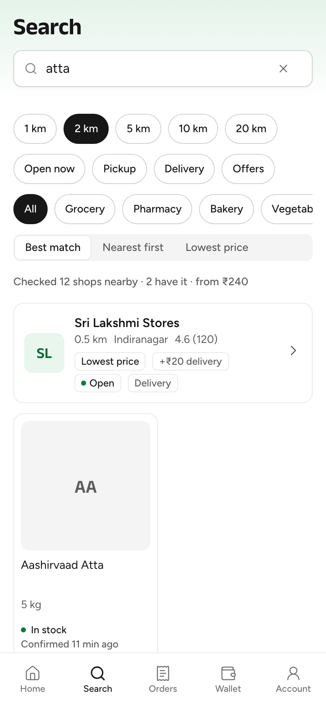
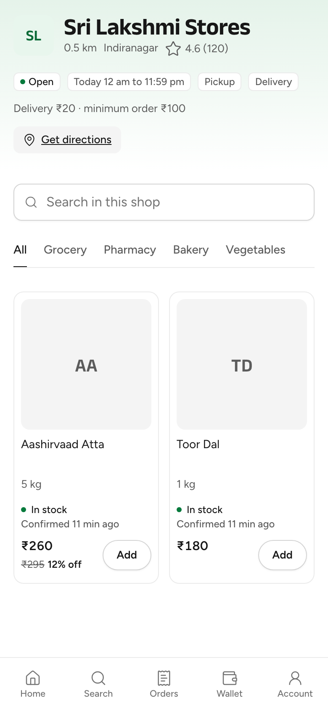

# W2-08 Customer discovery (weekend slice): QA report

C-03 Home, C-05 Search, C-07 Shop page and C-08 Product detail in `customer/`. Branch `worktree-agent-a2b712a5b311635a9`, rebased onto main da8feb5 and fast-forwarded to 7836a0c. Built against the W1-06 discover contract with typed MSW fixtures and synthetic data. No network, no cloud.

## What was built

- **C-03 Home** (`customer/src/routes/index.tsx`, `src/home/`):
  - location line, search field, and the stats "shops nearby / open now / products" (`getDiscoverSummary`);
  - radius chips 1, 2, 5, 10 and 20 km (default 2, remembered on the device);
  - category tiles that filter Home through `?category=`;
  - "Shops near you" StoreCards: letter avatar, distance, locality, rating, open state, Delivery / In-store only tags;
  - an empty-area state with "Search within 5 km", and "Set your location" when no place is chosen.
- **C-05 Search** (`src/routes/search/index.tsx`, `src/search/`):
  - suggestions (`searchSuggest`) and recent searches kept on the device;
  - results grouped by shop;
  - the D-101 summary line "Checked N shops nearby · M have it · from ₹X", hidden when M = 0, when the demand line takes its place;
  - at most one badge per shop card, and "+₹20 delivery" when the API sends `deliveryFeePaise`;
  - "Confirmed N min ago" when `confirmedAt` is set;
  - filter chips (open now, pickup, delivery, Offers, category) and sort (best match, nearest, lowest price);
  - refine chips from the API's `chips`, a zero-results state, and empty AI slots (search assist, voice, Ask shops nearby).
- **C-07 Shop page** (`/s/$slug`, `src/store/`):
  - header with today's hours, pickup and delivery tags, delivery fee and minimum, and Get directions;
  - in-shop search and category tabs (`listDiscoverStoreItems`);
  - items with stock, freshness, price and MRP strike;
  - an in-store-only state;
  - "This shop is not on TodayZ right now" for a 404;
  - `?r=` kept on the device under `todayz.ref` (`TODO(W2-01)` for attribution).
  - Add to cart goes through `customer/src/cart` only. A cart from another shop opens "Start a new cart?", and the CartBar links to `/cart`.
- **C-08 Product detail** (`/s/$slug/i/$itemId`, `src/product/`):
  - built from the cached item, with a quantity stepper and Add to cart;
  - "Other nearby shops" via a name search plus a client-side filter;
  - a plain-link share (system share or copy link).
- **Text:** `shared/i18n/messages/customer/{home,search,store,product}.en.json`.

## Evidence (agent)

| Check | Result |
|---|---|
| Vitest (customer) | 12 files, 54 tests pass |
| Typecheck, lint (`--max-warnings 0`) | clean |
| `build:e2e` | built; precache-check: all 40 chunks in the manifest; dist-check: no `sourceMappingURL` |
| size-limit | initial JS 130.27 kB gzip (limit 170); CSS 9.68 kB (limit 20) |
| `make check-frontend` | exit 0 |
| Stack journey `customer/e2e/discover.stack.spec.ts` | written, not run (language and PIN 560001 → Home → search "atta" → Sri Lakshmi → Add to cart → View cart) |

The screenshots were made with `vite preview` of the e2e build, with every `/v1/**` call answered by synthetic data, at 390×844:

| Home | Search "atta" | Shop page |
|---|---|---|
|  |  |  |

## Deferred

- The StoreMap card on Home (a TODO slot; the tiles are not wired for offline use).
- C-04 full-screen map and C-06 category page (category tiles filter Home instead).
- Banners and offers carousel (W2-07), share cards (W3-16), AI slots (empty).
- `?r=` attribution (stored only; `TODO(W2-01)`).

## Lead, at merge (2026-10-23)

**Store id (blocker, fixed in da8feb5).**
- The first hand-back used the store slug as the cart's store id, because discover returned no id, but `CheckoutQuoteRequest.storeId` is a ULID.
- I added a required `storeId` to `DiscoverStoreCard` and `DiscoverStorePage` (pins stay slug-only). `TestShopPage` asserts that the page, the list and search carry the same id.
- The agent then made `CartStore.id` the store ULID on the shop page, in search and on product detail. The slug stays in `CartStore.slug`. Add waits for the store query, so the id is never missing. A test asserts the cart holds the ULID, not the slug.

**Stale threshold.**
- The agent's client constant `STALE_AFTER_HOURS = 72` is removed. The server already sends `confirmedAt: null` past `stock_stale_after_hours` (a platform setting), so the client shows "Confirmed … ago" only when `confirmedAt` is set, and "In stock" alone otherwise.
- `RADIUS_OPTIONS_KM` and `DEFAULT_RADIUS_KM` stay as constants: they are 06-screens values, not 01 settings.

**Co-author lines.** The commits carry the Sonnet 5.5 trailer, which is accurate (Sonnet wrote them). I asked for an Opus trailer and then withdrew the request: a trailer names the model that wrote the commit.

**Lead verification in the worktree before the fast-forward:**

| Check | Result |
|---|---|
| Scope | only owned paths, plus `routes/index.tsx` (allowed), `test/render.tsx` (a `Call.query` helper) and `shell/Shell.test.tsx` (`/search` is no longer a placeholder). No lockfile or dependency change. |
| `make gen` | ok |
| `make check-frontend` | exit 0. Customer 54/54, business 56/56, admin 41/41, site 172/172, shared all pass, plus sizes and builds. |

**Answers to the agent's questions:**

1. Store id: fixed as above.
2. No Call button. Whether a customer with an active order may see the shop's phone is a founder question, the same one raised for W2-09.
3. No category name on the shop page. A small contract follow-up; not needed for the core loop.
4. No image base URL for `imageKey`, so tiles show initials. Follow-up: an `IMAGE_BASE_URL` env (img.todayz.localhost locally) once W1-05's image pipeline is used by the apps.
5. Radius constants are fine; the stale constant is removed.
6. "Other nearby shops" by name plus a client filter is accepted for now. Follow-up: a `productId` filter on `searchDiscover`.
7. A coarse refine-chip removal (`parse=false`) is accepted while `chips` is always `[]`.
8. `/cart` is W2-09's. The lead adds the cart entry point in the shell when W2-09 merges.

**Follow-ups:**
- 06-screens C-05: when there are results but **none confirmed within `stock_stale_after_hours`**, show the zero-results treatment (nearest shop categories, the demand line and Ask shops nearby). Today only the zero-results case shows it.
- Run the stack journey on the seed (lead, with the W2-09 and W2-10 journeys).
