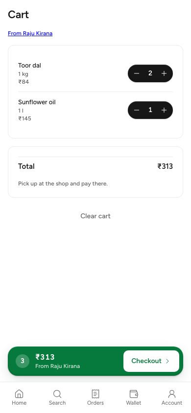
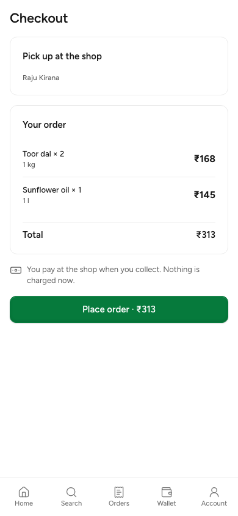
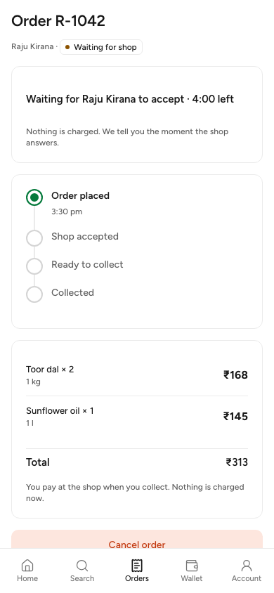
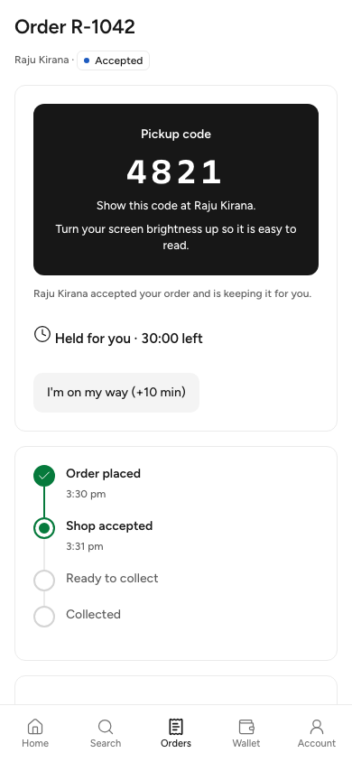
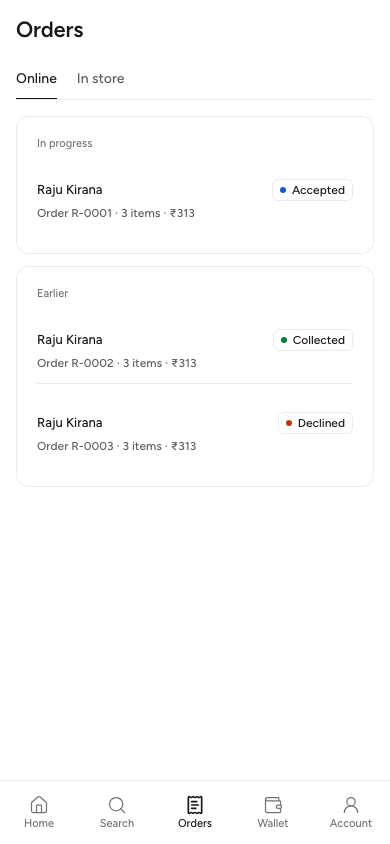

# W2-09 Customer transactions (weekend slice): QA report

Branch `worktree-agent-ad1dcf20a6d81c25a`, rebased by the lead onto main c075155 (after W2-02) and fast-forwarded: 71c107b, f250058, ba6f551, 4626ca6. The merge of the contract commit dropped out in the rebase (W2-02 is on main). Hashes in the agent sections are from before the rebase.

## Built
- Cart module moved to IndexedDB (write-through), same exported API (W2-08 unchanged).
- C-09 Cart (/cart): one-shop cart, live quote, short or unavailable lines flagged, server total in integer paise.
- C-11 Checkout (/checkout, pickup only): sign-in redirect with the cart kept; Idempotency-Key per attempt, reused on retry; two-tap acceptance when total or stock changed; banners for store closed, insufficient stock, ordering paused; update toast held while open (G9).
- C-12 Tracking (/orders/$orderId): waiting with serverNow countdown; pickup code after accept with hold countdown and brightness hint; +10 min once; cancel with reasons (other needs a note); locked-code state; outcome screens (rejected, expired, cancelled, collected); SSE with polling fallback; check animation once via ?placed=1 (removed after).
- C-13 Orders (/orders): Online tab, "In progress" and "Earlier"; sign-in empty state; In store tab placeholder.

## Evidence (agent)
| Check | Result |
|---|---|
| customer vitest | 60/60 (20 new in src/test/transactions.test.tsx) |
| tsc, eslint (src, e2e), stylelint | clean |
| make check-frontend | exit 0 (lint, types, unit, build:e2e, precache-check, dist-check, size-limit) |
| size-limit customer | JS 127.85 kB / 170 gzip; CSS 9.68 / 20 |
| make check (full) | stopped at check-backend: gofmt of backend/cmd/todayz/contract_test.go (W2-02 contract commit) |
| Screenshot spec (e2e/transactions.shots.spec.ts) | 5/5 at 390x844, synthetic API via page.route, no non-local requests |
| Stack journey e2e/order.stack.spec.ts | pass on the seed, 2026-10-24 (see `docs/qa/stack-2026-10-24/REPORT.md`); seed defaults, no env needed |

## Deferred
Delivery and address (W2-03), credits and wallet (W2-01), partial confirm (notice only, W2-02), reviews, refer, scan, inbox, help, receipt, support tickets and C-19, the In store tab, call shop (no phone in the contract), QR on the pickup code (no library).

## Security
The pickup code lives only in the order-detail query cache and PickupCode; not in URLs, query keys, storage, logs or telemetry (the stack spec asserts it). No secrets, OTPs, tokens or phones printed or committed.

## Files outside owned paths
customer/package.json (+@todayz/realtime), pnpm-lock.yaml (customer importer link), customer/src/test/render.tsx (Call.search), customer/src/shell/Shell.test.tsx (skips orders), customer/e2e/{order.stack,transactions.shots}.spec.ts, shared/i18n/messages/customer/{cart,checkout,orders}.en.json.

## Screenshots

Taken by `e2e/transactions.shots.spec.ts` at 390×844 against a synthetic API (`page.route`), before the rebase. The rebase changed only test files, so the screens are the same.

| Cart | Checkout | Waiting for the shop |
|---|---|---|
|  |  |  |

| Pickup code | Orders |
|---|---|
|  |  |

## Lead, at merge (2026-10-24)

**Rebase.**
- `customer/src/test/render.tsx` conflicted with W2-08. Both added a field to `Call`: W2-08's `query: URLSearchParams` and W2-09's `search: string`. I kept both.
- `customer/src/shell/Shell.test.tsx` conflicted too: the placeholder test now skips both `search` and `orders`.
- The resolution sits in f250058.

**Cart entry point (lead-owned, part of this merge).** C-03 Home now shows the same floating `CartBarLink` as Search, the shop page and product detail, so a cart with items is one tap from `/cart` on every discover screen. I added two tests to `home.test.tsx`: the bar shows with items, and it is hidden when the cart is empty. I added no bottom-nav cart tab, because 06-screens has none.

**Contract.** I checked the code against W2-02's final contract:
- the quote and create send `storeId` (the discover ULID) and `expectedTotalPaise`;
- the code shows only when `order.code` is set and the code is not locked;
- `new-code` re-reads the order rather than reading the code from the action answer (D-108).

**"make check stopped at gofmt of contract_test.go."** Fixed on W2-02's branch (70df509), so it no longer applies.

**Lead verification:**

| Check | Result |
|---|---|
| `pnpm install --frozen-lockfile --offline` | pass (worktree and main) |
| `make gen` | ok |
| `make check-frontend` (rebased worktree) | exit 0. All apps' lint, types, unit tests, builds, precache, dist and size pass. Customer JS 130 kB of 170; business 133.5 kB of 250 |
| Customer on main after the Home cart bar | vitest 14 files, 80/80; tsc and eslint clean |

**Answers to the agent's questions:**
1. **Call the shop:** no phone in the contract, and 01 §16 keeps it off discover. Whether a customer with an active order may see the shop's phone is a founder question. Until it is answered there is no call button; directions come from the address.
2. **QR on the pickup code:** digits only for now. A QR library is a new dependency and needs the user's OK (D-88 age rule). Follow-up.
3. **In store tab:** the placeholder is right; W2-04's POS links fill it (D-75).
4. **`TZ_SHOP_*` for the stack spec:** the lead sets them from the seed at the stack run.
5. **Cart entry point:** added on Home, as above.

**Follow-ups:**
- Run `e2e/order.stack.spec.ts` on `make dev` with the seed (lead, with the W2-08 and W2-10 journeys).
- The QR code needs the user's OK for a dependency.
- The shop phone on an active order is a founder question.
