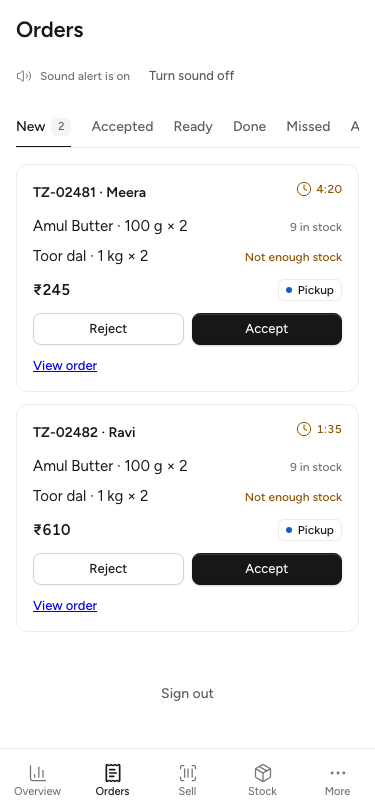
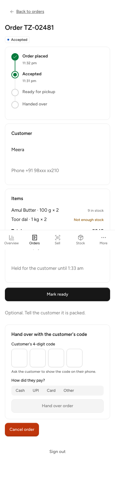
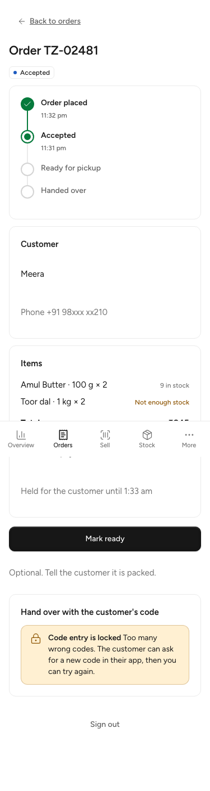
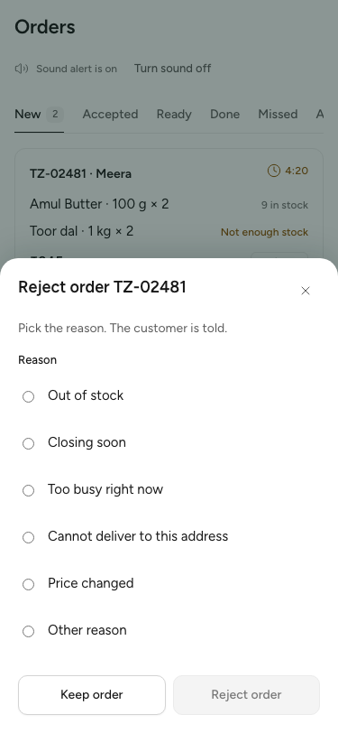

# W2-10 Business orders (weekend slice): QA report

Branch `worktree-agent-a5bebc7afd7f45347`, rebased by the lead onto main c85c82f (after W2-02 and W2-09) and fast-forwarded. Commits:
- 7ba8198: orders desk, detail and code entry
- f3205a3: tests
- bf71b36: stack journey, not run
- b0b5172: business CLAUDE.md
- 413f1dc: lead, the test-setup fix below

The contract commit was skipped as already applied. Hashes in the agent sections are from before the rebase.

## Scope
B-04 orders: tabs, live updates, sound alert, pickup code entry, order detail, role-based buttons (D-65).
Deferred: QR scan, dispatch, delivery, returns, B-02, B-13 (incl. /invite/$token), B-14, standee PDF, accept part (TODO(W2-02)), Asks tab content (TODO(W3-16)).

## What was built
- B-04 at /orders: tabs New, Accepted, Ready, Done, Missed, empty Asks slot. New cards count down from serverNow, show stock per line, Accept and Reject (D-60 reasons in a sheet; other needs a note).
- /orders/$orderId: timeline, customer name and masked phone, lines, totals, payment note; Accept/Reject (placed), Mark ready (accepted pickup), hand-over code entry (accepted or ready), Cancel for owner/manager only (D-65), not-found state.
- Live updates over @todayz/realtime SSE: 404/403 stops the stream; other failures retry three times, then polling with a banner.
- Sound: Web Audio chime repeating until the order is opened, accepted or rejected; "Allow sound" unlocks it; orders already seen on first load do not alert (alerts.ts).
- CodeEntry.tsx: 4 digits plus payment method (no default); tries left on code_invalid; lock banner on code_locked; the code lives in component state only, cleared after every answer; a test asserts it is absent from URLs, query keys and localStorage; never logged.
- Idempotency-Key per action, reused only after a network failure.

## Evidence (agent)
| Check | Result |
|---|---|
| lint, lint:css, typecheck (business) | clean |
| Vitest (business) | 72/72 pass; orders 13, alerts 3 |
| make check-frontend | exit 0 |
| build:e2e, precache check, dist-check | pass |
| size-limit business | JS 136.19 kB / 250 kB gzip; CSS 10.35 kB / 20 kB |
| make check (full) | failed at check-backend: gofmt of backend/cmd/todayz/contract_test.go (from W2-02's contract commit 8b2b909, outside this WP) |
| Stack journey e2e/orders.stack.spec.ts | both tests pass on the seed, 2026-10-24 (see `docs/qa/stack-2026-10-24/REPORT.md`) |
| Live API | not run; order routes not mounted yet; fake fetch and mocked routes |

## Files outside owned paths
business/package.json (+@todayz/realtime workspace dep), pnpm-lock.yaml (importer link only), business/src/test/render.tsx (Call carries search), business/src/shell/Shell.test.tsx (placeholder it.each excludes orders), business/CLAUDE.md, business/e2e/orders.stack.spec.ts, shared/i18n/messages/business/orders.en.json (~140 keys).

## Screenshots

Taken at 390×844 with synthetic data, before the rebase. The rebase changed no screen code.

| New tab | Order detail |
|---|---|
|  |  |

| Code locked | Reject sheet |
|---|---|
|  |  |

## Lead, at merge (2026-10-24)

**Rebase.** The rebase was clean; git skipped the contract commit (8b2b909) as already applied. The lockfile merged cleanly with W2-09's importer link.

**A real defect, found and fixed at merge (413f1dc).**
- After the rebase, `business/src/test/auth.test.tsx` printed "unable to get local issuer certificate" twice while still passing.
- The cause: the picker tests now land on the real `/orders` page, whose store stream (`@todayz/realtime`) uses the global `fetch` and was opening a TLS connection to the real API URL from a unit test. `renderAt`'s fake fetch only reaches the API client.
- Fix: `src/test/setup.ts` now stubs the global `fetch` to reject, before each test. Tests that need it (the orders stream tests) stub their own, which runs after. Main had no such errors before the merge, and the run now shows none.

**Checks against W2-02's final contract:**
- `CodeEntry` maps 422 `code_invalid` (tries left) and 409 `code_locked`.
- Hand-over is allowed from accepted or ready.
- Cancel on an accepted order is for manager and above (D-65), and the server enforces it as well (a cashier cancel gets 403 in TestOrdersTenancyHTTP).

**Store-scoped roles.** `BusinessSummary.role` is per business, and `stores` lists only the stores the person may open. A cashier for one store therefore only ever sees that store, and the server gates every action. Accepted.

**Lead verification:**

| Check | Result |
|---|---|
| `pnpm install --frozen-lockfile --offline` | pass |
| `make gen` | ok |
| `make check-frontend` (rebased worktree) | exit 0. Business 72/72, customer 80/80, admin 41/41, site 172/172, shared all pass. Business JS 136.19 kB of 250 |
| Business after 413f1dc | vitest 72/72, no certificate errors; tsc and eslint clean |

**Answers to the agent's questions:**
1. **Contract:** re-verified against W2-02's final branch, as above.
2. **Role from `listBusinesses`:** accepted. Store-scoped roles work, as above.
3. **`/choose-shop?next=/orders`:** yes.
4. **Timeline:** use the timeline events; `placedAt` only as a fallback.
5. **Hand-over from accepted or ready:** correct (D-108).
6. **The shop does not extend the accept timer.** Only the customer's one +10 min hold extension exists (BK-15).

**Follow-ups:**
- **Router warning.** Shell links to `/$section` print "Generated path /orders … matched route /orders/" in tests, now that `/orders` (and `/search` in the customer app) are real routes. It is only a warning. The shell should link a built section to its own route.
- **A New card can show "Not enough stock" and still offer Accept.** The server refuses an accept it cannot hold. Decide with W2-04 whether the button should be disabled with a hint.
- **The stack journey** `e2e/orders.stack.spec.ts` passed on the seed on 2026-10-24 (`docs/qa/stack-2026-10-24/REPORT.md`).
