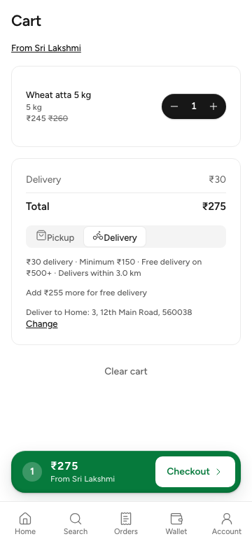
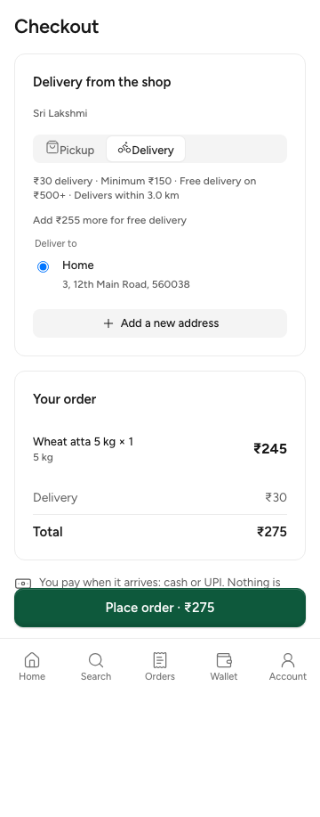
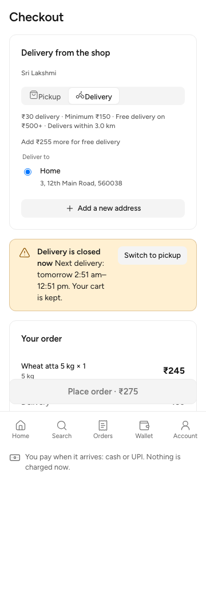
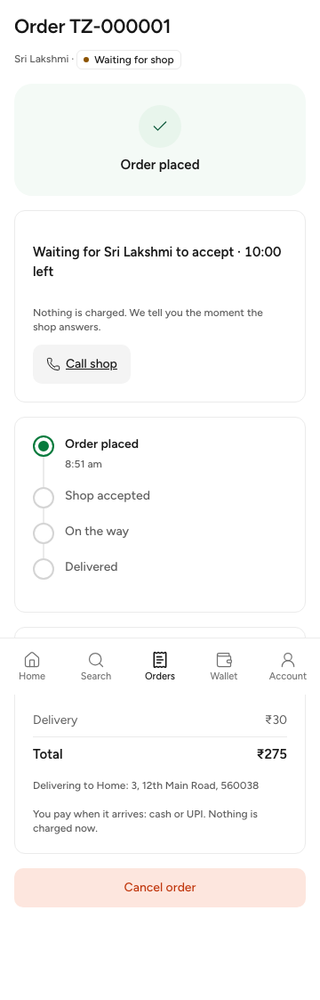
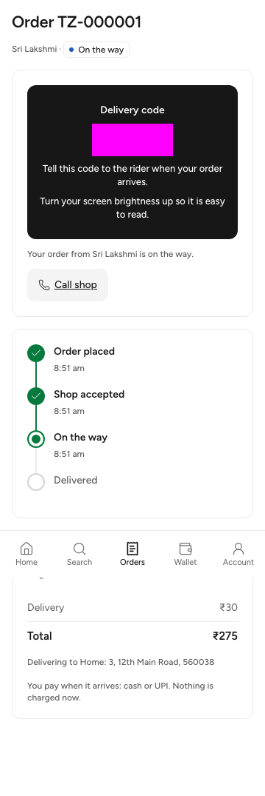
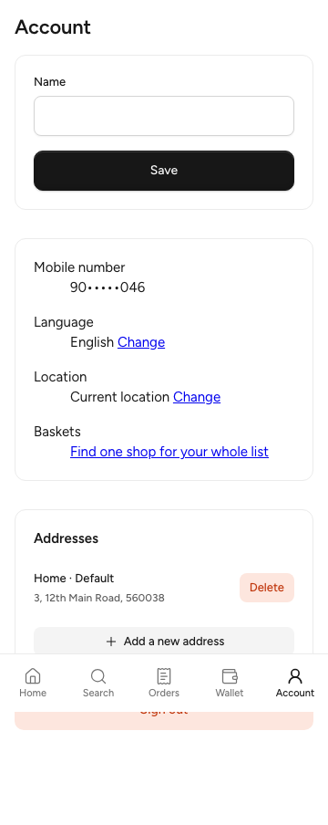
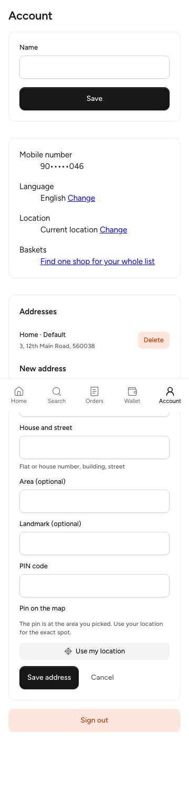

# W2-15 customer delivery: report

Branch `claude/nostalgic-lehmann-fae866`, 25 Oct 2026. Not pushed; the lead merges after review.

## What was built

| Part | Where |
|---|---|
| Saved addresses API: `GET/POST /v1/me/addresses`, `PATCH/DELETE /v1/me/addresses/{addressId}` | commit 7ae3135 (backend) |
| C-09 cart: a Pickup/Delivery switch, the shop's terms (fee, minimum, free-from, radius), "Deliver to …" and "Add ₹X more for free delivery" | `customer/src/cart/` (`Delivery.tsx`, `fulfilment.ts`, `deliveryRules.ts`, `quote.ts`, `CartPage.tsx`) |
| C-11 checkout for delivery: address picker (shows "outside the delivery area" with the distance), a new-address form with a pin, the `delivery_closed` banner with the next window and "Switch to pickup", and `addressId` sent on quote and place | `customer/src/checkout/CheckoutPage.tsx`, `customer/src/address/` |
| C-12: the delivery state ("on the way", the delivery code while out for delivery, the delivery address, "You pay when it arrives") | `customer/src/orders/OrderPage.tsx` |
| C-18: the Addresses card on Account (list, default, delete, add) | `customer/src/address/SavedAddresses.tsx`, `routes/account.tsx` |
| D-220: the shop's phone on the customer's own open order, and a "Call shop" link | see below |
| E2E-05: the three `test.fixme` journeys are now real tests | `e2e/journeys/specs/14-e2e-05-delivery.spec.ts`, fixtures `seed.ts` (person `delivery`) and `journey.ts` (`Shop.dispatch`, `Customer.savedAddress`, `StoreOrder`) |

### D-220 (the shop's phone)

- **Contract:** `OrderStore.phone` is required and nullable. Its description cites D-220. `make gen` was run.
- **Backend:** `internal/orders/reads.go` opens `stores.phone_enc`, sealed under `phone:<storeId>`. It fills `phone` only on the customer's `GET /v1/me/orders/{orderId}`, and only while the order is placed, awaiting_customer, accepted, ready or out_for_delivery.
  - The phone is null:
    - once the order is finished;
    - when the shop has no phone;
    - in lists (D-220's "every list stays without a store phone");
    - in action responses, because the idempotency layer may store those, the same reason the code is left out of them.
  - There is no fallback to an owner's or staff member's login phone. If the sealed value fails to open, the phone is null and a warning is logged without the value.
  - The business views leave it null.
- **Customer:** C-12 shows "Call shop" as a `tel:` link when `store.phone` is set: in the placed section, on the awaiting_customer card, and in the open actions. It replaces the old `TODO(lead)`.
  - The en key `orders.callShop` was added.
  - The hi key is a **machine draft** (`review: machine`) in the new `shared/i18n/messages/customer/orders.hi.json`. It needs human review before it ships, and English shows until then.
- **Tests:**
  - `backend/cmd/todayz/orders_store_phone_http_test.go`:
    - `TestD220ShopPhoneWhileTheOrderIsOpen` covers placed, list, accepted, collected, a second open order, the cancel response and cancelled.
    - `TestD220NoShopPhoneNoFallback` covers a shop with no phone.
    - The phone is compared as a boolean and never printed.
  - Customer vitest: the link is shown with a phone and absent without one.

## Checks

| Check | Result |
|---|---|
| `make gen` | ok |
| Backend: gofmt (no files), `go vet ./...`, golangci-lint on `internal/orders` + `cmd/todayz` (0 issues) | pass |
| `go test ./cmd/todayz/ ./internal/orders/...` (shared test PG) | ok (61 s) |
| Customer vitest | 17 files, 136 tests pass |
| Customer tsc, eslint; business, admin and e2e typecheck | pass |
| i18n lint (customer) | 0 errors (warnings are the unreviewed hi/kn/te/ta catalogues) |
| Customer `build:e2e` (precache-check, dist-check) | pass |
| E2E-05 delivery journeys, on a fresh `make reset` + `make dev` with the API restarted on this code | **3 passed** |
| Full journeys suite after `make reset` | 24 passed, 4 skipped (existing fixmes), 0 failed |

Not run: the whole `make check` and `make e2e` (contract full, visual, a11y, Lighthouse). The lead's gate covers those.

## Screenshots (360 px, local stack, seed data)

These were taken by a throwaway Playwright script against `make dev`, which was deleted afterwards. The delivery code is masked. No phone appears: Account shows only the app's own masked number for a seeded test person.

| Screen | File |
|---|---|
| C-09 cart with Delivery picked |  |
| C-11 checkout, saved address picked, ₹275 |  |
| C-11 `delivery_closed` (the quote answer is **stubbed** in the browser, because globalSetup opens SL all day; the window times in it are arbitrary) |  |
| C-12 placed, with "Call shop" (D-220) |  |
| C-12 out for delivery, code masked |  |
| C-18 Account, Addresses card |  |
| C-18 new address form |  |

The fixed bottom nav shows mid-page in the full-page shots. That comes from how full-page capture works, not from the layout.

## Notes and choices

- **Address privacy:** address text is stored as given and never logged, and journeys never print it. Whether it should be sealed like phones is the lead's call.
- **Address cap:** now the setting `customer_max_saved_addresses` (default 20, D-222; see "Lead review fixes").
- **The pin:** it comes from "Use my location" or the saved area and cannot be dragged on the map yet.
- **Payment note:** the C-11 and C-12 wording is "You pay when it arrives: cash or UPI. Nothing is charged now." This is the conservative reading; no prepay is built.
- **Journey shortcuts:**
  - The delivery code is entered through the API (`shop.handOver`), the same as the pickup journeys.
  - Journeys use `build:e2e`, because a production build needs a real Turnstile key.
- **Local setup in this worktree:**
  - `.tools` is a symlink to the main checkout's toolchain.
  - `.env.local` came from `make setup-keys`, which prints names only.
  - Neither is committed.

## Follow-ups for the lead

1. **Delivery code timing.** 01 says the delivery code is "valid only in `out_for_delivery`", but the backend returns it to the customer from accepted on (`codeShown`). The customer UI shows it only while out for delivery. Either 01 or the backend should change.
2. **Business app after Dispatch.** The order detail keeps the dispatch response, which has no phone (an idempotent replay could store it). So "Call {customer}" appears only after the order is read again. The journey reloads the page. The business app should refetch the order after dispatch.
3. **Address sealing:** the decision under "Notes and choices" (the cap is settled by D-222).
4. **Hindi review:** `orders.callShop` in `orders.hi.json` needs human review.
5. **Docs:** this branch does not carry main's D-220 docs commit (3a11a74). No docs were touched here, so the merge should be clean.

## Lead review fixes (25 Oct)

| Fix | Where |
|---|---|
| A control character or invalid UTF-8 in `label`, `line1`, `line2` or `landmark` is `422` on `body.<field>` on create and patch (a NUL was a 500) | `internal/identity/addresses.go` (`addressField`); `TestAddressTextRefusesControlCharacters`, `TestAddressesHTTP` |
| The cap is `customer_max_saved_addresses` (count, default 20, 1–50), read through `settings.Cache` (identity `Deps.Settings`); 01 §5.5 and §17, D-222 | migration `21501_w2-15_saved_address_cap.sql`, `settings/keys.go`; `TestAddressCap` lowers the setting to 3 |
| `updated_at` is the database's clock on insert and update (the INSERT takes the default; no `@now` in any address query); ties fall back to the ULID | `db/queries/identity/addresses.sql` |
| PATCH description: making a new default bumps the old default's version, so its ETag goes stale (412) | `api/paths/me.yaml` |
| D-220 tests: phone shown in awaiting_customer, accepted after confirm-partial or extend, ready, out_for_delivery; null in rejected, expired, delivery_failed and in the confirm-partial and extend responses | `TestD220ShopPhoneByStatus`, `TestD220ShopPhoneOnDelivery` |
| Router-level address test: another customer's PATCH and DELETE are 404, PATCH without If-Match is 428, a business token is 403 on GET, POST and DELETE | `cmd/todayz/addresses_http_test.go` |

The staff `ready` response is the business view, which has no `store` object, so it has no phone to check.

Checks: `make gen` ok; gofmt clean; `go vet ./...` ok; golangci-lint on `internal/identity`, `internal/platform/settings` and `cmd/todayz` reports 0 issues; settings lint ok; `go test` on `internal/identity`, `internal/platform/settings`, `internal/platform/migrate`, `internal/orders` and `cmd/todayz` (shared test PG): all ok (cmd/todayz 92 s). The journeys were not rerun, because nothing they use changed.
