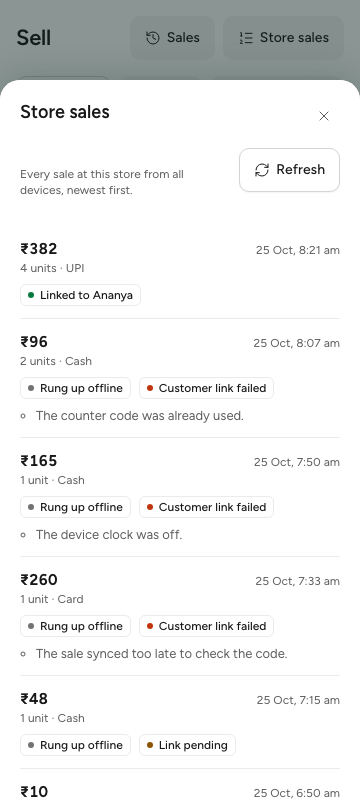

# W2-16 POS store sales list: QA report

The shop can now see every counter sale of the store and each sale's customer link, including "Customer link failed" with the reason (B-05 sales history, D-12, D-221). Branch `claude/zen-satoshi-82e8ae`, cut from `main` at 837164b. Nothing touched a cloud account.

## What was built

- **Contract:** `GET {S}/pos/sales` (`listPosSales`, tag pos), with `limit` and `cursor`. It returns `PosSaleList` of `PosSaleSummary` items. `PosSaleLink.failure` is the new enum `PosLinkFailure`. Examples are in `backend/api/paths/pos.yaml`.
- **Policy:** `pos.sales` is granted to all staff (cashier and above); the golden file is updated.
- **Migration 21601:** `pos_sales.link_fail_reason`, with a check that it is set only when `link_status = 'failed'`. Up and Down are both written.
- **Sync** (`internal/pos/sync.go`): `offlineLink` now records why a link failed:
  - `clock_off`: the offset at the device's last check was more than 2 min, or the typed time is in the future;
  - `too_late`: synced after `pos_offline_link_max_hours`;
  - `locked`;
  - `code_used`: the time step was already used;
  - `code_wrong`;
  - `unverified`.
- **Service** (`internal/pos/history.go`):
  - newest first by `(sold_at, id)`, keyset cursor, 20 per page by default and at most 100;
  - unit and line counts are included;
  - the customer is named only for `bill_qr` and `counter_code`;
  - no phone and no receipt token are returned.
- **Business app** (`business/src/pos/StoreSalesSheet.tsx`):
  - a "Store sales" button on the Sell screen opens the sheet;
  - each row shows the total, units, payment method, date and time (IST) and "Rung up offline";
  - the link pill is "Linked to {name}", "Customer linked", "Link pending", "No customer" or "Customer link failed", with the reason as a note below it;
  - "Load more" follows the cursor, and "Refresh" reloads;
  - offline, the sheet says it needs a connection and makes no call;
  - controls are at least 44 px (`--control-lg`), colours come from tokens only, and all copy is in `pos.en.json` (`pos.storeSales.*`, `pos.pay.other`).
- **E2E-07:** the `test.fixme` is now a real step. The cashier opens Sell, then Store sales, and sees "Customer link failed" with "already used", "clock was off" and "synced too late". The step also checks that no phone appears.

## Checks

| Check | Result |
|---|---|
| `go test -race` for cmd/todayz, internal/pos, authz, migrate, devtools (shared test Postgres) | pass |
| golangci-lint for pos, cmd/todayz, authz | 0 issues |
| `TestW216SalesListLinkFailures` (paging, all four failure reasons, no phone or receipt token, other-store cashier gets 403, bad cursor gets 422) | pass |
| business vitest | 375 passed |
| business typecheck and lint | pass |
| i18n gen and message lint | 0 errors |
| e2e journeys typecheck | pass |
| `business/e2e/sell.spec.ts` on the `build:e2e` bundle with a faked API (4 tests, including the new 360 px store sales test) | 4 passed |
| E2E-07 on a fresh `make reset` + `make dev` | not run here: the lead skipped the stack (swap nearly full, four workers running) and runs it on `main` after the merge |

## Screenshot



`store-sales-360.png`: the Store sales sheet at 360 × 800 against the faked API, made by the test "phone 360: store sales with each link status and why a link failed". The rows show linked to a name, three offline-code failures (already used, clock off, synced too late), link pending, and a reversed sale below the fold. The test also checks that Refresh is at least 44 px tall and that the page has no horizontal scroll. The data is made up: there are no real codes, phones or tokens.

To refresh it, run this from `business/` after `pnpm build:e2e`, with placeholder `VITE_TURNSTILE_SITE_KEY` and `VITE_API_URL` set in the shell:

```bash
TZ_QA_DIR=docs/qa/W2-16-pos-sales-list pnpm exec playwright test -c playwright.config.ts sell.spec.ts -g "phone 360"
```

## Notes for the lead

- D-221 takes the next free number after main's D-220. Renumber it if another branch took it first.
- Sales that failed before migration 21601 have no reason recorded. They show "Customer link failed" without the reason line.
