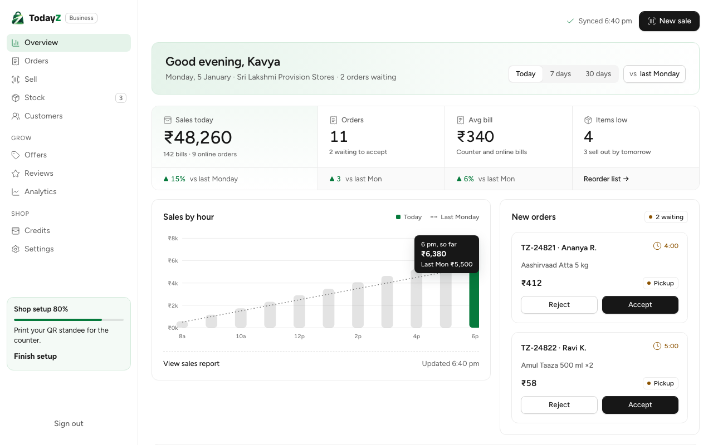
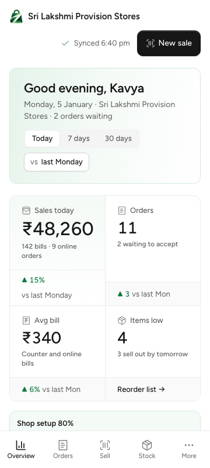
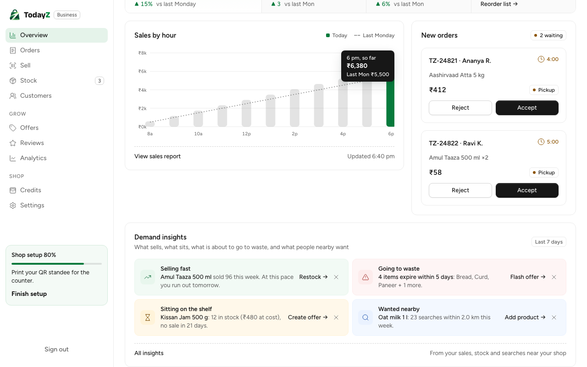
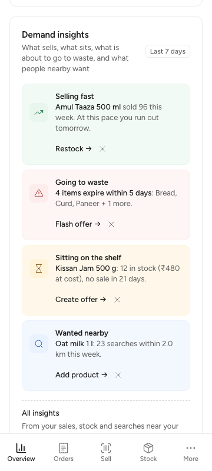
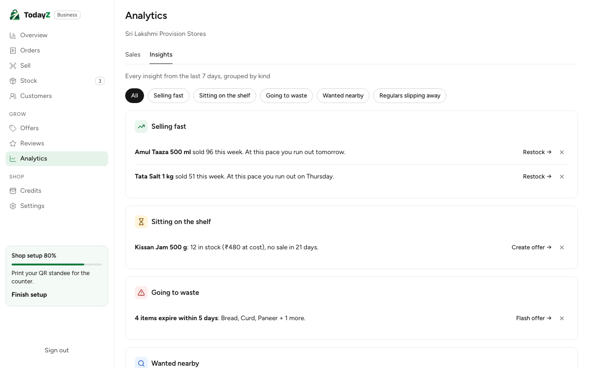
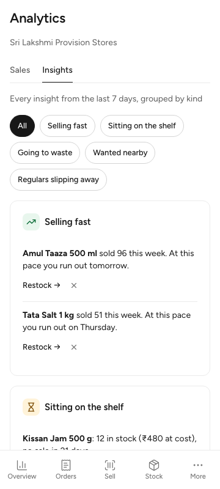
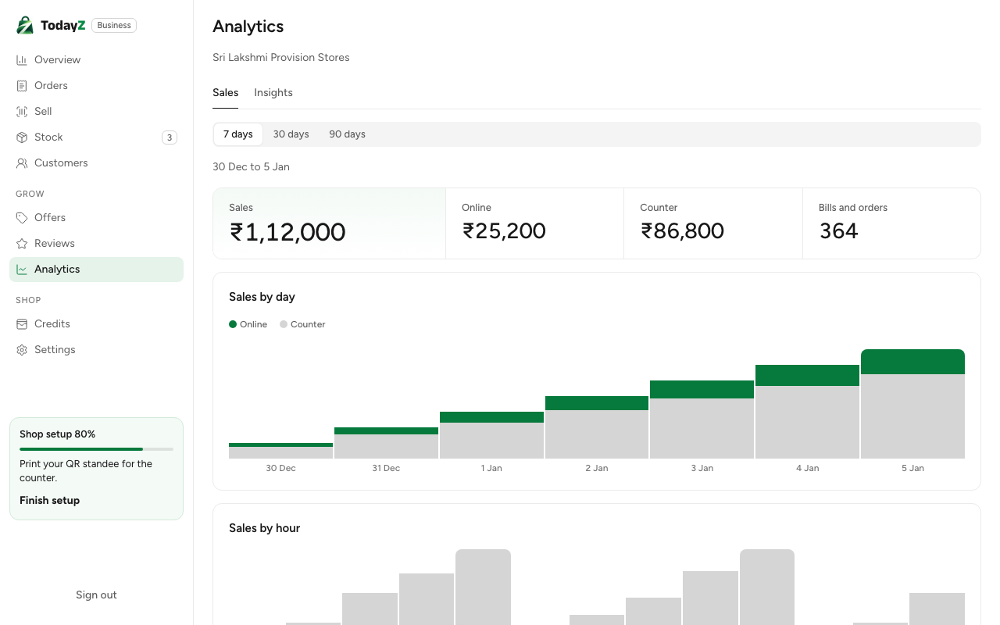
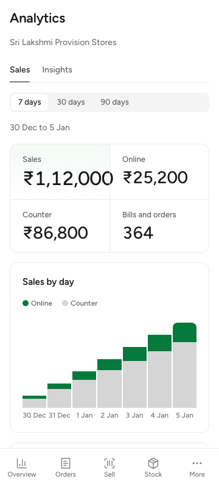
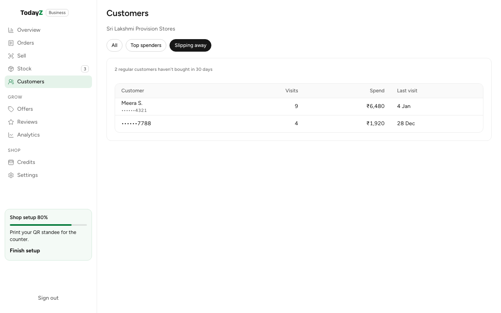
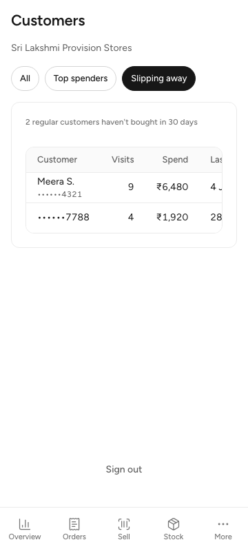

# W3-03 Demand insights v2, Overview, Analytics and Customers: QA report

Branch `claude/stoic-fermi-c00da6`, 25 Oct 2026. Decision: D-99 (Demand insights v2). Screens: B-03 Overview, B-12 Analytics (Sales and Insights tabs), B-09 Customers ("Slipping away"). Commits: `94b6e38` for the backend, and the business commit that adds this report.

## What was built

### Backend (`94b6e38`)

- **Facts (`internal/insights/facts`).**
  - Plain SQL for the 11 kinds: `selling_fast`, `sitting_on_shelf`, `going_to_waste`, `wanted_nearby`, `missed_sales`, `expired_on_shelf`, `selling_below_cost`, `stock_check_due`, `bought_together`, `regulars_slipping`, `priced_above_nearby`.
  - Each row carries `facts`, `severity`, an `evidence` state (`ready`, or `needs_data` with the key and numbers of what is missing) and a deep-link `action`.
  - No AI is involved. `text` is always `null`; W3-11's coach writes it later.
- **Thresholds come from `platform_settings`.** Every threshold is read from there: `insight_period_days`, `insight_min_units_selling_fast`, `insight_cover_days`, `insight_no_sale_days`, `insight_expiring_within_days`, `insight_min_searches`, `insight_wanted_nearby_radius_m`, `insight_missed_sales_*`, `insight_pair_*`, `insight_regular_*`, `insight_min_events_for_percent`, `insight_price_compare_enabled` and `coach_dismiss_quiet_days`. `priced_above_nearby` is off unless `insight_price_compare_enabled` is on.
- **`AskDemand`.** This interface adds unanswered asks to Wanted nearby and Missed sales before the k ≥ 10 test. `NoAsks` returns zero until W3-16 provides `asks.Demand`.
- **API** (`insights` domain, policy `insights.view`, owner and manager):
  - `GET {S}/overview?range=today|7d|30d`: KPIs, new orders, sales by hour against the same weekday last week, top items, and setup progress.
  - `GET {S}/insights`: the card is the top 4 by severity, one per kind. With `all=1` it returns every row, including `needs_data`. It also takes `kind=`, `limit` (≤ 100) and `cursor`.
  - `POST {S}/insights/dismiss` `{kind, subjectRef}`: "Not useful" quiets one subject for `coach_dismiss_quiet_days` and answers `quietUntil`. A going-to-waste row quiets every batch in it. `expired_on_shelf` cannot be dismissed.
  - `GET {S}/analytics?range=7d|30d|90d`: sales by day (online and counter), sales by hour, the order funnel with the median accept time against nearby shops, top items, category mix, repeat customers, and ratings by week.
  - `GET {S}/customers?segment=all|top|slipping`: phones masked, cursor pages. `enough: false` when too few customers are linked.
- **Rollups.** The figures reuse W3-07's rollups, including the item-pair rollup for `bought_together`.
- **Migration `30301_w3-03_insights.sql`.** It creates `insight_feedback`, which is unique per store, kind and subject. It also creates `insight_geo_cells`; see the H3 gap under "Notes for the lead".
- **Seed (`internal/seed/insights.go`).** Shop SL2 fires 13 rows across 10 kinds. SL keeps the original kinds. The eleventh kind, `priced_above_nearby`, is behind its setting, which is off.

### Business app

- **B-03 Overview (`src/overview/`).**
  - Sample data is gone (`sample.ts` deleted). The screen reads `GET /overview` for today, 7 days or 30 days; switching period keeps the last answer on screen until the new one arrives.
  - The KPI strip, sales by hour (current hour in brand colour, earlier hours grey, last week as a dotted line) and new orders count down on the server's clock.
  - The Demand insights card shows the API's rows with their sentences. "Not useful" hides a row optimistically and says until when, and the row comes back if the dismiss fails. When no insight fires, the card lists the setup steps left.
  - `<CoachSlot/>` is mounted and stays empty until W3-11.
  - `StoreGate.tsx` is the store gate for the three owner screens. A cashier gets a note pointing to Orders and Sell, and no call is made.
- **Shell.** The sidebar Stock badge (`sellOutSoon`) and the shop setup card now read the real overview, for owners and managers only.
- **B-12 Analytics (`src/analytics/`, `/analytics?tab=sales|insights&kind=`).**
  - The Sales tab shows the 7, 30 and 90 day views of the analytics answer.
  - The Insights tab shows every row from `all=1`, grouped by kind, with a kind filter kept in the URL. `needs_data` kinds are listed as "Not enough data yet", with no action or button.
- **B-09 Customers (`src/customers/`, `/customers?segment=`).** It has All, Top spenders and Slipping away, masked phones, "Load more", and a message when too few customers are linked.
- **Deep links apply nothing.** They only open the prefilled screen:
  - Restock → `/stock?restock=…&qty=…`
  - Flash offer → `/offers?offer=flash&batches=…`
  - Create offer → `/offers?offer=item&item=…&pct=…`
  - Add product → `/stock?add=…`
  - The tests check that no POST, PUT or PATCH is sent.
- **i18n.** It adds 122 keys (43 overview, 61 analytics, 18 customers), changes 6 and removes 10 sample-data keys, in all five languages.

## Checks

| Check | Result |
|---|---|
| `make gen` | clean |
| backend `go test -race ./internal/insights/... ./internal/seed/... ./cmd/todayz` (card and tab, dismiss quiet and renewal, customers, overview and analytics, unconfigured, ops cover every operation, handlers, paging; seed fires every kind) | pass (with `94b6e38`) |
| golangci-lint, contract lint, authz policy golden | 0 issues |
| business `typecheck`, `lint`, `lint:css` | pass |
| business vitest | 410 passed (overview 20, shell 12, analytics 10, customers 7 in this WP) |
| business `build:e2e`, precache check, dist check, size-limit | pass; initial JS 166.86 kB of 250 kB, CSS 10.86 kB of 20 kB |
| business Playwright on the `build:e2e` bundle (all specs) | 30 passed, 8 of them in `e2e/insights.spec.ts` |
| `make dev` / `make reset` stack run | not run; worker sessions stay local and the lead runs the stack |

## Screenshots

The data is made up and comes from `business/src/test/insightsData.ts`. The fixtures are shared by the unit tests and the Playwright specs. Each test also checks that the page has no horizontal scroll.

| | Desktop | 360 px |
|---|---|---|
| Overview |  |  |
| Overview, Demand insights |  |  |
| Analytics, Insights |  |  |
| Analytics, Sales |  |  |
| Customers, Slipping away |  |  |

To refresh them, run this from `business/` after `pnpm build:e2e`, with placeholder `VITE_TURNSTILE_SITE_KEY` and `VITE_API_URL` set in the shell:

```bash
TZ_QA_DIR=docs/qa/W3-03 pnpm exec playwright test insights.spec.ts
```

## Notes for the lead

- **H3 gap.** The backend has no H3 library, so `search_log.geo_cell` is still written NULL (`internal/search`). The only rows in `insight_geo_cells` are the seeded placeholder cells. Wanted nearby and Missed sales therefore fire only on the seed. To fix this, add an H3 library (or have the client send the cell), fill `search_log.geo_cell`, and fill `insight_geo_cells` from the writer. This is `TODO(lead)` in migration 30301 and in `internal/seed/insights.go`.
- **The W1-05 J11 assertion changed.** In `internal/seed/catalogue_test.go`, J11 (Idli rice) is now stocked and then sold out by the insights seed, so Missed sales fires (08 §2). The catalogue test asserted J11 had no stock row; it now asserts the sold-out state.
- **Specs from other WPs changed.** The owner's sidebar now calls `GET /overview`, so the fakes in other specs answer it:
  - `e2e/smoke.spec.ts` (W0-05) also answers `GET /insights`.
  - `e2e/sell.spec.ts` (W2-11) and `e2e/standee.spec.ts` (W3-09) answer `GET /overview`.
  - In `src/test/auth.test.tsx` (W1-08), the signed-in journey now gets the overview handlers.
  - In `src/orders/orders.test.tsx` (W2-10), the two accept-part tests now wait for "Accept part" to be enabled, which happens once the order detail has loaded, before clicking it. They raced the detail query and lost once the shell's timing changed.
- **Two Overview layout fixes at 360 px.** The sales-by-hour tooltip hangs from its right edge past the middle of the chart, and the top items scroll box is `position: relative` so its screen-reader text stays inside it. Before these fixes the page scrolled sideways at 360 px.
- **Translations.** The hi, kn, te and ta strings are machine-written under the founder's 25 Oct release instruction, with no native-speaker review. They are recorded in `docs/qa/business-i18n/REVIEW.md` with the terms to check, and the approval row is waiting for the lead to confirm it.
- **Test clock.** The fixtures use 5 Jan 2026, 6:40 pm IST (`SERVER_NOW`). The Overview's countdowns and "Synced" use the server's `serverNow`, never the device clock.
