# W3-04 Voice update (B-06): QA report

B-06 runs end to end: a shop speaks a stock change, gets a draft back, checks it and confirms it. It is built on W3-10's AI kit (07 W3-04, 02 §8, 01 D-65). This report lists what was built, the evidence, and the open points for the lead.

- **Branch:** `claude/kind-jepsen-edb7b5`, based on main 0776c04 (the W3-10 merge). One commit, not pushed. Main has moved on (2a2139d), so the lead's merge will need to bring it in.
- **Where it ran:** only on this machine. The speech-to-text service and the model are faked in the Go tests, and the 100-utterance eval replays recorded replies under `scripts/no-egress.sh`. No provider, cloud account or key was touched, and no real model was called.
- **Migrations:** none. `ai_drafts` and `ai_usage_daily` come from W3-10 (31001), so nothing went into the 30401–30499 block.

## Review fixes (lead review of cfee68f)

| # | Finding | Fix | Tests |
|---|---|---|---|
| 1 | A count and a sale on one item were applied in the wrong order | Price lines (`set_price`) still go first, so a sale in the same draft is priced at the new price. Every stock line then runs **in spoken order**. "Sold 3 Maggi, only 5 left" leaves 5, and "10 left, sold 3" leaves 7. Adjacent sales become one POS sale; a sale after a restock or a count starts a new one, with client id `SaleClientID(draft, first line)`. | `TestVoiceStockSpokenOrder` |
| 2 | A cashier's `not_permitted` lines were lost | A confirm applies the lines the caller may confirm and records their outcomes. While any line is still `not_permitted`, the draft **stays `ready`** (`confirmed_by` and `confirmed_at` stay null, as `ck_ai_drafts_confirmed` wants) and the answer's status is `ready`. A later confirm sees only the lines that are still open: a settled line is never applied twice, and a repeat by the cashier changes nothing. A manager's confirm applies the rest and closes the draft. A discard of the rest closes it as `discarded`. The contract's `VoiceStockConfirmResult.status` now allows `ready`. **UI:** a partial result is titled "Ask a manager to confirm the rest". A reopened draft shows "Already done" with each settled line's outcome, and only the open lines below it. A cashier left with only manager lines gets "Speak again" (no Confirm, no Discard: both would change nothing). The draft id is in the address (`/voice?draft=<ULID>`), so a reload or a manager on the same device can reopen it. | `TestVoiceStockCashierAskManager` (cashier, then GET, cashier repeat, manager, replays by both, an edited restock then a manager's discard), `TestDecide`, `lines.test.ts` "a draft confirmed in part", `voice.test.tsx` SC-VO-03 (3 cases), e2e partial cashier and manager |
| 3 | `catalogue.ErrStale` from `SetPrice` was a 500 | `voiceStockErr` maps it to 409 `conflict`. | `TestStockErr`, `TestVoiceStockErrMapping` |
| 4 | The 15 s limit was only in the app | `audio.go` reads the length the container states: wav (data size over byte rate), webm (Info Duration, or the last block's time for a recorder's live file), ogg (the last granule over the rate, less the Opus pre-skip) and mp4 (`mvhd`). Past `MaxSeconds` + 0.5 s grace the upload is 422 `body.audio: too_long`. When the container says nothing (mpeg, fragmented mp4), the cap is the type's top bit rate × `MaxSeconds`. `MaxSeconds` stays a constant (01 §17). Every container size goes through one bounds check (`within`). | `TestAudioDuration`, `TestReadRecording`, `TestVoiceStockUploadRules` (past 15 s by its header, past 15 s at the top bit rate) |
| 5 | The speech cost was not metered | `client.SpeechCostPaise` charges ₹30 per hour of audio, rounded up to the paisa, on the measured length (or `MaxSeconds` when it is not known). It is settled against `ai_daily_cost_cap_paise` whenever the provider took the recording: on success, on a speech error, on an empty transcript and when the candidate list fails. It is not charged when the call never left (not configured, or refused here). The draft's cost is speech plus model. `price.go` and its test are **W3-10 files**: one constant and one function added. | `TestSpeechCostPaise`, `TestVoiceStockSpeechCost` |
| 6 | A failed `Drafts.Create` used up a call | `Reserve` and `Drafts.Create` run in one transaction, so a draft that cannot be stored rolls the reservation back. | `TestVoiceStockReserveRollsBack` (a `CHECK (false)` constraint makes the insert fail: 500, store calls 0; once it is dropped, 1) |
| 7 | 90-day transcript retention | Kept, no change. | — |
| 8 | Missing tests | A concurrent double confirm: 4 at once, every answer 200 `confirmed`, and each change written once. Store A's draft through store B's path: 404 for confirm and for GET. | `TestVoiceStockConcurrentConfirm`, `TestVoiceStockOwnership` |

**Copy.** `voice.review.manager` and `voice.line.managerNote` now say the lines wait on the draft for a manager, and two keys are new: `voice.review.settled` ("Already done") and `voice.done.partial`. Four English strings broke the catalogue's sentence-case check at cfee68f (I had not run `shared/i18n` vitest then): `voice.off.body`, `voice.error.ai_daily_cap_reached` and `voice.edit.noItems` now quote “Stock”, and `voice.talk.error.unsupported` quotes “Chrome”. Their translations are unchanged and were re-approved for the new English. hi/kn/te/ta cover all 108 keys.

**No ready-draft TTL exists.** The brief says "The draft TTL still applies", but there is no expiry for a `ready` draft anywhere: W3-10's `ai_drafts` has none, and only `processing` times out (3 minutes, on read). A partial draft therefore waits for a manager until someone confirms or discards it. I did not invent one; see open point 11.

## What was built

| Area | What |
|---|---|
| `internal/voice` | **The upload** (`handlers.go`). One `audio` part of an allowed type (webm, ogg, mp4, mpeg or wav), at most 1 MB, with an optional `language` from the list. It is refused before any provider call when anything is off. It reserves one call against the store's daily AI cap, creates a `processing` draft and answers 202 `{draftId, status}`. **Processing** (`process.go`). 1. Speech to text (Sarvam, through the W3-10 metered client). 2. The scrubber removes personal details. 3. The candidate list: the store's top 2 000 items by units sold in the last 90 days, sent as `ref \| name` rows. 4. A forced, strict tool call (`record_voice_stock_lines`) to the model named by `ai_model_fast`. 5. Decode and `Validate`, then number grounding, then `drafts.MarkReady`. Each failure fails the draft with a short code. The recording is never stored. **Lines** (`tool.go`, `view.go`). Four kinds: `sale`, `restock`, `count` and `set_price`. "Out of stock" is a `count` of 0. A ref the list does not have becomes an unmatched line (no item, confidence 0). A number that is not in the transcript caps that line's confidence at 0.5. **Confirm** (`confirm.go`) goes through `drafts.Confirm`, checking each line against `policy.VoiceKindAction`: - `sale` → `pos.sell`; - `count` → `stock.count`; - `restock` → `stock.restock`; - `set_price` → `item.price.edit`. A line the caller may not confirm comes back `disabled: "ask_manager"` and is recorded as `not_permitted`. Allowed lines are written through their own domains in one transaction: a cash `sale_pos` with no customer (its `clientId` is the draft id), a `restock` movement, a `count_correction` movement, or the price change (MRP enforced). A sale is priced after the draft's own price changes. **Metrics** (`metrics.go`): `tz_voice_draft_duration_seconds`, `tz_voice_matched_ratio` and `tz_voice_cost_paise_total`, plus W3-10's `tz_ai_*` counters. **Retention.** The hourly `voice_transcript_retention` job (`internal/jobs/voice.go`) removes transcripts and heard words after 90 days and keeps the lines (02 §8 step 6). |
| `internal/voice/prompt.md` | The system prompt (`version: 1`), registered through `ai/prompts`. It covers the four kinds with en/hi/kn/te/ta and mixed examples, number words in all five languages, "only refs from `<items>`", and nothing outside stock changes (payments, greetings). |
| `internal/voice/voiceeval` | **100 fixtures**: en 19, hi 20, kn 15, te 15, ta 15 and mixed 16. Each has a transcript, the candidate list, a recorded reply and the expected lines. The `voice_stock` suite is registered with `ai/eval`, with a pass bar of 0.90. A case passes only when **every** line is exact (kind, item, quantity and price) or the output is refused for the expected reason, which is stricter than counting single lines. |
| api `voice` | `api/paths/voice.yaml` and `api/schemas/voice.yaml` (VoiceStock* names, D-100): - `GET …/ai/voice-stock`: availability. It gives `maxSeconds`, `maxBytes` and the languages, or 404 when off. - `POST …/ai/voice-stock/drafts`: multipart, 202. - `GET …/drafts/{draftId}`. - `POST …/drafts/{draftId}/confirm`: needs an `Idempotency-Key`. The base is `/v1/biz/businesses/{bid}/stores/{sid}`. They reuse W3-10's `Ai*` schemas and problems. |
| `cmd/todayz` | `routes_voice.go` mounts the voice routes from `aiKitFor(d)`. `ai.go` registers the `voice_stock` eval suite (a one-line import). |
| Migrations | None. |
| policy | `policy/voice.go` and `testdata/voice.golden`: `ai.voice_stock.draft`, `ai.voice_stock.confirm` and `VoiceKindAction`. |
| Shared backend files (small edits) | **`internal/catalogue/price.go` (new file in W1-05's package).** `SetPrice` changes one price inside the caller's transaction with the same rules as `PATCH {S}/items/{itemId}` with only `pricePaise`: the catalogue change is recorded, the MRP check runs, and the write is guarded by the item's version. The item handler itself is unchanged; the owner of W1-05 may want to make the PATCH path call it too. **`db/queries/voice/voice.sql`.** Candidates ranked by sales, and the retention update. **`internal/jobs/voice.go`.** The retention job. |
| `business/src/voice` | **The B-06 screen** (`/voice`, `src/routes/voice/index.tsx`). **Idle.** The intro and a language chip row: Detect, then each language in its own script, with a hint that follows the choice. Then **hold to talk** (pointer and Space), a live waveform, a timer with a 15 s cap, and the privacy note "used once … not kept". **Then:** processing, then the draft. **Each draft line** shows the kind pill, the matched item, the change, stock on hand, what was heard and the confidence ("Check this" below 60 %). Lines with no item or no number are highlighted, with **Pick item** (a search sheet). A line the caller may not confirm shows an **Ask manager** flag and a note. Banners count blocked and manager lines. **The edit sheet** sets the kind, item, quantity or price, with range checks and the MRP when it is known. Each line also has Remove and Undo. **Confirm N changes and Discard.** One Idempotency-Key per attempt; nothing is written before Confirm. The result lists applied lines and lines left for a manager. **Errors:** the daily cap, too large (no upload), failed or timed out, microphone denied, and an already confirmed draft. **Voice off.** The screen shows the off state, and the "Voice update" link on Stock (`VoiceLink`) is hidden. |
| i18n | `voice.en.json` has 108 keys (106 at cfee68f), with hi/kn/te/ta for all of them (see the open points on approval). |

## Scenarios

07 lists SC-VO-01…12 without saying what each one is. These are my definitions; please confirm or replace them.

| Scenario | What it checks | Tests |
|---|---|---|
| SC-VO-01 | **Create and ready.** An upload answers 202 `processing`. The draft becomes `ready` with one line per change (item, kind, number, confidence, price and stock now). **Nothing is written before a person confirms** (0 unconfirmed writes). The UI makes no confirm or other write call before Confirm. | `TestVoiceStockConfirmAllKinds`, `voice.test.tsx` "SC-VO-01", e2e cashier |
| SC-VO-02 | **Each kind's write.** A no-customer `sale_pos`, a `restock` movement, out of stock as a count of 0, and the new price. The sale is at the price after the draft's price change. | `TestVoiceStockConfirmAllKinds`, `TestKindActionCoversEveryKind` |
| SC-VO-03 | **A cashier confirms sale and count only.** Restock and set_price lines are `disabled: ask_manager` and stored as `not_permitted`, unwritten; the draft stays `ready` for a manager, who applies only those lines. The UI flags them, counts them in a banner, sends them as accepted (the server records them as not permitted), and on a reopened draft shows the settled lines apart from the open ones. | `TestVoiceStockCashierAskManager`, `TestDecide`, `lines.test.ts` role matrix, `voice.test.tsx` "SC-VO-03", e2e cashier |
| SC-VO-04 | **A manager or owner confirms every kind,** with no flags. | `TestVoiceStockConfirmAllKinds`, `lines.test.ts`, `voice.test.tsx`, e2e manager |
| SC-VO-05 | **Unmatched lines.** No candidate, or an unknown ref, gives a line with no item and confidence 0. Accepting it is refused (`pick_item`); picking an item applies it. The UI highlights the line and offers Pick item, then search, then ready. | `TestVoiceStockPickAndEdit`, `TestToLines`, `voice.test.tsx` "SC-VO-05", e2e pick-item |
| SC-VO-06 | **Edit ranges.** A quantity of 1…9999, or 0…9999 for a count. A price of 1…10⁸ paise and at most the MRP. An item not in this store is not found. A refused confirm writes nothing. In the UI, a cashier who edits a line into a restock gets the manager note. | `TestVoiceStockPickAndEdit`, `TestValidate`, `lines.test.ts`, `voice.test.tsx` "SC-VO-06", e2e manager edit |
| SC-VO-07 | **Hidden.** Every voice endpoint, availability included, is the common 404 while `ai_voice_stock_enabled` or `feature_voice_enabled` is off (or a provider is missing). The UI shows the off state and no Stock link. | `TestVoiceStockHidden`, `voice.test.tsx` "SC-VO-07", e2e off |
| SC-VO-08 | **Daily cap.** One call per recording against `ai_daily_calls_store`. Past the cap the upload gets 429 `ai_daily_cap_reached` with Retry-After and no draft. The UI shows the cap message. | `TestVoiceStockDailyCap`, `voice.test.tsx` "SC-VO-08" |
| SC-VO-09 | **Upload rules.** One part, an allowed type, at most 1 MB, and a language from the list. Anything else is refused before a provider call. The UI refuses a recording over the size without uploading it. | `TestVoiceStockUploadRules`, `TestReadRecording`, `voice.test.tsx` "SC-VO-09" |
| SC-VO-10 | **Failures.** A speech error, no tool call, a bad schema, nothing heard or no stock change fails the draft with a code. A draft still processing after 3 minutes times out on read. A failed draft cannot be confirmed. The UI shows "failed", "busy" and "microphone denied". | `TestVoiceStockFailures`, `TestParse`, `voice.test.tsx` "SC-VO-10" |
| SC-VO-11 | **Ownership, repeat and discard.** Another cashier, another store and a non-draft id get 404. The owner and managers may confirm staff drafts. A repeated confirm returns the stored answer. Discard everything closes the draft with no writes. The UI's Discard, Remove and Undo work. | `TestVoiceStockOwnership`, `voice.test.tsx` "SC-VO-11" |
| SC-VO-12 | **Privacy and retention.** The transcript is scrubbed before the model sees it and before it is stored (a phone becomes `[phone]`). The recording is never stored. Logs have no phone numbers. After 90 days the job removes the transcript and heard words and keeps the lines. | `TestVoiceStockPrivacyAndRetention` |

## Evidence (on the commit below)

Re-run for the review fixes:

- **Go.** `go test -race` passes for `./internal/voice/...`, `./internal/ai/...` and the 13 `TestVoiceStock*` tests in `./cmd/todayz` (shared test Postgres). gofmt, go vet, `golangci-lint` (0 issues), gosec (no issues in the touched packages) and `settingslint` are clean. `check-contract-lint`, `check-contract-client` and `check-ai-eval` pass (`voice_stock` still 96/100).
- **Business.** tsc and eslint are clean. vitest passes the voice files (`lines.test.ts` 14, `voice.test.tsx` 18) and the full suite 425/425 with `--maxWorkers=3`. `shared/i18n` vitest passes 198/198. `build:e2e` passes, and the initial JS is 165.64 kB gzip (budget 250 kB). Playwright `voice.spec.ts` passes 6 of 6; the two new cases cover the partial draft for a cashier and a manager.

As first reported on cfee68f:

- **Recorded eval under no-egress.** `scripts/no-egress.sh make check-ai-eval` passes: `voice_stock recorded 96/100 score 0.96 bar 0.90 ok`, and `ai_selftest` still gives 12/12. The four failing cases are kept on purpose. They are hard mixed or number-word replies, so the suite shows a real margin rather than a fake 100 %.
- **Go.** `go test -race -count=1` passes for `./internal/voice/...`, `./internal/platform/authz/policy/...`, `./internal/catalogue/...` and `./internal/jobs/...`. In `./cmd/todayz`, `-run 'VoiceStock|AIEval|TestRoutesAreInTheContract'` covers the 9 `TestVoiceStock*` HTTP scenarios against the test Postgres.
- **Static checks.**
  - `gofmt -l` is clean.
  - `golangci-lint run` on the same packages reports 0 issues.
  - `gosec` and `settingslint` are clean.
  - Three literals carry `//settings:ok`: the 2 000-candidate count (02 §8), the transcript `maxLength` from the contract, and a byte index in the eval's ids.
  - The other numbers are fixed by the plan and do not match a seeded setting: the 15 s recording length (01 §17 fixed constants), the 90-day sales window and transcript retention (02 §8), and the 1 MB upload limit (the contract).
  - The caps and the model come from `platform_settings` through the W3-10 guard: `ai_daily_calls_store`, `ai_daily_cost_cap_paise`, `ai_model_fast`, and the `ai_voice_stock_enabled` and `feature_voice_enabled` flags.
- **Contract.** `make gen` plus the contract lint and client check exit 0, and `TestRoutesAreInTheContract` passes.
- **Business.**
  - `pnpm lint`, `typecheck` and `lint:css` are clean.
  - `vitest`: the voice files pass 28 tests (`lines.test.ts` 12, `voice.test.tsx` 16). `src/settings/language.test.tsx` passes, so all 106 keys are present and reviewed in hi/kn/te/ta.
  - The full suite passes 421/421 with `--maxWorkers=3`. With the default worker count it showed 30 `findBy` timeouts across unrelated areas (orders, credits, settings and others). The machine's load average was about 96 then, from the other sessions running here. The same run passed with fewer workers.
- **Build and size.** `pnpm build:e2e` passes. The initial JS is **164.92 kB gzip** (budget 250 kB) and CSS is 10.35 kB (budget 20 kB). The voice screen is a lazy route.
- **Playwright** (`e2e/voice.spec.ts`, fake API and a fake microphone): 4 of 4 pass, with a no-sideways-scroll check at 360 px:
  1. The cashier journey at 360 px, asserting the confirm body and the idempotency key.
  2. A manager editing a line.
  3. Voice off.
  4. The draft on desktop.
- **Not run.** The full `make check` (the brief asks for area checks only), `make ai-eval` (it needs the user's own keys) and a stack journey against `make dev`.

## Screenshots (360 px unless noted)

| Screen | File |
|---|---|
| Idle: language chips, hold to talk, the 15 s cap, the privacy note | 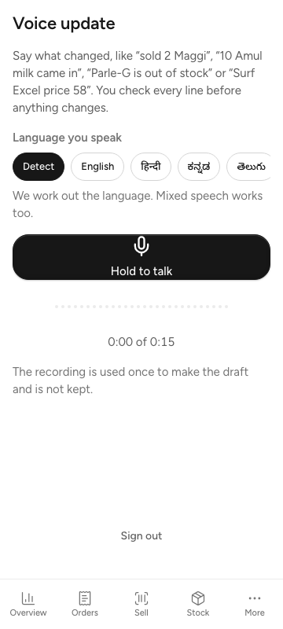 |
| Listening: the live waveform and timer | 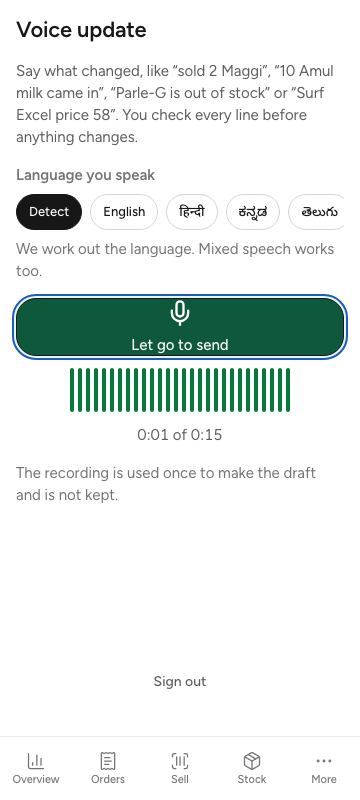 |
| Processing | 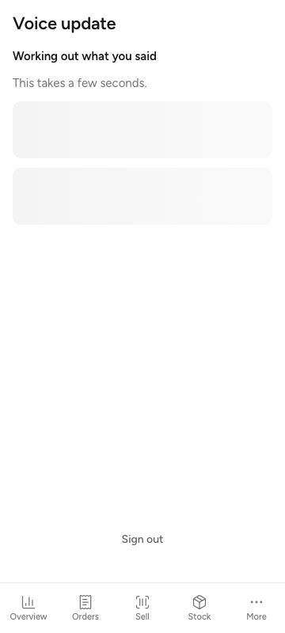 |
| A cashier's draft: 5 lines, two Ask manager, one Pick item, banners | 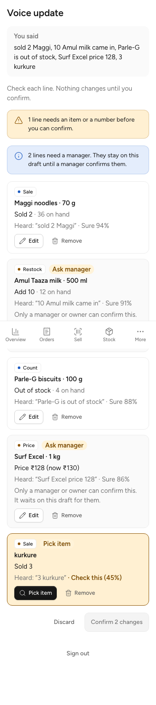 |
| Pick item search | 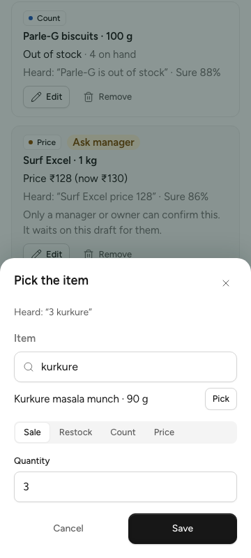 |
| Ready: "Confirm 3 changes" | 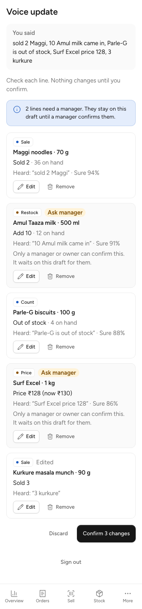 |
| Done after a cashier's confirm: "Ask a manager to confirm the rest" | 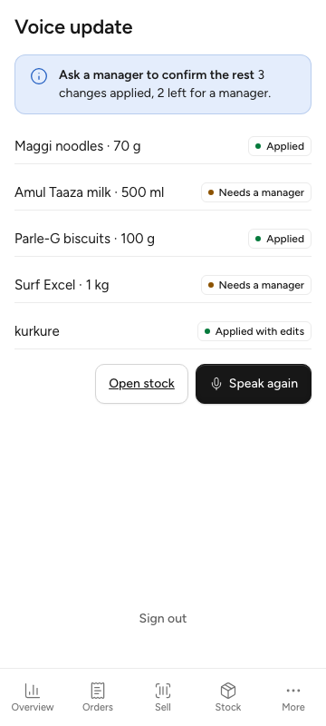 |
| A cashier reopens the draft: "Already done", two lines waiting, Speak again | 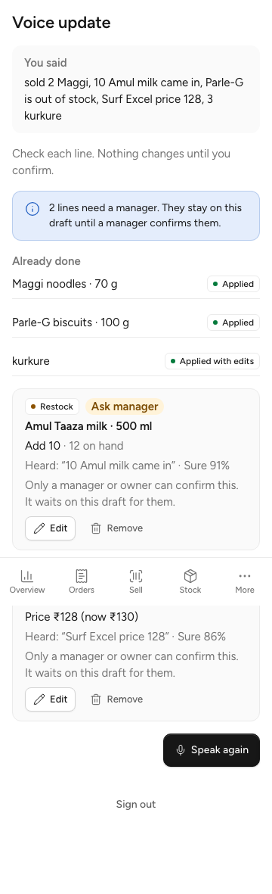 |
| A manager reopens it: only the open lines, "Confirm 2 changes" | 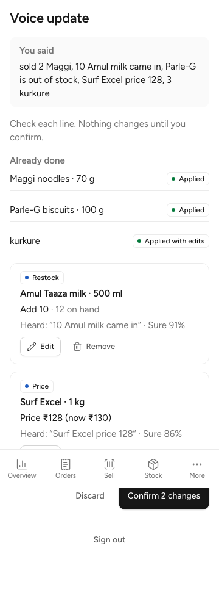 |
| A manager's edit sheet, price check | 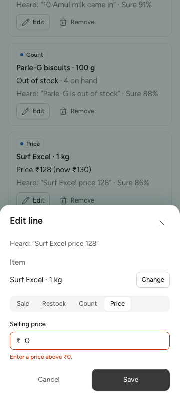 |
| Voice off | 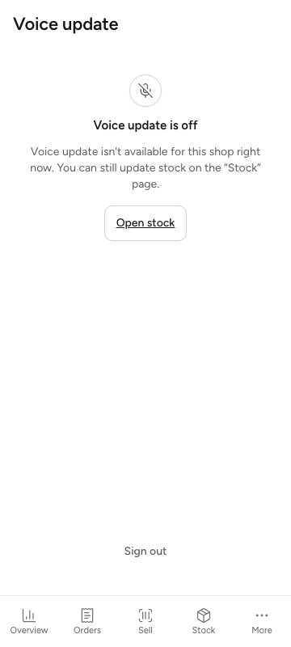 |
| Desktop draft | 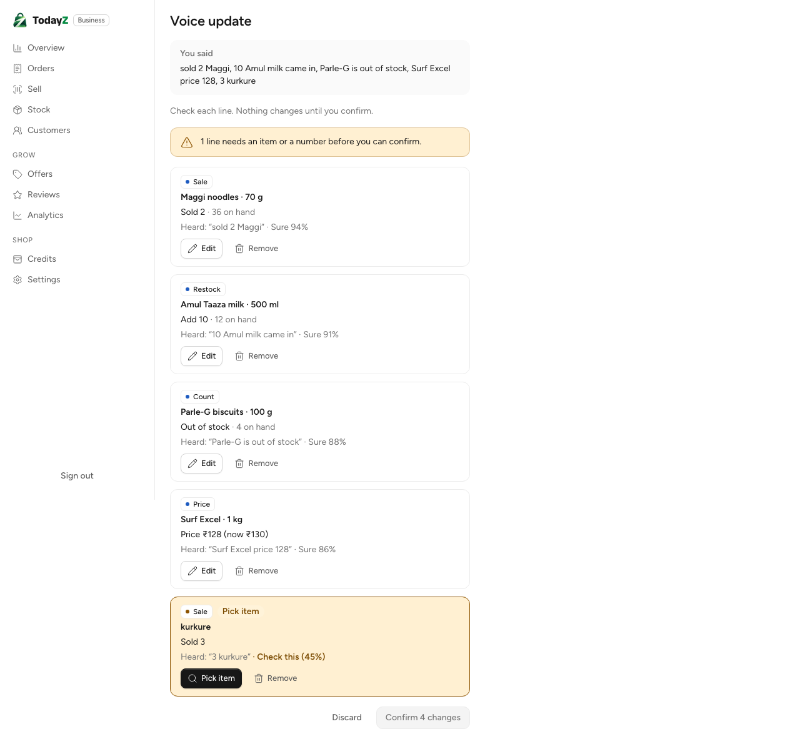 |

In the full-page draft shots, the fixed bottom tab bar is drawn where the viewport ended. It sits at the bottom on a real phone.

## Open points for the lead

1. **SC-VO definitions.** 07 names SC-VO-01…12 but does not define them. The table above is my reading; please confirm it or point me at the list.
2. **i18n approval.** The 108 `voice.*` keys are machine-written in hi/kn/te/ta and marked `reviewed` so the language test passes. `docs/qa/business-i18n/REVIEW.md` has a **pending** row: please relay the founder's approval, or tell me to hold them.
3. **Navigation.** There is no `nav.ts` entry, because nav.ts is lead-owned. The way in is the "Voice update" link on B-07 Stock, which shows only while voice is available. Add a nav entry if B-06 should be in More or the sidebar.
4. **Audio retention.** 02 §8 step 6 says "audio is deleted after 7 days". I keep no audio at all: the recording goes to the speech-to-text service and is dropped, which is the conservative reading (the same as AI-C5). If 7-day audio is wanted for quality review, it needs a bucket and a lifecycle rule (W5 infra).
5. **No dashboard panel.** The `tz_voice_*` metrics are emitted, but dashboard 14 (W3-10) has no voice row yet. I did not edit another WP's dashboard. It is a small follow-up to add latency p95, matched ratio and cost per draft.
6. **Recorded replies are authored.** The 100 eval replies were written by hand to match what the prompt asks for, not recorded from the real model (the brief allows no real model call). `make ai-eval` with the user's own key will give the real score and should be run before the flag goes on in prod.
7. **A sale is cash.** A voice `sale` line becomes a cash `sale_pos` with no customer, priced at the item's price after the draft's own price lines. Tell me if it should take a payment method.
8. **MRP in the edit sheet.** The browser knows the MRP only for an item picked through search; otherwise the server's MRP check (422 `validation_failed`) is shown on confirm. The e2e test checks the client-side "above ₹0" rule instead.
9. **Production build.** `pnpm build` needs the real `VITE_TURNSTILE_SITE_KEY` (CI has it), so the local evidence uses `build:e2e`, as earlier business WPs did.
10. **The language part of an upload** is checked in the Go tests and in the e2e test's fake, not in the vitest UI tests: the fake `fetch` there does not parse FormData bodies.
11. **Ready-draft expiry.** There is no TTL for a `ready` draft (see the review fixes). If a half-confirmed draft should lapse, it needs a setting in `platform_settings` and a sweep, which is a product rule for you or the founder to set.
12. **Finding a waiting draft.** A manager reaches a partial draft through `/voice?draft=<id>`, on the same device or from a shared link. There is no list of drafts waiting for a manager, because that is a new endpoint and screen. Tell me if B-06 should have one.
