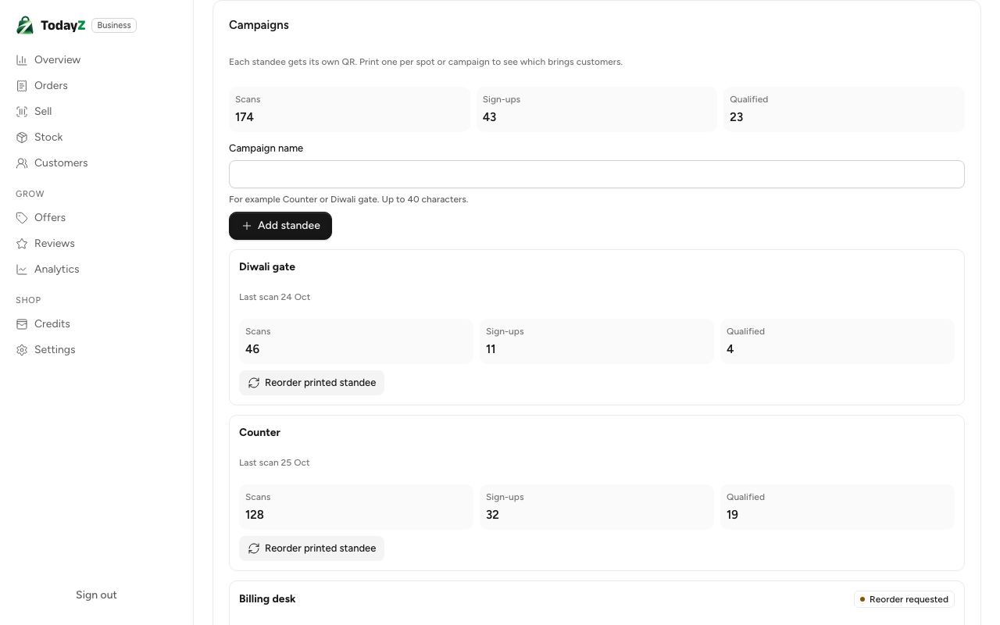
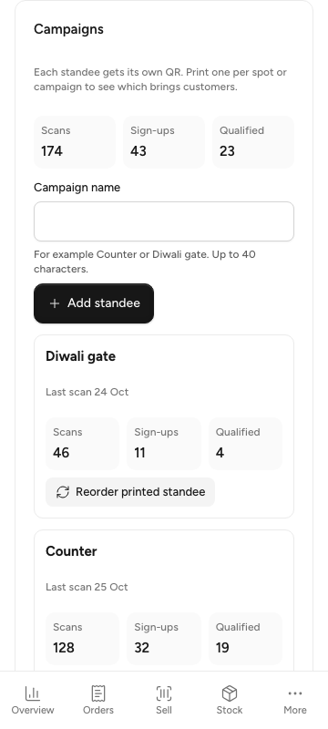

# W3-09 QR standee campaigns and analytics: QA report

Branch `claude/distracted-poincare-3e4ea5`, 25 Oct 2026. Decision: D-223 (it also narrows D-211). Scenarios: SC-ST-03, SC-ST-04.

## What was built

- **Database.**
  - `30901_w3-09_qr_standees.sql` creates `qr_standees`: one row per printed standee of a store, with `campaign`, `reorder_requested_at/_by`, `printed_at` and `version`.
  - It also adds the two FKs D-211 deferred: `referral_clicks.standee_id` and `referrals.standee_id`.
  - Nothing stores a scan count. The counts are computed from `referral_clicks` and `referrals`.
- **API** (`standee` domain, manager and above, policy `standee.manage`):
  - `GET {S}/standees`: rows newest first, each with its QR link and scans → sign-ups → qualified counts, plus `totals` and `limit`.
  - `POST {S}/standees` `{campaign}`: audited `standee.create`. Gives `409 standee_limit_reached` at 20 per store, checked under a store row lock.
  - `POST {S}/standees/{standeeId}/reorder`: audited `standee.reorder_requested`. A request already waiting is answered unchanged.
- **Scan attribution (SC-ST-03).** `referrals/click.go` accepts `?s=` only for a standee of the store the code names. Another store's standee, or an unknown id, still lands on the store page, with no `standee_id` and no `?s=`.
- **Business app (B-10).** The standee page gains a Campaigns card: the totals funnel, an "Add standee" form, and one row per standee. Each row shows the last scan, its own funnel, and "Reorder printed standee" (or "Reorder requested" and the date once one is waiting). Owners and managers only; a cashier never asks for the list.

## Checks

| Check | Result |
|---|---|
| `make gen` | clean, no tracked changes |
| gofmt, `go vet` | clean |
| golangci-lint (standee, referrals, cmd/todayz, authz/policy) | 0 issues |
| settingslint, gosec | clean |
| `go test -race ./internal/business/standee` (create and list, counts with rejected sign-ups and other stores excluded, cap under 6 concurrent creates, reorder idempotency with one audit row, store isolation, not configured) | pass |
| `go test -race ./internal/referrals` (adds "another store's standee is not a scan" and `TestStandeeJourney`: create → scan through `/v1/public/ref` → claim → second scan → first order → 2/1/1 counts, SC-ST-04) | pass |
| `go test -race ./cmd/todayz` (routes in the contract, contract smoke), `migrate`, `authz/policy` (golden) | pass |
| business lint, lint:css, typecheck | pass |
| business vitest | 382 passed (7 new in `src/standee/campaigns/campaigns.test.tsx`) |
| i18n gen and message lint | 0 errors |
| business `build:e2e`, precache check, size-limit | pass; initial JS 161.57 kB of 250 kB, CSS 10.35 kB of 20 kB |
| `business/e2e/standee.spec.ts` on the `build:e2e` bundle with a faked API (desktop flow: add and reorder; 360 px fit) | 2 passed |
| `make dev` / `make reset` stack run | not run, as asked; the lead runs the stack |

The backend tests used the shared test Postgres (`TODAYZ_TEST_PG_URL_FILE`), because this shell cannot reach Docker for testcontainers.

## Screenshots





The data is made up. Both shots come from `business/e2e/standee.spec.ts`. The 360 px test also checks that "Add standee" is at least 44 px tall and that the page has no horizontal scroll. To refresh them, run this from `business/` after `pnpm build:e2e`, with placeholder `VITE_TURNSTILE_SITE_KEY` and `VITE_API_URL` set in the shell:

```bash
TZ_QA_DIR=docs/qa/W3-09 pnpm exec playwright test -c playwright.config.ts standee.spec.ts
```

## Notes for the lead

- **The PDF has no per-standee `?s=`.** W2-10's `GET {S}/qr-standee.pdf` takes no standee id, so a printed PDF encodes the store link without `?s=`. Its scans are not counted per standee. 04 already lists `?standeeId=`. Following your instruction, I left the PDF route alone. It needs that parameter, and a "Download" per row on B-10, to close the loop (W2-10 or the lead).
- **The cap of 20 is not a product rule.** 01 has no number for standees per store, so `MaxPerStore = 20` is a guard (`TODO(lead)`). Say if it should be a `platform_settings` key.
- **Reorder fulfilment is not built.** No admin screen clears `reorder_requested_at`. Per your answer there are no admin screens in this WP (`TODO(lead)`).
- **Discover `?s=`.** 04 said discover's `?s=` records a scan. The scan is recorded by `/v1/public/ref` (D-162), so 04 is corrected and discover is unchanged.
- **Not filled.** `internal/seed/standee.go` and `internal/jobs/standee.go` stay empty. Nothing needs a job, and the dev seed has no standees.
- **Numbering.** D-223 takes the next number after main's D-221. Renumber it if another branch took it first.
