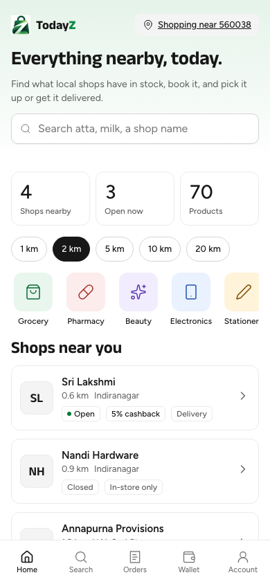
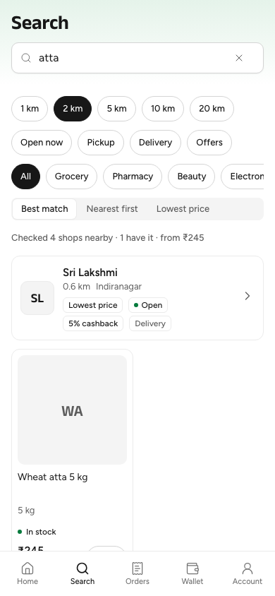
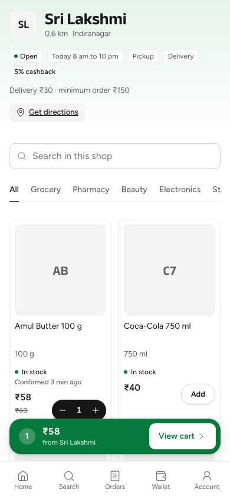
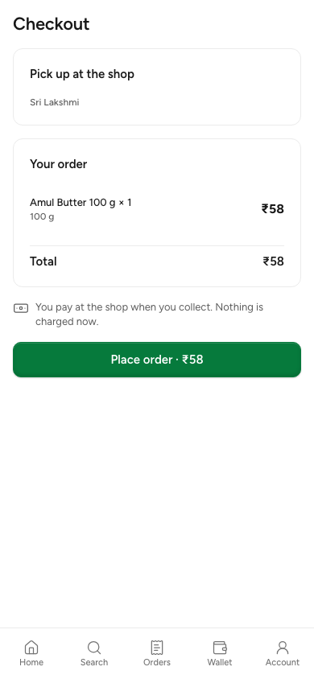
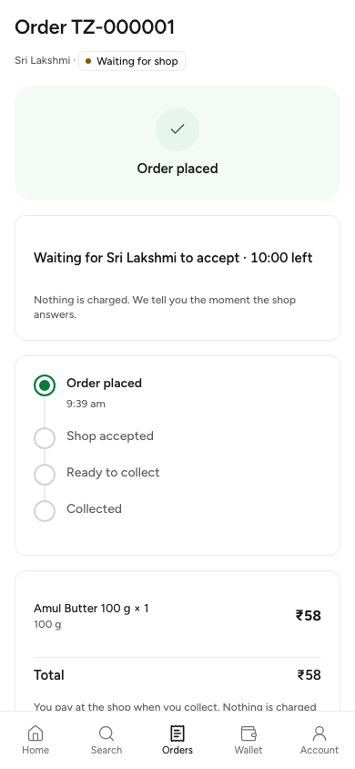
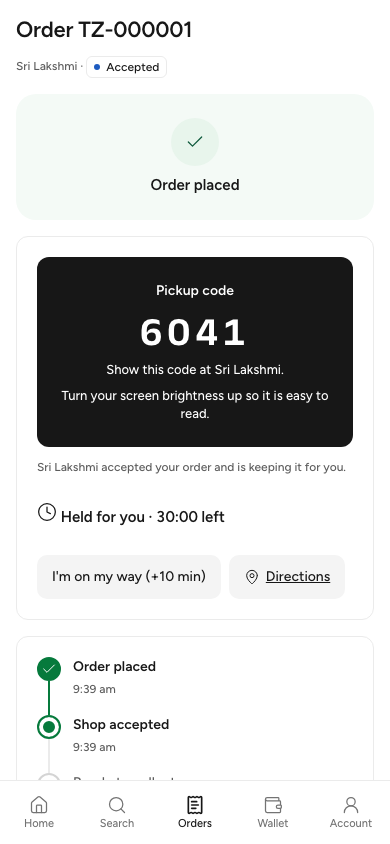
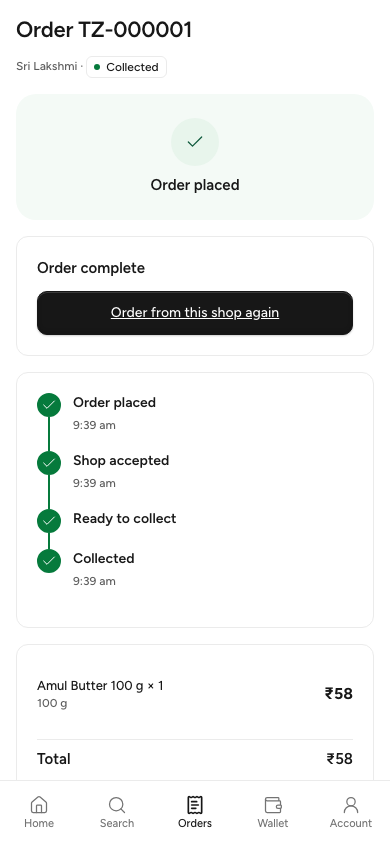
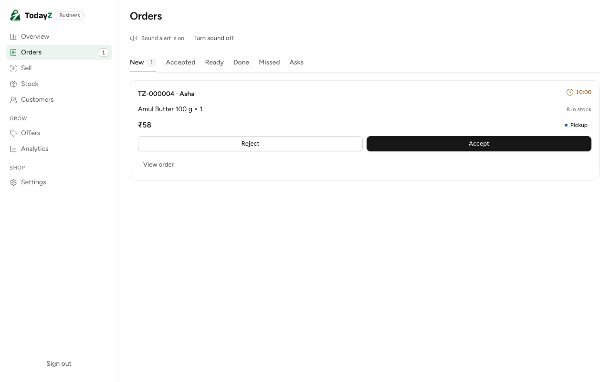
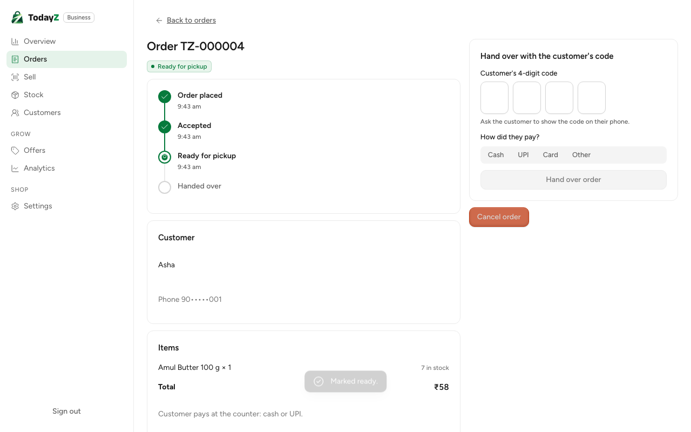
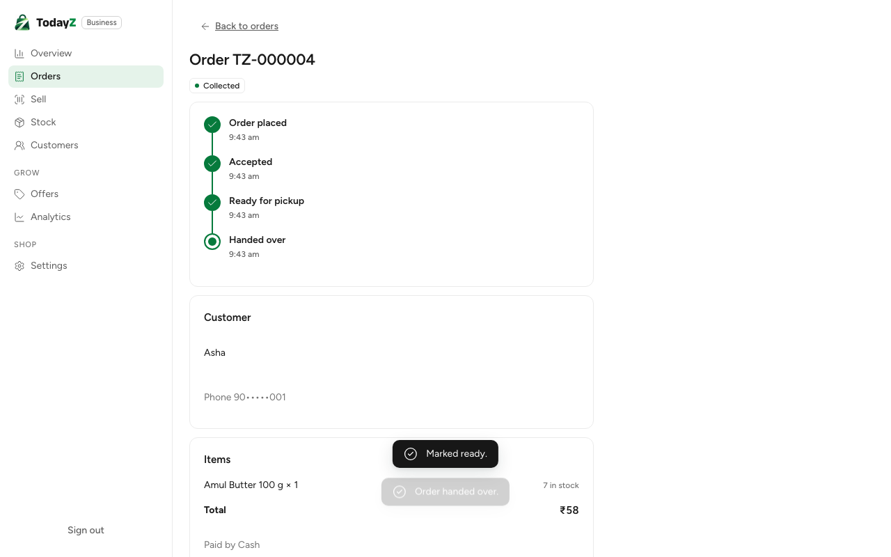

# Demo pack, Sunday 25 October 2026

This is what we show on Sunday: the core loop of TodayZ, running locally on the build machine with the seed data.

A customer finds an item in a shop nearby and books it. The shop sees the order straight away and accepts it, the customer gets a pickup code, and the shop checks the code at the counter and hands the order over.

Everything here runs on the build machine. Nothing is deployed, no cloud account is used, and every name, phone number and order is synthetic seed data.

## What works end to end

All four stack journeys passed again on Saturday 24 October at 09:40, on a fresh `make reset` (main `280fb1c` plus the screenshot steps added with this pack). They run against the real API, Postgres/PostGIS, Caddy HTTPS and the seed.

| Journey | Result |
|---|---|
| Customer: home, search "atta", open a shop, add to cart | pass |
| Customer: sign in with an OTP, book, the shop accepts, the pickup code shows, the shop checks it, collected | pass |
| Shop: a new order arrives live, then accepted, ready, and handed over with the code (a wrong code first) | pass |
| Shop: the owner cancels an accepted order; the reason "other" needs a note | pass |

The order journey, step by step:

1. **Sign in.** The customer signs in with a phone number and a one-time code. The sign-in stays on and renews itself.
2. **Find.** The home page shows shops, open shops and products within 2 km of a PIN code, plus the shops near you. The radius can be 1 to 20 km.
3. **Search.** A search shows the shops that have the item, with the proof line "Checked 4 shops nearby · 1 has it · from ₹245".
4. **Book.** The customer opens a shop, adds an item and checks out for pickup. The total is worked out on the server and nothing is charged.
5. **The shop answers.** The order appears on the shop's New tab without a reload. It shows a countdown to accept, the stock of each line and a sound alert.
6. **Pickup code.** When the shop accepts, the customer's screen changes on its own and shows a 4-digit pickup code, held for 30 minutes. The customer can add 10 minutes once ("I'm on my way").
7. **Hand over.** The shop marks the order ready, which is optional. It then enters the customer's code and how they paid (cash, UPI, card or other). A wrong code says how many tries are left. The right code completes the order on both screens, and the stock goes down by one.

Behind the screens:

- **Live updates.** The server pushes updates as they happen; if that drops, the apps fall back to polling.
- **Timers.** An order the shop does not accept in time expires, and so does a held order that is never collected.
- **Unseen orders.** A new order still unseen after a few minutes sends the shop an SMS. This needs the encryption key, which the local stack sets.
- **Safety.**
  - The pickup code is never put in a web address, in browser storage or in the logs.
  - Phone numbers are stored encrypted and shown masked (`90•••••001`).

## How to run the demo

Before the demo (about 3 minutes):

1. Run `make reset`. It recreates the database, runs the migrations and loads the seed. It also clears the sign-in code limits (see the tips below).
2. Run `make dev`. It ends with `health: all required checks pass`.
3. Optionally, confirm the loop with the shop journey, which takes about 1 minute:
   ```bash
   pnpm --filter @todayz/business exec playwright test -c playwright.stack.config.ts orders.stack.spec.ts --reporter=line
   ```

Open these addresses:

| What | Address |
|---|---|
| Customer app | https://app.todayz.localhost (use the browser's phone view, about 390 px wide) |
| Shop app (business) | https://business.todayz.localhost |
| Sign-in codes (SMS stand-in) | https://mocks.todayz.localhost, SMS tab |
| Marketing site | https://todayz.localhost |
| Monitoring | https://grafana.todayz.localhost |

Seed accounts (synthetic):

| Who | Phone | Notes |
|---|---|---|
| Customer Asha | 9000000001 | Any unused number from 9000000030 to 9000000089 is a new customer |
| Shop owner Lakshmi | 9000000011 | Lakshmi Traders; pick the store "Sri Lakshmi" (Indiranagar) |

Demo script (two windows side by side):

1. **Shop window:** sign in as the owner, choose Sri Lakshmi, and open Orders. Press "Allow sound".
2. **Customer window:** choose English, enter PIN **560038** (Indiranagar), and show the home page and the radius chips.
3. Search **atta** and show the proof line, then open Sri Lakshmi.
4. Add an item (Amul Butter is in stock), open the cart, and go to Checkout. Sign in when asked, reading the code from the mocks SMS tab. Then press Place order.
5. **Shop window:** the order appears on New with its countdown and chime. Accept it.
6. **Customer window:** the pickup code appears on its own, with "Held for you · 30:00 left".
7. **Shop window:** open the order and mark it ready. Then type the customer's code, choose Cash and press Hand over order.
8. **Customer window:** "Order complete" shows, and the order is listed under Earlier in Orders.

Tips:

- **Opening hours.** The shop takes orders only while it is open: Sri Lakshmi is open 8 am to 10 pm. To demo outside those hours, change its hours first. The stack journey does this itself and puts them back afterwards.
- **Sign-in code limits.** They are 5 codes per number and 20 per network address an hour, and every local run comes from the same address. After many rehearsals, run `make reset` to clear them.
- **Shop page.** PIN 560001 (MG Road) is about 3.7 km from the seed shop, outside the default 2 km. Use 560038.

## Screenshots

These were taken from the live local stack on 24 October by the journeys above (`TZ_QA_DIR=docs/qa/demo-2026-10-25`).

Customer app (390 px):

| | |
|---|---|
|  |  |
|  |  |
|  |  |
|  | |

Shop app (1280 px):







More screens, from tests with made-up data:
- `docs/qa/W2-10/`: the shop's orders at phone size: reject sheet, locked code.
- `docs/qa/W2-09/`: cart and tracking states.
- `docs/qa/B-03-demo/`: the Overview dashboard.

## Still sample data, or not built yet

**Sample data, labelled as such:**
- The shop's **Overview** dashboard: sales, insights and top items (W3-03 makes it live).
- The sidebar's Stock badge and setup card are hidden until then, so made-up numbers never sit next to real orders.

**Deferred from the weekend cut:**
- **Delivery.** Pickup only for now; there is no delivery or address.
- **Partial orders.** There is no "Accept part" yet. When a line is short, Accept is disabled with "Not enough stock for one item. Reject the order, or update the stock." (decided on 24 October; screenshot in `docs/qa/W2-10-short/`).
- **Money and rewards.** There are no credits, cashback, wallet, referrals, offers or reviews. The cashback tag on a shop is seed data.
- **The shop till.** No POS, offline sales, stock screens, product editing or shop onboarding screens.
- **Pickup code extras.** There is no QR code (only the digits, until a QR library is approved), and no "Call shop" button (whether a customer may see the shop's phone is still open).
- **Platform pieces.** There is no admin console, payouts, fraud rules, AI features or voice search.
- **Images.** Product photos are not wired yet; products show their initials.
- **Real messaging.** Real SMS and WhatsApp (MSG91) wait for the DLT template ids. Locally, every message goes to the mocks server.

## Progress by stage

| Stage | What it delivers | Status |
|---|---|---|
| 0 · Foundation | Local servers, backend skeleton, API contract, tooling, stand-ins for SMS, WhatsApp and AI | Done (8 of 8) |
| 1 · Platform | Login, shops and stores, catalogue and stock, nearby search, design system, languages, monitoring, website, jobs | Done (11 of 11). Catalogue and search are weekend slices; CSV import, the review queue and all-India places come later |
| 2 · Core flows | Bookings and pickup codes, live updates and alerts, customer screens, shop orders | 5 of 13 started: orders, realtime and alerts are done; customer discovery and transactions and shop orders are weekend slices. Not started: credits, referrals, delivery, reviews, offers, POS, shop stock, the stage-2 test gate |
| 3 · Money, insights, AI | Payouts, fraud rules, insights, voice, AI drafts, admin console, dashboards | Not started (16 packages) |
| 4 · Hardening | Full journeys, load, security, accessibility, translations, manual QA | Not started (7 packages) |
| 5 · Cloud and launch | AWS, Cloudflare, staging, production | After stage 4, once the accounts are ready |

**Since Friday's pack:**
- sign-in, shops and stores, catalogue and stock, search, live updates and alerts;
- orders with pickup codes;
- the customer's search, shop, cart, checkout and tracking screens;
- the shop's orders desk.

**On Saturday, after the first full run:**
- **Two server fixes (D-109):** the proxy changed the version tag the app sends back, and a closed browser tab was logged as an error.
- **Four screen fixes** in the shop's orders.
- **A router warning** in the shells.
- **One background job** no longer opens a database client at start.

## Quality

- On Saturday, these all pass: `make check-frontend` (lint, types, unit tests and builds, with outbound traffic blocked), the business app tests (76), the customer app tests (81), and the Go race tests for orders, jobs, notify and the API.
- The API log for the stack run has no error or warn lines and no 5xx responses.
- Under load, one i18n command-line test can time out at 5 s; it passes on a rerun.

## Decisions we need

- **The shop's phone.** May a customer with an active order see it ("Call shop")?
- **QR code.** May we add a QR library for the pickup code?
- **Messaging.** MSG91 DLT template ids, the WhatsApp number, SMS cost per message, and a Hindi template review.
- **Plan and launch.** Budget, rate limits and staging hostnames.
- **From Friday, still open.** Legal sign-off and a grievance officer, native reviewers for the four languages, the old site's page list, and the real Turnstile key.

## Next

1. The rest of stage 2: partial accept (Accept part), credits and referrals, delivery, reviews and offers, the shop's POS and stock screens, and the stage-2 test gate.
2. Stage 3, then stage 4. A fully tested product running locally is about 3 weeks away; the cloud launch follows about a week after the accounts are ready.
