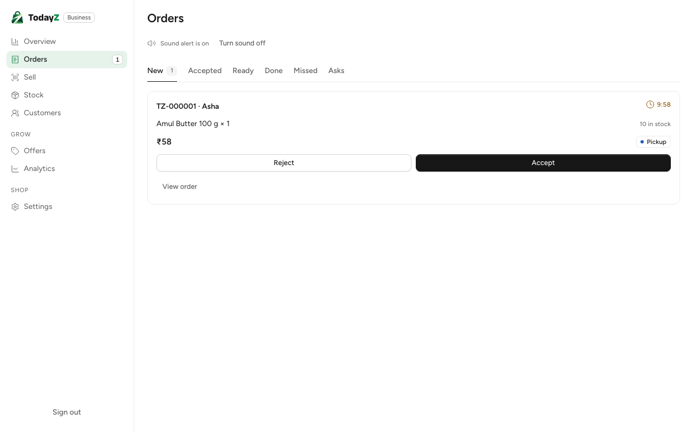

# Stack run 2026-10-24: the core loop on the seed

The first run of the weekend's stack journeys against `make dev`: real API, Postgres/PostGIS, Caddy HTTPS and the seed. The run used synthetic seed data only, with no network egress and no cloud.

The core loop works end to end. A customer signs in with an OTP, finds Sri Lakshmi nearby and books. The shop accepts the order, the customer sees the pickup code, the shop enters it, and the order is collected.

## Result

All four journeys pass on a fresh `make reset`, on main 82d45fc.

| Journey | Spec | Result |
|---|---|---|
| Home, search "atta", open a shop, add to cart | `customer/e2e/discover.stack.spec.ts` | pass |
| Book from the seed shop, shop accepts, code shows, shop verifies, collected | `customer/e2e/order.stack.spec.ts` | pass |
| New, accepted, ready, handed over with the pickup code (business app) | `business/e2e/orders.stack.spec.ts` | pass |
| Owner cancels an accepted order; reason "other" needs a note | `business/e2e/orders.stack.spec.ts` | pass |

The API log for the run has no error or warn lines and no 5xx responses. Client hang-ups, such as the SSE stream closing at the end of a test, log as INFO 499.



## What failed first, and why

### Server bugs, fixed in ac179a4 (D-109)

1. **If-Match was refused behind the proxy.**
   - Caddy's `encode` rewrites a compressed response's ETag from `"v1"` to `"v1-gzip"`, and Cloudflare weakens it to `W/"v1"`.
   - The shop-hours PATCH sent back the ETag it received and got a 422.
   - Fix: the new `internal/platform/httpx/ifmatch` package accepts `"v{n}"`, `W/"v{n}"` and `"v{n}-{coding}"`. Identity, business and catalogue use it, and the contract's IfMatch pattern matches.
2. **A client hang-up logged as an error-level 500.**
   - A navigation aborted an in-flight OTP verify, and the request was logged as a 500 at error level.
   - Fix: `problem.Write` now answers a canceled request whose context is done with 499 and an INFO log.
   - The SSE replay wraps its cause, so a hang-up there is a 499 and no longer a 503.

### Spec bugs, fixed in 82d45fc

- **Discover:** PIN 560001 (MG Road) is about 3.7 km from the seed shop, outside the 2 km default radius. The spec now uses 560038 (Indiranagar).
- **Order journey:**
  - it navigated before sign-in had finished;
  - it booked while the shop was closed (runs at night). The spec now opens the shop all day for the run and restores its hours afterwards;
  - it sent `+91` twice on the shop phone;
  - its Idempotency-Keys were not ULIDs.
- **Business journey:** it hit the OTP limits. The customer token is now cached. The owner's UI sign-in waits out "Too many tries" and sends again.

## OTP limits on a local stack

01 §2 fixes the limits at 5 sends per number per hour and 20 per IP per hour. They are constants (01, constants table), not settings.

Every local run comes from 127.0.0.1, so about four full runs in an hour reach the per-IP cap. The specs retry once when `Retry-After` is short.

The counts live in the database. When the cap is reached, `make reset` clears it, or you can wait for the hour to pass. No code change is needed.

## Follow-ups seen in the run

- **Business order card** (W2-10), fixed the same day (screenshot refreshed):
  - ~~the item line repeats the size ("Amul Butter 100 g · 100 g × 1")~~: `lineName` drops the pack when the name already ends with it (`orders/labels.test.ts`);
  - ~~"View order" is an unstyled browser link~~: it is a small ghost `tz-btn` (the kit's `.tz-btn` does not reset the anchor underline, so the card CSS does);
  - ~~the sidebar's Orders badge says 2 while the New tab says 1~~: the badge counted the Overview's sample data. It now counts the live New list (same query as the tab, refreshed by the stream).
- **Setup card:** ~~"Add opening hours" shows while the shop has hours set~~: that was the Overview's sample data too. The sidebar card and the Stock badge stay hidden while `SAMPLE_DATA` is on; the real setup rule (all-day hours included) comes with W3-03.
- **Not covered by these journeys:** delivery, credits, partial confirm, the QR code, and calling the shop. These were deferred in W2-09 and W2-10.

## How to rerun

1. `make reset`, then `make dev`.
2. Run the customer journeys:
   ```
   pnpm --filter @todayz/customer exec playwright test -c playwright.stack.config.ts discover.stack.spec.ts order.stack.spec.ts
   ```
3. Run the business journeys:
   ```
   pnpm --filter @todayz/business exec playwright test -c playwright.stack.config.ts orders.stack.spec.ts
   ```
4. Set `TZ_QA_DIR=<dir>` to save the screenshots.
